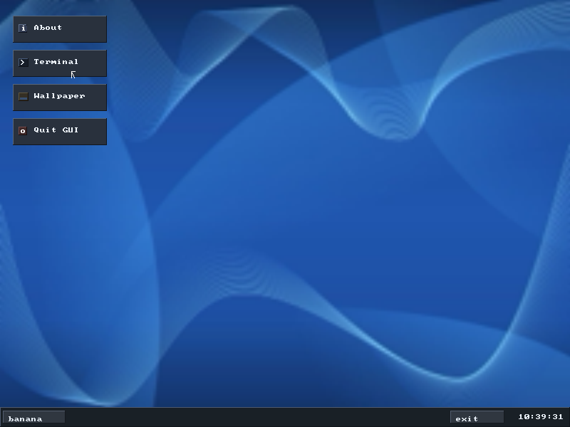

# 🍌 Banana OS 0.6

Banana OS 0.6 is a minimal x86 operating system written from scratch (no Linux kernel, no external OS kernel) - a **64-bit (x86_64) kernel with a 32-bit fallback**, booting on **UEFI and BIOS** machines and in VirtualBox/QEMU with **its own boot loader** (Banana Boot, Multiboot2) - now with **real networking**: its own drivers for the Intel e1000, AMD PCnet, virtio-net and Realtek RTL8139 network cards (every card VirtualBox offers) and its own TCP/IP stack, so `ping`, `curl` and `wget` talk to the actual Internet (HTTP and HTTPS).

```
  ____                                   ___  ____
 | __ )  __ _ _ __   __ _ _ __   __ _   / _ \/ ___|
 |  _ \ / _` | '_ \ / _` | '_ \ / _` | | | | \___ \
 | |_) | (_| | | | | (_| | | | | (_| | | |_| |___) |
 |____/ \__,_|_| |_|\__,_|_| |_|\__,_|  \___/|____/
```



## Highlights

- Bare-metal x86 kernel (freestanding C + NASM)
- Multiboot2 boot flow with framebuffer mode
- IDT-based exception handling with a panic screen instead of silent triple-faults
- Interrupt-driven timer; the CPU sleeps (`hlt`) whenever every task is idle
- Kernel heap over all available RAM
- Dual terminal backend:
  - VGA text mode
  - Framebuffer-rendered console
- GUI desktop (started on demand with `startx`)
- PS/2 keyboard + PS/2 mouse support, plus touchpads:
  - **Synaptics PS/2** (most laptops until ~2015, e.g. the HP Folio 13): absolute mode, ClickPads (the whole pad is the button; bottom-right corner or two fingers = right click), TrackPoint pass-through, palm detection
  - **I2C HID touchpads** (most laptops since ~2015: Synaptics, ELAN, ALPS, Cirque... on the Intel LPSS I2C controllers, Skylake and later): found from the ACPI tables, switched to precision-touchpad mode
  - gestures on both: tap to click, tap-and-drag, double tap, two-finger tap = right click, three-finger tap = middle click, two-finger scrolling; *Settings > Mouse* turns tap-to-click and natural scrolling on/off; `usbctl` shows which touchpad was found
- Ctrl+Alt+Delete closes the GUI, from anywhere
- The integrated tabbed Terminal uses Bash by default, with independent PTYs, shell processes and scrollback for each tab (64-bit)
- Fluxbox-inspired dark desktop theme, with network status in the taskbar
- Wallpaper app with 10 built-in presets plus your own pictures from `~/Pictures`
- In-memory Unix-style filesystem (`/bin`, `/etc`, `/home/banana`, `/usr`, `/var`, `/tmp`, `/dev`, `/root`) with absolute/relative path resolution, `.`/`..`/`~`, files up to 32 MiB (text or binary)
- POSIX-flavored shell utilities (`ls -l`, `mkdir -p`, `rm -r`, `cp`, `mv`, `touch`, `whoami`, `hostname`, `date`, `time`, ...)
- Two shell personas sharing one command engine - stock `sh` (default) and a bash-compatible `bash` (aliases, `export`/`$VAR`, `!!`) - selectable per-session with `chsh`
- Built-in editor and live system monitor
- Networking: e1000, PCnet, virtio-net, RTL8139 + RTL8111/8168 drivers, USB adapters (RTL8152/8152B, CDC-ECM), TCP/IP stack, DHCP, DNS, HTTP + HTTPS (TLS 1.3), saved configuration
- Servers: SSH (password login, 2 sessions) and a web server with PHP pages, optionally started at boot
- Web browser: tabs, HTML + CSS layout (selectors level 4, variables, `calc()`, media queries), images, forms, JavaScript (ES2020+ with classes, modules, promises, regular expressions) with a DOM, history, copy and paste
- Notepad: a GUI text editor
- Microphones (HD Audio, AC'97, USB) and USB webcams (UVC), with the Camera app
- Users and Unix permissions: `doas`, `su`, `adduser`, a gentle administrator prompt on the desktop ([how](docs/USER-GUIDE.md#users-and-administrator-rights))
- One clipboard shared by the terminals, the editor, Notepad and the browser; resizable, maximizable windows
- File explorer window with text/picture previews
- Real bootable disk install (`install`/`sync`) - installs onto a dedicated IDE or SATA hard disk so Banana OS boots on its own, with a persistent filesystem, no CD required
- Storage: IDE (ATA/ATAPI) and SATA (AHCI) disks and CD/DVD drives
- Serial console on COM1 (output mirror + input)

## Requirements

- CPU : Yes (any x86-64 CPU runs the 64-bit kernel; an i686 runs the 32-bit one)
- Firmware : UEFI or BIOS (legacy/CSM not required on UEFI machines; Secure Boot must be off - the ISO is not signed)
- RAM : 32 MB (256 MB recommended - decoding a large photo for a wallpaper needs width x height x 3 bytes)
- GPU : any sort of graphics accelerator should do it
- Keyboard / Mouse : PS/2
- Network : Intel e1000 (82540EM/82543GC/82545EM), AMD PCnet (PCnet-PCI II, PCnet-FAST III), virtio-net, Realtek RTL8139, Realtek RTL8111/8168/8169/8101, or a USB adapter (Realtek RTL8152/8152B such as the Lanberg NC-0100-01, CDC-ECM) - optional
- USB : xHCI or EHCI controller for USB devices - optional
- Not hating AI slop

## Quick start

### Build (Ubuntu/Debian)

#### Quick build

```bash
chmod +x build.sh
./build.sh
```

#### Manual build

```bash
sudo apt-get install nasm gcc-multilib binutils xorriso mtools python3
make
# Output: Banana_OS.iso (kernel.bin = 32-bit, kernel64.bin = 64-bit inside)
```

No GRUB: the boot loaders are built from `loader/` with the same tools as the kernel (`nasm`, `gcc`, `ld`; `objcopy` turns the UEFI one into a PE program), `mtools` makes the EFI partition, `xorriso` the ISO.

### Run in QEMU

```bash
make run          # BIOS, 64-bit kernel
make run-uefi     # the same ISO on UEFI firmware (apt install ovmf)
make run-32       # a 32-bit-only CPU: the menu falls back to the 32-bit kernel
# or by hand
qemu-system-x86_64 -cdrom Banana_OS.iso -m 256 -nic user,model=e1000 -serial stdio
qemu-system-x86_64 -bios /usr/share/ovmf/OVMF.fd -cdrom Banana_OS.iso -m 256 -nic user,model=e1000 -serial stdio
```

The boot menu has both entries - **Banana OS 0.6 (64-bit)** and **(32-bit)**; the default is the 64-bit one when the CPU has long mode (CPUID), the 32-bit one otherwise.

### Run in VirtualBox

1. Create a new VM:
   - Name: `Banana OS 0.6`
   - Type: `Other`
   - Version: `Other/Unknown (64-bit)`
2. Assign at least **32 MB RAM** (256 MB recommended)
3. Network: Adapter 1, **NAT**, **Intel PRO/1000 MT Desktop**
4. No virtual disk required (add one to use `install`)
5. Attach `Banana_OS.iso` as optical media
6. Optional: **System → Motherboard → Enable EFI** to boot it the UEFI way
7. Boot

## Documentation

| | |
|---|---|
| [Changelog](CHANGELOG.md) | what changed, build by build |
| [Using Banana OS](docs/USER-GUIDE.md) | the desktop, Files, the browser, sound, wallpapers, shells, installing to a disk |
| [Commands](docs/COMMANDS.md) | every shell command (`help <command>` inside Banana OS) |
| [Networking](docs/NETWORKING.md) | network cards, Wi-Fi, SSH and web servers, remote desktop |
| [Hardware](docs/HARDWARE.md) | USB, storage, graphics drivers, the Driver Kit ([status per device](docs/driver-status.md)) |
| [Apps and the SDK](docs/APPS.md) | apt and the App Store, OpenGL, OpenCL, hosting a repository ([SDK](sdk/README.md)) |
| [How it works](docs/INTERNALS.md) | the source tree, Banana Boot, 64-bit, Secure Boot, technical notes |
| [Testing](docs/TESTING.md) | the tests inside Banana OS and on the build host |
| [Roadmap](ROADMAP.md) · [GPU](GPU.md) | what comes next; the graphics work |

## Testing

Every test and how to run it is in **[docs/TESTING.md](docs/TESTING.md)**. In short:

| Where | Command | What it checks |
|---|---|---|
| Banana OS | `selftest [ring3\|memory\|limits\|cores\|opencl\|ipv6 [host [port]]]` | User mode, RAM above 4 GiB, app / thread / file limits, system calls on every core, OpenCL, IPv6 (local, then optionally over the network) |
| Banana OS | `fstest [-k] <mount point>` | A FAT32 / exFAT drive end to end: writes, appends, renames, 300 files, deletes, a remount, every byte read back |
| Banana OS | `crashtest [preview\|report\|panic\|ud2\|pagefault]` | The crash screen (the last three halt the system) |
| Banana OS | `fsck [-f]`, `vmtools`, `help --check` | The filesystem, the guest tools, the help pages |
| Linux host | `tools/dev.sh build\|run\|test\|apps [bios\|uefi\|32]` | Builds, boots in QEMU, fails on a panic, runs selftest and the example apps over the serial console |
| Linux host | `tools/serialtest.py ... -- <qemu args>` | Types commands at Banana OS's serial console and checks their output |
| Linux host | `tools/test-exfat.sh [bios\|uefi]` | exFAT: fstest in QEMU, then `fsck.exfat` and `tools/exfat_check.py` on Linux |
| Linux host | `tools/test_opencl.sh [x86_64\|i686]` | The OpenCL runtime and cltest, built for the host, 1 and 4 workers |
| Linux host | `python3 tools/test_crashscreen.py` | The crash screen's renderer, with preview PNGs in `build/test/crashscreen/` |

Recent host regressions cover DHCP lease states, DNS TCP fallback, descriptor synchronization, PNG encoding, notifications, NTP, command output and latency diagnostics. The `tools/test_*.py` runners for these features support `--sanitize` and `--32`; `tools/check_screenshot_png.py` independently decodes the PNG produced by the screenshot tests. `sh tools/ext4test/run.sh` checks filesystem errors and journal recovery against `e2fsck`.

For the already-built ISO, run `bash tools/ci-boot.sh bios` and `bash tools/ci-boot.sh uefi`. `BASE_ISO=/path/to/previous.iso bash tools/ci-install-test.sh bios` (or `uefi`) also checks installation, upgrade to the current ISO and persistence. These scripts use disposable disk images. QEMU and host regressions do not qualify physical GPU, disk-cache, network-adapter or RTC behavior.

## To do

- **32-bit app isolation** - the 64-bit kernel already runs apps in ring 3 with separate address spaces (build 141). The 32-bit kernel still needs paging and equivalent isolation; its apps currently run in ring 0.

## Licence

Banana OS is free software under the **GNU General Public License, version 3 or later** (`LICENSE`). The **SDK** (`sdk/`) and Banana OS's own files in `ports/` stay under the **BSD 2-Clause License** (`sdk/LICENSE`), so apps built with the SDK may use any licence, open or closed. Every source file names its licence on its first line (`SPDX-License-Identifier`); `COPYRIGHT` explains which part is under which, and `THIRD-PARTY-NOTICES` lists the bundled components and their own licences. Banana OS was under the BSD 2-Clause License until October 2026; copies published before then keep that licence.
