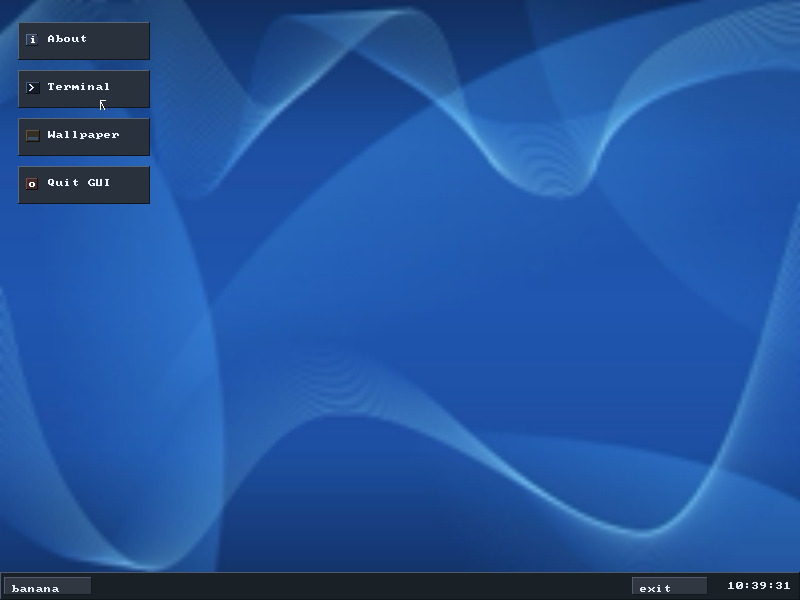

# 🍌 Banana OS 0.6

- **SDK build input preservation:** incremental app builds can no longer let
  GNU make delete allocator source as an intermediate file. The regression
  reproduces the old cleanup and compiles both architectures in an isolated SDK.

- **Intel Wi-Fi port groundwork:** validated AX200/AX210 API-77 firmware parsing
  and separate bootstrap DMA contexts, with pinned firmware/licences.
  Command descriptors, bounded ALIVE/event decoding and command/RX queues now
  have sanitizer tests for both architectures, including ring wraparound and
  DMA retention after uncertain writes or failed stop. AX210 calibration now
  uses an exact SKU/MAC/RF match and blocks commands until PNVM completion.
  Bounded initialization now reads MAC/antenna/channel metadata from NVM;
  channel metadata alone never authorizes transmission.
  **Radio connectivity is not implemented yet.**
  [Current state and remaining work](docs/wifi.md#intel-ax200--ax210-port-status).

- **Interactive CI synchronization:** editor checks wait for raw/no-echo input
  mode and a bounded quiet interval after redraw instead of treating a visible
  heading as readiness. PTY input write errors now fail explicitly.
  Failed exits now include escaped wire output, sent keys and queued-input
  state. The intermittent Vim exit issue is reproduced and remains open.
  [Failure trace and validation](docs/OS-TESTING-2026-10-30.md#interactive-editor-ci-synchronization).

- **Safe editor file loading:** Notepad and the built-in console editor keep
  their document when a read, allocation or line-limit check fails. Text is
  built separately before replacing the current buffer; cached input files
  stay pinned while being parsed.
  [Reproductions and tests](docs/OS-TESTING-2026-10-30.md#editor-load-failures-and-document-preservation).

- **VirtualBox pointer clicks:** absolute position updates no longer bypass the
  PS/2 button queue. This fixes a reproduced starvation path where clicks or
  releases stayed unread while mouse integration refreshed the pointer.
  Tested on both architectures, with native PS/2 and USB-tablet click checks.
  [Mouse tests and live RAM measurements](docs/OS-TESTING-2026-10-30.md#virtualbox-pointer-clicks-and-live-memory).

- **Clipboard history safety:** prevent an out-of-bounds read when an entry
  changes during selection, and keep the saved history resident while loading.
  Malformed lengths and incomplete records are rejected; copying new text no
  longer evicts a pinned entry when all 25 history slots are pinned.
  [Reproductions and tests](docs/OS-TESTING-2026-10-30.md#clipboard-history-and-persistence).

- **Filesystem cache safety:** copying/moving files and modifying cached files now
  hold their buffers through allocations and disk I/O. Appends reject oversized
  requests before arithmetic overflow; writes from a file's own contents remain
  valid when its cache moves. Large downloads retain direct-to-disk streaming.
  [Reproductions and regression coverage](docs/OS-TESTING-2026-10-30.md#filesystem-mutations-under-memory-pressure).

- **CC0 landscapes:** Alpine Peaks, Seeley Lake and Grand Tetons are new
  3200 × 1800 presets. Their JPEGs use the isolated image worker on x86_64;
  32-bit or decoder-failure paths retain low-memory thumbnails.
  [Photographers, original sources, CC0 declarations and checksums](assets/wallpapers/landscapes/README.md).

- **Cleaner Windows Task Manager styles:** Windows 10 has a neutral light
  palette; Windows 11 uses charcoal surfaces. Both use anti-aliased proportional
  text, quieter controls and readable resource columns. The memory tint now
  represents a percentage of available RAM rather than treating MiB as percent.
  [Windows 10 preview](assets/screenshots/task-manager-windows10.png) ·
  [Windows 11 preview](assets/screenshots/task-manager-windows11.png).

- **Wallpaper fault handling:** unreadable images leave the current background
  intact; the saved configuration stays pinned while decoding can allocate or
  reclaim memory. Host tests reproduce the former null access and use-after-free.


- **Desktop and file safety:** removed **Restore removed icons** from the desktop
  right-click menu. Saved icon coordinates are validated before indexing the
  desktop grid. Recursive folder copies include more than 32 subfolders, and
  failed/incomplete copies keep the source during cross-volume moves. Exhausted
  or overlong destination names fail safely instead of overwriting an item.
  See the [follow-up audit](docs/OS-TESTING-2026-10-30.md#desktop-and-file-operations-follow-up).

- **OS regression audit (October 2026):** hardened the actual ELF loader against
  wrapped offsets, truncated segments, unbounded dynamic tables and relocation
  reads/writes. Damaged executables return a format error; allocation failures
  retain their separate out-of-memory error. Tests include 20,000 deterministic
  mutations per architecture, sanitizer checks and built SDK/ported executables.
  The 32-bit selftest now checks the documented refusal of isolated decoding;
  full image decoding remains covered by hosted tests and the 64-bit guest.
  Full offline OS regressions now gate ISO publication in BIOS 32/64-bit and UEFI 64-bit VMs.

- **Offline local networking:** TCP/UDP loopback works without a physical NIC
  or DHCP lease, including local servers, epoll and receive timeouts. Physical
  Ethernet packets claiming IPv4/IPv6 loopback addresses are rejected. External
  networking keeps its existing device/configuration requirements.
  [Audit results, reproduction commands and hardware limits](docs/OS-TESTING-2026-10-30.md).

- **Safer settings saves:** configuration text stays pinned while its replacement
  is allocated; read failures leave existing settings intact. Saving identical
  content now avoids a file rewrite (100 repeated saves: 100 writes reduced to
  zero in the regression), while explicit filesystem persistence is retained.
  The actual parser/writer is tested with cache eviction and I/O/allocation
  failures on 32-bit and under 64-bit ASan/UBSan.

- **Upgrade ELF checks:** installation/update CI preserves an executable from
  the old release, runs it again after cache eviction and a cold reboot, and
  compares installed Bash/Echo/Terminal SHA-256 hashes against the candidate ISO.

- **Programs on installed disks:** executable files stay pinned while their
  address spaces are allocated, including allocation failures. Disk read errors
  return an I/O error. Bash now stops if its binary/script probe cannot read
  the file, instead of attempting to parse its contents. Fault-injection
  regressions exercise both fixes; installation/update CI also executes commands
  after dropping the disk cache.

- **Sandy Bridge context memory fix:** Intel Gen6 now reserves the ring,
  extended and pipeline context sizes from the correct hardware fields.
  The regression models an 8 KiB context with a different power-context
  size and catches the former 4 KiB allocation before the fix.
  `gpu3d on` permits acceleration; use `glinfo`'s renderer to confirm
  whether an application actually uses Intel or software rendering.
  Physical Intel performance and the reported installed-disk command failure
  still require confirmation on the affected PC.

The LibJS browser renderer is included in both 64-bit ISO variants. Standalone
LibJS BPKs and their sidecar files are kept as developer CI artifacts and are
no longer attached to ISO prereleases; the optional diagnostic probe is not an
integrated application.

**Mesa ISO:** prereleases also include `Banana_OS-mesa.iso` with Intel Crocus/Iris (Core 1st–10th generation), VirGL and software OpenGL. The combined Mesa/LibJS profile is tested with 1 GiB RAM. Intel acceleration remains experimental: see [GPU.md](GPU.md#mesa-iso-in-prereleases) for setup, tests and hardware limits.

Hybrid images share the BIOS and UEFI kernel data to avoid storing duplicate
kernels and keep images small enough for legacy boot areas. Upgrade tests
verify that user files survive. New installations reserve at least 1 GiB and require
50% image growth room (at least 256 MiB). CI checks BIOS and UEFI upgrades
from both legacy 128 MiB and newer 256 MiB installations.

The integrated Terminal uses the newer tabbed Bash interface with the original
terminal icon. Zsh is selected with chsh zsh. Terminal, Bash and Zsh have no
separate entries in Apps, App Store or Settings > Apps.

Banana OS 0.6 is a minimal x86 operating system written from scratch (no Linux kernel, no external OS kernel) - a **64-bit (x86_64) kernel with a 32-bit fallback**, booting on **UEFI and BIOS** machines and in VirtualBox/QEMU with **its own boot loader** (Banana Boot, Multiboot2) - now with **real networking**: its own drivers for the Intel e1000, AMD PCnet, virtio-net and Realtek RTL8139 network cards (every card VirtualBox offers) and its own TCP/IP stack, so `ping`, `curl` and `wget` talk to the actual Internet (HTTP and HTTPS).

```
  ____                               ____  ____
 | __ )  __ _ _ __   __ _ _ __   __|  _ \/ ___|
 |  _ \ / _` | '_ \ / _` | '_ \ / _` | | \___  \
 | |_) | (_| | | | | (_| | | | | (_| | |___)  |
 |____/ \__,_|_| |_|\__,_|_| |_|\__,_|___/____/
```



## Latest additions

- **Experimental RTL8811CU Wi-Fi** - separate native firmware/DDMA, EFUSE,
  radio/channel and WPA2/CCMP station path. USB lifetime and malformed packet
  models pass in 32/64 bits. Initial scope is selected high-speed USB boards,
  2.4 GHz at the lowest AP-supported legacy rate and TX gain; physical RF remains untested.
  [Exact scope, sources and limitations](third_party/rtw88/README.md).

- **Experimental Atheros AR9380 Wi-Fi** - native PCIe radio/calibration and
  WPA2/CCMP station with separate RX FIFOs and a checked TX completion ring.
  EEPROM/OTP reconstruction and malformed DMA tests pass in 32/64 bits.
  Initial MAC 2.2 profile uses legacy 2.4 GHz channels 1-11; physical RF remains
  untested. [Exact scope and limitations](third_party/athn/AR9380.md).

- **Experimental Atheros AR9280 Wi-Fi** - native PCI DMA, EEPROM calibration,
  radio initialization and WPA2/CCMP station integration without external firmware.
  Models pass in 32/64 bits with malformed EEPROM/descriptor tests. Initial
  scope is MAC 2.0/2.1 and legacy 2.4 GHz channels 1-11; physical RF is untested.
  [Driver details and limits](third_party/athn/README.md).

- **Experimental AX88179A/B vendor Ethernet** - separate revision-matched
  initialization, PHY negotiation and 64-bit packet framing. Startup failures
  cannot publish a half-initialized USB network interface; queued transfer
  objects remain valid. Existing RTL8152/8153 and AX88179 regression models pass.
  [Scope, sources and physical-test status](third_party/asix/README.md).

- **Experimental Broadcom BCM5720 Ethernet** - independently written native
  A0 copper driver with boot-firmware handshake, PHY negotiation and polled DMA.
  Active BMC/APE management profiles are declined before reset. Sanitizer and
  32-bit models cover malformed completions and two independent cards;
  [physical validation is pending](docs/bcm5720.md).

- **Experimental Aquantia AQC107 Ethernet** - native PCI, flash firmware API
  2.x/3.x, PHY link setup and independent polled DMA rings for Atlantic B0/B1.
  Models cover two cards, packet/error bounds, power capabilities and reset
  failures; physical testing and throughput measurements remain pending.
  [Hardware scope and tests](third_party/aq/README.md).
- **Experimental RTL8188EUS Wi-Fi** - a native RTL8188EU USB driver now loads
  firmware, reads EFUSE calibration, initializes MAC/BB/RF and connects through
  the existing WPA2/CCMP station. Sanitizer and 32-bit models exercise real driver
  code; physical RF validation is pending. Legacy 2.4 GHz channels 1–11 only.
  [All requested controller statuses](docs/driver-status.md), [Wi-Fi limits](docs/wifi.md).
- **Independent vi/ex editor** - `vi` and `ex` now use
  [Neatvi](ports/vi/README.md), separately from Vim and its configuration.
  UTF-8 editing, saving, line deletion and ex mode are tested in the OS;
  `shelltest -e` passes 29 checks with all four editors installed.
- **Standalone Driver SDK with network and laptop services** - hardware modules
  now have versioned Ethernet, Wi-Fi station, USB transport, firmware and cached
  battery/backlight/UCSI interfaces. The original ABI remains compatible.
  `make driver-sdk` exports `banana-driver-sdk.tar.gz` separately from the
  application SDK. See [Driver SDK](driver-sdk/README.md). This API milestone
  does not declare the remaining requested chipsets implemented.


- **Taskbar Wi-Fi controls** - the network flyout lists nearby networks, accepts
  a masked WPA2 password and connects/disconnects compatible radios. It shares
  Settings' station core, supports multiple radios and keyboard input, and erases
  entered passwords. See [Wi-Fi setup and limits](docs/wifi.md).

- **Experimental RTL8125/A/B/D Ethernet** - a separate native PCI driver uses
  Realtek/OpenBSD MAC/PHY initialization and microcode, 32-byte descriptor rings
  and per-card polling. Register/firmware/DMA models pass on 32-bit and under
  sanitizers; physical validation is pending. Existing RTL8111/8168 and RTL8152
  drivers are unchanged. See [network status](docs/network-priority.md).

- **USB-C PD diagnostics** - `usbc` retains power-role request results and reads
  firmware error details (partner refusal, policy conflict, CC and electrical
  faults); Settings shows the last error. Firmware rejection and failed connector
  acknowledgements are tested separately from successful role changes.

- **Laptop power and USB-C PD firmware services (experimental)** - a native uACPI
  interpreter reads ACPI battery capacity/state, AC adapter and lid information,
  with ACPI panel-brightness fallback and Settings > Power & USB-C. The `laptop`,
  `brightness` and `usbc` commands expose status and supported power-role requests.
  ACPI UCSI 1.1/1.2 reports PD contracts (fixed, battery and PPS PDOs) and lets the
  firmware negotiate power. Software models and synthetic firmware tests are
  separate from physical validation. USB4/Thunderbolt, display Alt Modes, EPR/AVS
  and non-UCSI PD controllers still require drivers. See [power and USB-C status](docs/power-usbc.md).

- **Experimental Intel I225-V / I226-V Ethernet** - separate native PCI driver
  with per-card DMA queues, Intel/OpenBSD PHY/NVM initialization and link
  negotiation. Host register/DMA models pass on 32-bit and under sanitizers;
  physical validation is pending. Existing e1000/igb and RTL8152 paths are retained.

- **Experimental MT7601U Wi-Fi** - native USB radio initialization and embedded
  firmware connect to a WPA2-CCMP station core, with scan/join controls in
  Settings > Wi-Fi and the `wifi` command. Initial scope is legacy b/g on
  2.4 GHz channels 1–11; firmware/USB/access-point models pass in 32-bit and
  sanitizer builds. Physical RF validation and the remaining requested radio
  families are pending. See [Wi-Fi setup, limitations and tests](docs/wifi.md).

- **Network priority and multiple adapters** - Settings > Network and
  `ifconfig priority auto|ethernet|wifi` select the preferred connected
  interface, with fallback and a three-second stability check. USB hotplug
  keeps interface names unique; interface changes renew DHCP and notify TCP
  applications to reconnect. Experimental native ASIX AX88179 and CDC-NCM
  drivers and a separate RTL8153/RTL8156 driver have protocol-model tests;
  RTL8152 retains its hardware-tested path. New-driver physical validation and the
  remaining Wi-Fi families remain pending. See [network status and tests](docs/network-priority.md).

- **Terminal preferences and application fullscreen** - the integrated Terminal
  now saves themes, custom colors, font size, cursor style and a Bash/Zsh/System
  shell choice for new tabs. Open the sliders button or Ctrl+Shift+,.
  F11 toggles fullscreen for desktop applications and restores the previous
  window size and placement. The recent Task Manager styles have calmer colors,
  clearer rows and graphs, and columns that adapt to narrower windows.
  See [Terminal preferences](apps/terminal/README.md).


- **Isolated browser and image decoding (first milestone)** - HTML/CSS/JavaScript,
  fonts, SVG and raster decoding now run in restricted 64-bit user processes,
  with bounded IPC, origin/file permissions and CPU/memory quotas. GitHub release
  pages display notes and asset links through a reader in the isolated process.
  Google search and manual CAPTCHA support are still in progress; page
  audio/video is temporarily disabled. See [scope, limits and tests](docs/browser-isolation.md).
  The [Ladybird LibJS prototype](ports/libjs/README.md) is included in the 64-bit
  OS as an isolated internal renderer, installed and updated automatically. It runs JavaScript
  and containment probes in a restricted user process. Its DOM worker is the
  default desktop browser engine on 64-bit systems (browser --legacy selects the
  older renderer; browser --engine reports the selection). It
  supports persistent realms, events, timers, MutationObserver, binary-safe Base64,
  UTF-8 text codecs and rendering. Larger bounded CPU/memory budgets accommodate
  heavier pages; CPU and wall-time exhaustion have distinct diagnostics;
  Google/CAPTCHA compatibility remains in progress.

- **PNG screenshots** - `screenshot [absolute directory]` saves the screen without overwriting previous captures; **Win+Shift+S** captures the completed desktop frame. The default destination is `/home/banana/Pictures`.

- **Native notifications** - `notify TITLE [BODY]` posts a five-second desktop toast in the bottom-right corner, 12 pixels above the taskbar; **Win+N** opens the last 16 alerts, with keyboard navigation and Clear all. Notifications are rate-limited per source.

- **Network time** - `ntp [server]` queries UTC; `ntp --set [server]` explicitly sets the RTC after validating the reply. Queries leave the clock unchanged. This is unauthenticated SNTP with an approximate offset, not a background time service. See [NTP behavior and limits](docs/ntp.md).

- **DHCP, DNS and network status** - DHCP now honors renewal/rebinding timers, retries acquisition and clears expired or rejected leases. Truncated UDP DNS replies retry over native TCP. Settings > Network shows physical link, IP configuration and DHCP state separately, so an unplugged cable is no longer presented as connected just because an address remains configured.

- **File synchronization and ext4 recovery** - SDK ABI 31 connects `fsync` / `fdatasync` to journal and device flushing for files and directories on the installed system volume. The live RAM filesystem also supports sync without disk I/O, so Nano, Vim and vi can save and quit normally; this adds no persistence after shutdown. Unsupported mounted filesystems return an error. Failed ext4 extensions preserve the prefix already written when space runs out; host regressions check ENOSPC, device errors and interrupted journal commits. See [descriptor synchronization](docs/fd-sync.md) and [the ext4/JBD2 format](docs/ext4-format.md).

- **Latency diagnostics** - `latency on`, `latency status` and `latency off` report boot-core IRQ, timer and keyboard queue measurements to serial. Collection is off by default; the figures are diagnostics, not a promise of lower latency. See [measurement scope](docs/latency.md).

- **Complete command output and reliable command aliases** - kernel commands drain their remaining output before exiting, preventing truncated selftest summaries and redirected output. Incremental builds also regenerate the commands in `/bin` when the help catalog changes.

- **Review images and boot validation** - pull requests can produce an unsigned [review ISO with its commit and checksum](docs/review-iso.md). The main build validates its exact ISO with BIOS and UEFI boot, live editor saves, installation, upgrade and user-file persistence checks on disposable QEMU disks.

- **One Terminal and graphical-only app menus (build 252)** - the desktop keeps its original Terminal launcher; the Apps launcher and Start menu (including All Programs and search) show graphical apps only, without separate Bash, Zsh or GNU command entries. Other command-line packages stay installed and available in the terminal, App Store and Settings > Apps; Terminal, Bash and Zsh are integrated components and are hidden from app inventories. Old CLI desktop shortcuts and duplicate Terminal shortcuts are cleaned up. `chsh zsh` or `chsh bash` selects the shell for new Terminal windows and tabs; existing tabs keep their shell.

- **Rename the PC in Settings or the terminal (build 251)** - Settings > About now has an editable PC name; `hostname NAME` sets the same name and `hostname` displays it. Names are saved in `/etc/hostname`, survive reboots on installed systems, and are used by new terminals, `uname -n` and DHCP requests. Names allow 1-63 letters, digits or hyphens and are normalized to lowercase.

- **Install larger system images (build 250)** - new installations reserve a boot area sized for the ISO (256 MiB, 512 MiB or 1 GiB), with the ext4 partition recorded in the MBR. This fixes installation of build 249's 156.6 MiB ISO, which exceeded the previous 128 MiB area. Updates preserve the partition; existing 128 MiB installations remain readable and reject oversized updates before writing. See [the disk layout and tests](docs/INSTALLER-BOOT-AREA.md).

- **Desktop shortcuts that work like Windows' (build 249)** - the programs on the desktop are now real shortcuts (`.link` files in `~/Desktop`, with the arrow), not icons of the programs themselves: **Delete** sends just the shortcut to the Recycle Bin (the program stays installed - the desktop no longer offers "Uninstall this app"), and they can be renamed, cut, copied and moved like any file; deleting one leaves the other icons where they are. A desktop app installed later gets its shortcut once (as a Windows installer makes one) and an app removed takes its shortcuts along (`~/.config/desktop-apps`); desktops of before get their shortcuts once, in the icons' places. A right-click on a program in the **Start menu** now gives *Open*, *Add to desktop* and *Pin to taskbar* (it used to close the menu); a program's shortcut can be pinned to the taskbar, and files dropped on it open in that program. Since build 252, Start and All Programs show graphical apps only; CLI packages remain available through terminals, the App Store and Settings > Apps.
- **nano, vi and vim come installed; Neovim stays optional (build 248)** - GNU nano, vi and Vim are now installed with the system like the GNU tools; only Neovim waits for `apt install neovim`, and typing `nvim` before that says so (`nvim: not installed - apt install neovim`, in bash and zsh). Fixed: the editors' help pages had given them `/bin` links to the old built-in shell's commands (`apps/kcmd`), so an editor not installed answered "command not found... Did you mean" from the kernel's shell instead of bash's.
- **Text editors to choose from: GNU nano, vi, Vim and Neovim (build 247)** - four editors for the terminal come with the 64-bit system, **installed only if you want them**: `apt install nano`, `apt install vi`, `apt install vim`, `apt install neovim` (or from the App Store), and `apt remove` takes them away again. They are built into the system like the GNU tools, but as *optional* packages (the Makefile's `OPTPORTS64`): the App Store's built-in source offers them, nothing is unpacked until you ask, and once installed they are kept up to date with the system. **GNU nano 8.7** with syntax colouring for 40 languages and file kinds (`/apps/nano/nanorc`); **Vim 9.2** with the whole runtime - syntax colouring, file type plugins, indenting, colour schemes, `:help`, `vimdiff` (`/usr/share/vim/vim92`, `/apps/vim/vimrc`); **vi**, the independent Neatvi UTF-8 editor (also `ex`), separate from Vim; **Neovim 0.12** on PUC Lua 5.1, libuv, luv, lpeg, unibilium, utf8proc and tree-sitter - Lua, `:help`, `:terminal`, and the tree-sitter parsers Neovim comes with (C, Lua, Vim script, help, queries, Markdown) linked into `nvim` itself, as the SDK makes no shared libraries. Each is a `ports/<name>/build.sh`; Neovim's builds its dependencies and its code generator for the build machine first, then everything for Banana OS (CMake, with the SDK's new `sdk/tools/banana-toolchain.cmake`); `ports/port.sh` can fetch a source from a git tag (`port_fetch_git`, checked against its commit). For them the SDK's C library grew `ftruncate` / `truncate` that really shorten a file (the kernel's `fs_fdattr` what 5 - a saved file that got shorter kept its old end before), `<iconv.h>` (UTF-8, ASCII, Latin-1, UTF-16, UTF-32), `mkdtemp`, socket control messages (`CMSG_*`), `recvmmsg` / `sendmmsg`, `getprotobyname`, `fpathconf` names, `<sys/vt.h>`, `<net/ethernet.h>`, `<netpacket/packet.h>`. **`shelltest -e`** types at every editor that is installed on a pseudo-terminal - text typed, saved, quit and found in the file; C syntax colouring and `:help` in Vim; a line deleted in vi (the file shorter); Lua, a tree-sitter parser, `:help` and `:terminal` in Neovim: 23/23. In QEMU: selftest 0 failed (64-bit, 512 MiB) and 296/0 (32-bit), posixtest 124/0 and 89/0, shelltest 11/11 + 47/47.
- **Intel GPUs' 3D, part 3: 5th to 10th generation Core - Broadwell to Ice Lake, Mesa's iris (build 246)** - the kernel now drives the render engine of **Broadwell, Skylake, Kaby Lake, Coffee Lake, Comet Lake and Ice Lake** (gen 8 - 11: HD Graphics 5500 to UHD 630, Iris / Iris Plus) as well (`kernel/gpu_i915_lrc.c`): **execlists** - every context is a logical ring context, submitted through ELSP (ELSQ on Ice Lake) and followed through the context status buffer, set up from a golden image with the context workarounds Linux applies; the 64-bit global GTT and **a 48-bit, 4-level address space of its own for every app**; forcewake domains, PPAT, the GPU's topology read from its fuses (slices, subslices, EUs), its clock, a hang reset through the reset handshake. Sandy Bridge to Haswell (gen 6 - 7.5) now keep **hardware contexts** between batches (MI_SET_CONTEXT). Apps get what **Mesa's iris** needs on top of the i915 interface of build 235: softpinned buffers (iris says where each one goes in the app's address space), the context's address space, create extensions, the topology query, the timestamp frequency. Banana OS's Mesa gets iris with `IRIS=1 ports/mesa/build.sh` (OpenGL 4.6; iris's internal shaders are OpenCL, compiled at build time by Mesa's `intel_clc`, which the script builds first with the build machine's LLVM 17 - libOSMesa.so itself needs no LLVM). The display driver knows Comet Lake and Ice Lake (and their 400-series / Ice Point PCHs) too. **Tested without the hardware, so experimental:** `tools/tests/test_i915.c` checks the kernel side against the GPU model, now with an execlists model, for 9 chips (gen 5, 6, 7, 7.5, Broadwell, Skylake, Coffee Lake, Comet Lake, Ice Lake: 69 checks each from gen 8); `tools/tests/iris_host/run.sh` runs the Linux build of iris on it - Broadwell, Skylake, Coffee Lake and Ice Lake each get an OpenGL 4.6 context and run 30 frames with no GL error, no stray GPU write and no reset (crocus on gen 5 - 7.5 still does too); in QEMU (no Intel GPU) the IRIS=1 libOSMesa.so passes `gl3test` with `gpu3d` off and on (the fall-back to softpipe). **Not yet run on a real Intel GPU.** `gpu3d test` checks it on yours; `gpu3d on` lets apps use it.
- **bash everywhere: consoles, serial line, SSH, the desktop's Terminal (build 245)** - on the 64-bit system **GNU bash is the shell before the desktop too**: the console is **tty1**, with **tty2..tty6** a key away (**Alt+F1..F6**; Ctrl+Alt+F1..F6 from the desktop), and the serial line is **ttyS0** - each a pseudo-terminal with a login bash on it, started again when it ends (`exit` gives a fresh one). The screen consoles run the Terminal app's emulator inside the kernel (xterm escapes: `top`, `less`, colours mapped to the console's 16, the alternate screen), **Shift+PgUp / PgDn** scroll back, and what the kernel itself prints shows on the console in front. `/dev/tty1..6`, `/dev/tty0` and `/dev/ttyS0` are there (Linux's device numbers: `tty`, `ps`, `ls /dev`, `stat` name them; `echo hi > /dev/tty2` works). **Every command of the old built-in shell is a program in `/bin`** - `neofetch`, `startx`, `theme`, `ifconfig`, `pkg`, `selftest`, `help`... (one multi-call app, `apps/kcmd`; API 30's `kcmd` runs the command in a kernel task of its own, its output going to the program's stdout - as ANSI colours on a terminal - and its keys coming from its stdin), so they work in pipes, scripts and `$(...)`. The desktop's **Terminal** (its icon, Win+R, "Open a terminal here" in Files, a console app clicked) is the bash Terminal app; **SSH sessions** run bash on a pty too (`ssh banana@host`, or `ssh host command` as `bash -c`), following the client's window size. `/etc/profile` gives login shells the usual prompt and colours; `help` in bash is Banana's list of commands (`enable help` brings bash's own back). Installed console apps get a `/bin` name of their own (`pkg install ~/Examples/posixtest.bpk`, then `posixtest`). Fixed on the way: `sleep` ended early after `^Z` and `fg`; `ssh host 'exit 3'` gives 3; a background job that stopped or ended right as bash printed its job list could stay "Running" in `jobs` (and `exit` then refused: "There are stopped jobs"); `pselect` / `ppoll` are atomic. The 32-bit system keeps its built-in shell. The test harness (`tools/serialtest.py`) types into ttyS0's bash.
- **bash and zsh, tested properly - and what that found fixed (build 244)** - a new example, **`shelltest`** (`pkg install ~/Examples/shelltest.bpk`, then `shelltest`), checks the shells two ways: 11 scripts - variables and arrays, parameter expansion, arithmetic, control flow, redirections, here-documents, process substitution, functions and traps, jobs, `read` / `printf`, globs, the GNU tools in pipelines, zsh's own syntax - whose output must be byte for byte what the same scripts print on Linux; and 47 checks that type at `bash -i` and `zsh -i` on a terminal as a person does: line editing, the arrows, history and ^R, Tab completion (commands, paths, options), ^C, ^Z / `jobs` / `fg`, ^D, `less`, `read -p`, the window size. What it found is fixed: bash's `[[ $x =~ regex ]]` was a syntax error (the C library has POSIX regular expressions now: musl's TRE); `printf '%.2f'` and `%e` printed `%Lf` (long doubles); `timeout`, `alarm` and `setitimer` never fired (the system has timers now, API version 30); zsh's Tab completion of files and options hung after the first command - a SIGCHLD taken between setting the signal mask and waiting made `sigsuspend` wait for ever (it is one system call now); ^D typed as bash came back to its prompt was lost; `diff <(...) <(...)` could not open `/dev/fd/63`; `ls /dev` was empty; `2>/dev/null` with `set -o noclobber` failed; zsh's first start took 3 s (its completion index comes prebuilt: 0.5 s); `$SHELL` said `/bin/sh`. New commands: **`ps`** (Unix and BSD options: `ps`, `ps -ef`, `ps aux`, `-o`, with the system call a process waits in), **`pgrep`**, **`pkill`**, **`pidof`**, **`which`**. selftest 312/0 and 296/0, posixtest 120/0 and 85/0, shelltest 11/11 and 47/47, in QEMU.
- **Hard links, access times, zsh completion, Chinese / Japanese / Korean text (build 243)** - what build 242 left out. **Hard links**: `ln a b` (and `link()`) gives a file another name, in any folder of the same disk - every name shows the same data, permissions and dates, a change through one is seen through all, and the data goes with the last name (`rm`); `ls -li` shows the shared inode and the link count, `cp -a`, `du` and `find` recognise them. On an installed system they are real ext4 hard links, kept across restarts (`fsck` clean); USB sticks (FAT, exFAT) have none, as on Linux. **Access times**: `touch -a`, `touch -m` and `utimensat` now set the access time and the modification time each on its own (the access time followed the other before). **zsh** comes with its function library: Tab completes commands, their options and files with a menu (`compinit` in its zshrc, 1488 completions), prompt themes (`prompt -l`), `vcs_info`. **CJK**: Banana OS carries two more fonts, built in - **Droid Sans Fallback** (Apache 2.0: Chinese, Japanese) and **Nanum Gothic** (SIL OFL 1.1: Korean) - so Chinese, Japanese and Korean show wherever text is drawn: the Terminal (two cells a character), file names, apps, web pages; they were empty boxes. Also fixed: `open()` with `O_DIRECTORY` opened a file too, which made `mv a b` onto an existing file fail; the ports are linked again when the SDK's C library changes. API version 29. selftest 310/0 and 294/0, posixtest 120/0 and 85/0 (6 new file checks), in QEMU.
- **The GNU tools in /bin - terminal remaster, part 6 (build 242)** - the 64-bit system now comes with the commands a Unix user expects, in `/bin` next to bash: **GNU coreutils 9.5** (`ls`, `cp`, `mv`, `rm`, `ln`, `cat`, `chmod`, `stat`, `touch`, `sort`, `uniq`, `wc`, `head`, `tail`, `cut`, `tr`, `od`, `dd`, `du`, `df`, `date`, `seq`, `sha256sum`, `env`, `[`... 107 commands in one program), **grep 3.11**, **sed 4.9**, **findutils 4.10** (`find`, `xargs`), **diffutils 3.10** (`diff`, `cmp`, `sdiff`, `diff3`), **gawk 5.3.1** (`awk`), **ncurses 6.5** (`tput`, `clear`, `reset`, `tic`, `infocmp`, and a terminfo database in `/usr/share/terminfo`: xterm-256color, linux, vt100, screen, tmux...), **less 668** (`more`) and **zsh 5.9** - each `ports/<name>/build.sh` on the shared `ports/port.sh`, built in and installed at boot. bash and zsh set their own coloured prompts and aliases (`/apps/bash/bashrc`, `/apps/zsh/zshrc`; `ls` and `grep` in colour). For them the system learnt Unix files (API version 28): `lstat`, permissions and owners (`chmod`, `chown`), symbolic links (`ln -s`, `readlink`), modification times (`touch`), `unlink`, and directory descriptors (`openat` and the other `*at` calls, `fchdir`, `fdopendir`); the SDK's stdio is buffered (files were read a byte per system call), with `<stdio_ext.h>`; GNU `getopt_long`, `<search.h>`, glibc's error texts (`ls: cannot access 'x': No such file or directory`). A package's `bin=` names now link to its own file of that name (one package, several programs). Not yet: hard links, access times, zsh's completion library. selftest 310/0 and 294/0, posixtest 114/0 and 79/0, in QEMU.
- **Terminal: bash in windows and tabs - terminal remaster, part 5 (build 241)** - a new desktop app, **Terminal (bash)** (`apps/terminal`, built in on the 64-bit system): as many windows as the desktop allows, each with any number of tabs, every tab a pseudo-terminal running `/bin/bash`. It is an xterm-256color terminal (`apps/terminal/vt.c`): 16, 256 and 24-bit colours, bold / faint / underline / reverse / strike, cursor movement, scrolling regions, insert and delete, the alternate screen of full-screen programs, mouse reporting (X10 and SGR), bracketed paste, window titles (OSC 0 / 2), DEC line drawing, device reports; UTF-8 with double-width characters (CJK, emoji) and a 5000-line scrollback. The text is DejaVu Sans Mono, each glyph drawn once and kept. Ctrl+Shift+T opens a tab, Ctrl+Shift+N a window, Ctrl+Shift+W closes a tab, Ctrl+PgUp / PgDn move between tabs (or click; × and + on the tab bar), Shift+PgUp / PgDn and the wheel scroll back, selecting with the mouse copies (a double click: a word), right-click or Ctrl+Shift+V pastes, Ctrl+= / - / 0 change the text size; resizing the window tells the programs (`SIGWINCH`). bash gets `TERM=xterm-256color` with its termcap entry and a coloured prompt. `terminal -e command` runs something else. Desktop fixes on the way: PgUp / PgDn never reached app windows, Esc pressed alone reached them only with the next key, and Ctrl+Shift+T now goes to the app in front (Ctrl+T still opens Start). `tools/tests/terminal_vt/run.sh` checks the screen engine on Linux (28 checks). The desktop's own Terminal (the built-in shell) stays until its commands are programs bash can run. selftest 310/0 and 294/0, posixtest 114/0 and 79/0.
- **GNU bash and a cross toolchain for Unix software - terminal remaster, part 4 (build 240)** - **GNU bash 5.2.37** comes with the 64-bit system as `/bin/bash` and `/bin/sh` (`ports/bash/build.sh`, built into the kernel and installed at boot like the other apps): scripts with `#!/bin/sh`, pipelines, `$(...)`, `<(...)`, here-documents, arrays, traps, `system()` / `popen()` for every app - and interactive on a pseudo-terminal with readline (line editing, history, `^C`) and job control (`&`, `jobs`, `kill %1`; a background job reading the terminal stops). Packages may now put commands in `/bin`: `bin=bash,sh` in a manifest makes `/bin/bash` and `/bin/sh` links to the program, removed with the package. For porting more Unix software (coreutils, zsh... next) the SDK has **`sdk/tools/banana-cc`**, a C compiler taking gcc's options that builds and links programs for Banana OS - never with the build machine's headers or libraries - and **`banana-configure`**, which runs an autoconf `configure` cross-compiling for Banana OS with the answers it cannot test (`banana-config.site`). The SDK's C library grew what bash needed: `<wctype.h>` (Unicode classes and case), `wcwidth` (double-width CJK and emoji, combining marks), `pselect`, `mktemp`, `setuid` & co., `getpwent` / `getgrent`, `getcwd(NULL, 0)`, `_POSIX_VERSION`; `main` gets the environment as its third argument; the kernel's `poll` returns `EINTR` when a signal comes (readline's `^C`). posixtest's new `bash` part: `bash -c` with a pipeline, `sh -c` with process substitution and traps, a `#!` script run by `execve`, then `bash -i` on a pty - its prompt, job control on, a command, backspace, the up arrow, `^C`, a background job stopped by SIGTTIN, `kill %1`, `exit 7` - 8/8. posixtest 114/0 (64-bit) and 79/0 (32-bit: the bash part is skipped), selftest 310/0 and 294/0 - in QEMU without KVM.
- **Pseudo-terminals, termios and job control - terminal remaster, part 3 (build 239)** - real terminals for programs: `/dev/ptmx` gives a pseudo-terminal's master, `/dev/pts/N` its slave, as many as memory allows (`kernel/pty.c`). Its line discipline honours Linux's termios: canonical lines with erase, word erase, kill, reprint and literal-next (UTF-8 aware), or raw bytes with `VMIN` / `VTIME`; echo (`^C` shown as `^C`); `\r` / `\n` translations both ways; `^S` / `^Q`; the window size (`TIOCSWINSZ` sends `SIGWINCH`). Sessions get a *controlling terminal*: its foreground process group gets `^C` (SIGINT), `^\` (SIGQUIT) and `^Z` (SIGTSTP); a background group reading it gets SIGTTIN (and writing, with `TOSTOP`, SIGTTOU); when the master closes, the session gets SIGHUP. **Job control**: SIGSTOP / SIGTSTP / SIGTTIN / SIGTTOU stop a process, SIGCONT continues it, `waitpid` reports both (`WUNTRACED`, `WCONTINUED`). Also `/dev/null`, `zero`, `full`, `random`, `urandom`, `tty`, `console`, `stdin`, `stdout`, `stderr`, `fd/N`. In the SDK: the whole `<termios.h>` (`tcgetattr` / `tcsetattr`, `cfmakeraw`, speeds, `tcflush`, `tcgetpgrp` / `tcsetpgrp`, `tcgetsid`), `posix_openpt`, `grantpt`, `unlockpt`, `ptsname`, `openpty`, `forkpty`, `login_tty`, `ttyname` (`/dev/pts/N`), `ioctl` with the terminal requests, `stat` of `/dev` devices; stdin reads its descriptor when it is not the console (a pipe, a pty). API version 27. `selftest pipes` checks the line discipline; posixtest's new `tty` part: canonical and raw input, output translation, the window size, `forkpty` with a line read and written back, `^C`, `^Z` + SIGCONT + SIGKILL, SIGTTIN for a background reader, SIGHUP on hangup, `/dev/null` and `/dev/zero` - 11/11. posixtest 106/0 (64-bit) and 79/0 (32-bit), selftest 312/0 and 294/0.
- **Unix processes: fork, exec, wait - terminal remaster, part 2 (build 238)** - apps are real Unix processes now (64-bit). **`fork`** makes a copy of the calling process: a new address space sharing every page *copy-on-write* (read-only in both until one writes it, then that one gets its own copy - `kernel/uspace.c`, page reference counts in `kernel/upage.c`), the same open files, pipes and sockets (build 237's descriptions), the signal handlers and mask; the child goes on from the same system call with 0. To make that possible a program now lives entirely in its own mmap region: the ELF image (built in kernel memory, relocated for where it runs, copied in), its stacks with guard pages, argv, the environment and the call table. **`execve`** replaces the calling program (descriptors marked close-on-exec closed, caught signals back to their default, the other threads gone); `#!` scripts run their interpreter. **`waitpid` / `wait` / `wait3` / `wait4` / `waitid`** with `WNOHANG`; a process that ends while its parent lives stays a *zombie* until waited for, its parent gets `SIGCHLD`; orphans are nobody's. Process groups and sessions (`setpgid`, `getpgid`, `setsid`, `getsid`), `kill` to another process, a group or everyone, `getppid`. In the SDK: the `exec` family (`execl`, `execlp`, `execle`, `execv`, `execvp`, `execvpe` with `$PATH`), `posix_spawn` / `posix_spawnp` with file actions and attributes, `system` and `popen` (they need a `/bin/sh` - coming with bash), `environ` from the system (`HOME`, `PATH`...). Also: each task has its own current folder (a `cd` in one terminal no longer moves the others), the kernel's own writes obey read-only pages (CR0.WP: a write into a shared page copies it), up to 96 processes at once. API version 26. posixtest's new `proc` part: a child's exit code, copy-on-write of data / stack / heap, 100 KB through a pipe between processes, `execve` with argv and envp and stdout into a pipe, a missing program, `kill` with `SIGTERM`, `ECHILD`, `posix_spawn`, `O_CLOEXEC` across exec, `setpgid`, 20 children at once - 11/11. posixtest 95/0 (64-bit), 73/0 (32-bit: `fork` gives `ENOSYS` there), selftest 292/0 and 274/0, installed from and booted off the disk.
- **Unix file descriptors and kernel pipes - terminal remaster, part 1 (build 237)** - first step of replacing the built-in shell and its terminal with real Unix processes, ttys, GNU bash and zsh (the plan: `docs/TERMINAL-REMASTER.md`). A process's file descriptors now point at *open file descriptions* kept by the kernel (`kernel/kfile.c`), as on Unix: `dup`, `dup2`, `dup3` and `fcntl(F_DUPFD)` make more descriptors for the same file, socket or pipe end, sharing its position and flags; close-on-exec flags (`FD_CLOEXEC`, `O_CLOEXEC`, `pipe2` / `socketpair` / `dup3` with it); `F_GETFL` gives the real access mode. 0, 1 and 2 are now descriptors like the others - the terminal at the start, but they can be closed or replaced (`dup2(pipe, 1)` sends `printf` into a pipe). Pipes and AF_UNIX socket pairs moved from the SDK's C library into the kernel (64 KiB, writes up to 4 KiB never mixed with another's, `SIGPIPE` / `EPIPE` with no reader left, poll wakes when the other end acts), so their ends can later be in different processes - a shell's pipelines. `isatty` and `fstat` tell a terminal from a pipe from a socket. A system call working on a descriptor holds it while it runs, so a `close` or `dup2` from another thread cannot free a socket or pipe under a blocked `recv` / `read`. Apps get it through API version 25 (`fd_pipe`, `fd_socketpair`, `fd_dup`, `fd_fcntl`, `fd_info`). `selftest pipes` checks the kernel side; posixtest has new checks (stdout into a pipe and back, `FD_CLOEXEC`, `F_DUPFD`, the end once every writer closed); posixtest 84/0 (64-bit) and 72/0 (32-bit), selftest 292/0 and 274/0.
- **Intel GPUs' 3D, part 2: Mesa's crocus (build 236)** - OpenGL on the GPU of Intel HD Graphics of the 1st to 4th generation Core: Mesa's crocus driver is now in Banana OS's Mesa (`CROCUS=1 ports/mesa/build.sh`, with LLVMpipe: `LLVMPIPE=1 CROCUS=1`), talking to the kernel's i915 interface of build 235 through `/dev/dri/card0` - the part of libdrm it needs is `ports/mesa/banana/drm_shim.c`, its screen for OSMesa `ports/mesa/banana/crocus_screen.c`. The order is: the Intel GPU (once `gpu3d on` was given), then VirGL, then the processor. Banana OS keeps no hardware context between batches, so crocus sets the whole GPU state at the start of every batch. OpenGL 2.1 on Ironlake (1st generation), 3.3 on Sandy Bridge, 4.2 on Ivy Bridge, 4.6 on Haswell. Tested without the hardware: `tools/tests/crocus_host/run.sh` runs the Linux build of crocus on the hosted kernel interface and the GPU model of build 235 (an OpenGL 3.3 program with shaders, a texture, an FBO, 10 frames; the legacy path on Ironlake) - all four generations get their context and run every frame with no GL error and no stray GPU write (the pixels are not the model's to compute); in QEMU (no Intel GPU) `selftest llvmpipe` passes with `gpu3d` off and on (the fall-back). **Not yet run on a real Intel GPU.**
- **Intel GPUs' render engine, part 1: the kernel side (build 235)** - first step towards real 3D on Intel HD Graphics of the 1st to 4th generation Core processors (Ironlake, Sandy Bridge, Ivy Bridge, Haswell: gen 5 - 7.5). Banana OS now drives their render engine itself (`kernel/gpu_i915.c`): the GPU's global address space (GTT) and, from gen 6, an aliasing per-process one (PPGTT) as Linux sets it up; the render ring with a seqno written to the status page after each batch; forcewake; the hardware fixes and clock gating Linux's i915 applies to these chips; bit-6 swizzling as the firmware left it; and a GPU that makes no progress for 2 seconds is reset and set up again. On top, apps get the part of Linux's i915 interface Mesa's crocus driver uses (`kernel/gpu_gem.c`, Linux's own request numbers and structures): buffers bound into the GPU's address space and mapped into the app, execbuffer2 with relocations and a fence array, waits, busy, tiling, contexts and their reset statistics, syncobjs, the GPU clock. The SDK opens it as `/dev/dri/card0` (API version 24: `drm_ioctl`). Nothing is touched until the first use. **`gpu3d test`** checks it on your GPU (a batch writing memory, the 3D pipeline's post-sync write, 4000 submissions, the clock); `gpu3d on` / `off` decides whether apps may use it (off by default). Mesa's crocus itself comes in part 2. Tested: `tools/tests/test_i915.c` runs both files against a model of the command streamer for gen 5, 6, 7 and 7.5 (48 checks each, a hung batch and its reset included); in QEMU (no Intel GPU) `gpu3d` reports it and `selftest memory` checks GPU pages mapped into an app.
- **`update` waits for your answer (build 234)** - the command-line `update` (and `install`) asked *Replace the Banana OS system on this disk...? [y/N]* after comparing the disk with the CD for a few seconds, and took the first key waiting in the keyboard buffer as the answer: an Enter left over from the command line, or repeated by a USB keyboard while the disk was busy, answered *no* before anyone could press y. The keys typed before a question is shown are now thrown away, and an Enter in its first half second is not taken; then y updates, and n, Enter, Esc or Ctrl+C cancel. The disk-number question works the same way.
- **Realtek Ethernet that does not freeze mid-download (build 233)** - on a Realtek RTL810xE (and the 8111/8168), a download could stop after a few hundred KB, and nothing reached the network again until a restart. These chips are known to freeze with PCIe power saving (ASPM) on, which the firmware often sets; Banana OS now turns it off as Linux's r8169 does - at both ends of the card's PCIe link and in the chip itself (ASPM, CLKREQ). And if the card still stops sending, the driver notices within 3 seconds, resets it and carries on (`r8169: the card stopped sending - reset` in the log) instead of waiting forever. The receive ring is 256 frames (it was 32: too few at 100 Mb/s between two polls), and its status is cleared even when the interrupt goes elsewhere. The 8168g sequence of build 232 now runs on the 8168 only (an RTL8107E has XIDs in that range too). `tools/tests/test_r8169.c` checks all of it against a model of the chip (8168h, 8168g, 8168c, 8107E, 8106E: ASPM off, a hung transmit reset, frames in and out after it); `tools/tests/lossywire.py` puts a lossy, reordering cable between a QEMU guest and its network to try TCP under loss.
- **The mainboard's Realtek Ethernet gets its answers (build 232)** - the RTL8111/8168g and 8168h (the Ethernet chip on most PC mainboards since about 2013) have a small controller of their own, which the firmware (PXE, UEFI's network stack, Realtek's management engine) can leave in charge, with the chip's receive path gated off: Banana OS then sent its DHCP requests and never saw an answer. The driver now does what Linux's does before using these chips: takes the chip back from that controller, waits for its FIFOs, turns the PLL on and opens the receive path once its rings are set. Older Realtek chips are unchanged. QEMU has no model of the chip, so `tools/tests/test_r8169.c` runs the real driver against one: with the chip as a cold start leaves it and as a firmware leaves it, the previous driver sent but received nothing in the second case; this one sends and receives in all of them, the descriptor rings wrapping included.
- **Downloads that say how far they are, and USB Ethernet that takes over (build 231)** - a download begun as the Browser opened (a link from another app, `browser URL`) finished but was never announced: the status line kept saying *Downloading java.bpk*, which looked stuck. It is now told when it ends, and while it runs the status line follows it: *Downloading java.bpk - 12.3 MB of 30.8 MB (40%), 7.4 MB/s*. On the network side, the card in use that has no cable for 3 seconds now hands over to one that has one - a USB adapter first - and asks for an address by DHCP, even when the saved settings (`/etc/network.conf`) name the first: a laptop's empty Ethernet port no longer keeps a USB Ethernet adapter off the network.
- **The RX 580 pointer fixed (build 230)** - on Radeon RX 400 / 500 cards (Polaris) the experimental driver laid the pointer image out 64 pixels wide, but these chips read it in 128-pixel rows: the pointer came out squashed, with a strip of leftover video memory under it that followed the mouse. It is now laid out as the chip reads it; HD 5000 - 7000 cards keep 64. The hosted driver test now starts from video memory full of junk and checks the pointer covers all of it.
- **Graphics drivers for more real cards: Intel 1st to 8th generation Core, and (experimental) AMD Radeon HD 7450 / RX 580 (build 229)** - the Intel display driver now covers **Ironlake (1st generation Core), Sandy Bridge, Ivy Bridge, Haswell, Broadwell, Skylake, Kaby Lake, Kaby Lake R / Amber / Whiskey Lake and Coffee Lake** (HD Graphics to UHD 630 and Iris / Iris Pro, about 90 chips), on top of the GMA 950: it takes the display over from the firmware on the pipe that shows the screen (A, B or C) and adds the **mouse pointer in hardware** (its image mapped into each generation's graphics translation table: 32-bit entries up to Haswell, 64-bit from Broadwell), **vsync** (frames copied while the screen is not scanned out), the **laptop backlight** (the CPU's PWM up to Ivy Bridge, the PCH's from Haswell, the 300-series Cannon Point PCH's own way) and a write-combining framebuffer. On 6th to 8th generation chips the pointer is drawn by the hardware only when the firmware gave the cursor its share of the display buffer; else the CPU draws it, as before. **AMD Radeon HD 5000 / 6000 / 7000 TeraScale 2** (the HD 7450, Caicos) and **RX 400 / 500 Polaris** (the RX 580) get a hardware pointer and vsync too, **experimental and off unless `gpu experimental on`**: it was written without those cards to try it on, so before touching anything it checks that one display controller scans out exactly the screen the firmware handed over, and else leaves the card alone. NVIDIA GeForce GTX 600 / 700 (Kepler) cards keep the firmware's screen (named, write-combining): their display needs a command channel this can't safely drive blind. 3D stays on the CPU (LLVMpipe / OSMesa). Both drivers pass a hosted test against register files laid out as each generation's (`tools/tests/test_gpu_drivers.c`, 12 cases); QEMU emulates none of these cards. `lsgpu` shows what the driver found, `gpu experimental` whether the AMD driver runs and why not.
- **Disk Management: partitions and formatting, in a window and in the shell (build 228)** - like Windows' Disk Management: the volumes in a list (name, layout, type, file system, status, capacity, free space, % free) and every disk below as a bar of its partitions and unallocated space - the disk Banana OS runs from, extra IDE / SATA / NVMe / virtio disks, USB sticks and SD cards, CD drives. A right-click or the toolbar: **New volume** in free space (a size, a name, FAT32 or exFAT), **Format**, **Delete**, **Mount / Unmount**, and a **new partition table** (MBR or GPT) on an empty or old disk. Banana OS now writes **MBR and GPT** tables (with GPT's backup and checksums) and **formats FAT32 and exFAT** itself; the volumes it makes pass Linux's `fsck.vfat` and `fsck.exfat` clean and mount at once under /mnt. It also tells what an existing volume holds (FAT32, exFAT, NTFS, ext4, swap) and its name. The disk Banana OS runs from and CDs are shown but never changed; every change that erases data asks first. In the terminal **`diskmgr`** does the same (`diskmgr list`, `init usb0 gpt -y`, `create usb0 2G exfat PHOTOS -y`, `format usb0p1 fat32 STICK -y`, `delete sata1p2 -y`, `mount` / `unmount`; `diskpart` is the same), plus **`mkfs.fat` / `mkfs.vfat` / `mkfs.exfat -n LABEL`** as on Linux. Open the window from the Start menu (All Programs), the desktop's right-click menu, `diskmgr gui` or `diskmgmt.msc`. In the five languages.
- **Device Manager (build 227)** - every device of the computer in one window, like Windows' Device Manager: **by type** (Disk drives, Display adapters, DVD/CD-ROM drives, Keyboards, Mice, Monitors, Network adapters, Processors, Sound, Storage and USB controllers, System devices...) or **by connection** (each device under the bridge, controller or hub it is plugged into: a USB stick under its hub, under its UHCI / xHCI controller). The chosen device's properties show at the right: its maker, where it is (PCI bus 0, device 3 / port 2 of a hub on USB bus 1 / IDE secondary master), **its status and the driver that runs it**, its hardware ID (`PCI\VEN_8086&DEV_100E...`, `USB\VID_0627&PID_0001`) and its resources (IRQ, memory and I/O ranges, the network interface and MAC address). A device Banana OS has no driver for gets a yellow mark under **Other devices**, opened at once. Plugged or unplugged USB devices show up by themselves; *Scan for hardware changes* looks again; buttons go to what a device needs - *Eject* a USB stick, *Test sound*, the screen, keyboard, mouse or network settings. Open it from the Start menu (All Programs), the desktop's right-click menu, `devmgr gui` or `devmgmt.msc`. In the terminal **`devmgr`** lists the same (`-c` by connection, `show e1000` one device's properties, `problems`, `rescan`), and **`lspci [-v] [-n]`** prints the PCI devices as Linux's does, with the driver in use. Every driver that takes a PCI device is now remembered (`pci_enable` notes it; a driver module counts under its own name). In the five languages.
- **The desktop in five languages: English, French, German, Italian and Romansh (build 226)** - menus, windows, Settings, Task Manager, Files, Notepad, the calendar, the emoji panel and the installer can now speak **Français**, **Deutsch**, **Italiano** or **Rumantsch** (Rumantsch Grischun, Switzerland's fourth language); **English stays the default** when nothing is chosen. The installer asks first (*Language*, above the keyboard) and picks that language's keyboard - FR, DE, IT, or de_CH for Romansh - until another one is clicked; afterwards **Settings > Language** or `language fr` (`language` lists them) changes it at once, with no restart, and it is kept. Commands in the terminal stay in English. Texts are written in English and wrapped in `_()`; each language is a catalog (`kernel/lang_fr.c`...) of about 370 texts, and a text missing from one shows in English. **For apps**: the SDK has `banana_language()` (`"en"`, `"fr"`, `"de"`, `"it"`, `"rm"`), `banana_tr_init()` with catalogs in the app, `banana_tr_load("app.lang")` for a text file of translations, and `_("...")` (with `BANANA_UNDERSCORE`); see `sdk/examples/languages`. **Old apps keep working unchanged**: they stay in English, and an app built with the new SDK running on an older Banana OS gets English (API v23). The Start menu's places column now widens for longer names.
- **31 keyboard layouts, and a clock that stays in the taskbar (build 225)** - 19 new layouts, each the whole keyboard by key position with AltGr and dead accents: **Canadian French, Spanish (Latin American), Portuguese (Brazil, ABNT2), Dutch, Swedish, Finnish, Norwegian, Danish, Polish (programmer), Czech, Hungarian, Croatian / Slovene, Romanian, Turkish (Q), Greek, Russian, Ukrainian, Dvorak and Colemak** - with the accents they need (caron, ring, double acute, cedilla, ogonek, breve, dot above, Greek tonos: ˇc = č, ˝o = ő, ΄α = ά) and Caps Lock on Cyrillic, Greek and Central European letters. On a Russian or Greek keyboard Ctrl+C and the other shortcuts go by the key's place, and **Win+Space** switches to English (US) and back - a note on screen says which - to type commands and web addresses. Settings > Keyboard lists them in two columns; `keyboardctl RU`. The taskbar clock's two lines (time over date) are now sized and placed by the font's own height and kept inside the taskbar, so they no longer spill over its edge. `selftest keyboard`: 25 sequences on 31 layouts.
- **Mesa for more apps: EGL, OpenGL ES 1.1 / 2.0 / 3.0, any OpenGL version (build 224)** - apps written for phones, the Raspberry Pi or Linux's EGL can now run on Banana OS's Mesa: the SDK has **EGL 1.5** (`<EGL/egl.h>`, `USE_EGL = 1`) with **OpenGL ES 1.1** (the fixed pipeline: `glOrthof`, matrices, lights, client arrays), **2.0** and **3.0** (`<GLES/gl.h>`, `<GLES2/gl2.h>`, `<GLES3/gl3.h>`; 3.1 / 3.2 functions where the renderer has them), window surfaces (a `bwin_t*`) and pbuffers, one configuration (RGBA 8888, depth 24, stencil 8). OpenGL ES runs on Mesa's compatibility profile, which takes all OpenGL ES does: GLSL ES shaders (`#version 100` and `300 es`; a shader without a `#version` line is read as OpenGL ES 1.00), client-side vertex arrays, no vertex array object needed; `glGetString` answers "OpenGL ES ...". Desktop OpenGL through EGL, or `bgl3_create_version(win, w, h, BGL3_CORE / BGL3_COMPAT, major, minor, share)`, makes any version and profile Mesa has - the highest by default, shared objects between contexts. New in the SDK: **`glinfo`** (like glxinfo: every kind of context with its version, renderer and extensions, each checked by drawing) and **`gles2`** (an OpenGL ES 2.0 window); `ports/mesa/build.sh` puts both on its test disk. Tested in QEMU with softpipe: `glinfo` - OpenGL 3.3 core and compatibility, OpenGL ES 1.1, 2.0 and 3.0, every check passed - and the gles2 demo spinning in a window. OpenGL 4.x and Vulkan (lavapipe) need the LLVMpipe build (`LLVMPIPE=1 ports/mesa/build.sh`) and come next.
- **Four looks for Task Manager, chosen by the theme (build 223)** - Task Manager can look like **Windows 11** (a rail of pages at the left, dark), **Windows 10** (a menu bar and tabs - Processes, Performance, Users, Details - light, the busy columns tinted yellow, *End task* at the bottom), **classic Windows** (XP / 7: grey 3D, *Applications*, *Processes* with image names and memory, *Performance* with green CPU and memory meters and a history graph per core, *Networking*, *Users*, a status bar) or **Banana OS's own first Task Manager**. The look belongs to the theme: a `.theme` file says `taskmgr=windows11` (or `windows10`, `classic`, `banana`); the built-in themes each pick one (Banana Dark and Light: Windows 10, Midnight, Ocean and Sakura: Windows 11, Forest and Banana: Banana OS, High Contrast: classic). **Settings > Themes** has a *Task Manager* row to keep the theme's look or choose another, and so has the shell: `theme taskmgr classic`, `theme taskmgr theme`. Tested in QEMU: each of the four, their Processes and Performance pages.
- **Themes, and an SDK to make them (build 222)** - the desktop's colours can now change: **Settings > Themes** shows every theme drawn small in its own colours, and a click uses it at once - windows, the taskbar, the Start menu, menus and panels, and the built-in apps (Files, Settings, Task Manager, Notepad, the Apps launcher...). Built in: **Banana Dark** (the usual look), **Light**, **Midnight**, **Ocean**, **Forest**, **Banana**, **Sakura** and **High Contrast**; a theme may bring its wallpaper. A theme is a short text file (`NAME.theme`): a name, eight shades from the darkest to the brightest (`base`, `surface`, `raised`, `line`, `text_dim`, `text`...) and an `accent`; the desktop's own palette is worked out from them - each grey by its lightness, so a light theme turns the whole interface over, each blue into the accent - while icons, pictures, the Start orb and terminals keep their colours (`kernel/theme.c`, the colours wrapped in `TC()`). Make one on Banana OS - **`theme new Mine`** writes a copy of the theme in use to edit, **`theme check`** finds mistakes and hard-to-read colours, **`theme install`** (or *Install theme...*) installs a `.theme` or a **`.btheme`** (a ZIP with its picture), `theme set`, `theme show` - or **on Linux with the SDK**: `sdk/tools/bananatheme new | check | preview | pack` (Python 3 only; *preview* draws a PNG of the desktop in the theme, worked out exactly as Banana OS does). The format: `sdk/themes/README.md`, with two examples. Tested in QEMU: every built-in theme, Light and Ocean across the desktop, a `.btheme` made on Linux downloaded and installed with its wallpaper.
- **Task Manager like Windows 11's (build 221)** - redrawn in Windows 11's dark look, with a rail of pages at the left. **Processes**: the apps (windows and running programs) and the background processes (the kernel's tasks) in two groups, with **CPU, Memory, Disk and Network** columns - the totals over each column, the cells tinted amber by how busy - and Switch to / End task (a right-click: Go to details, or a background task's priority). **Performance**: a tile per device with its live graph - **CPU, Memory, Disk, Ethernet, GPU** - and the chosen one in big: the CPU's model, utilization over 60 seconds (a click shows **a graph per logical processor**), apps, tasks, up time, cores, logical processors, whether it runs in a virtual machine, its **L1 / L2 / L3 caches**, the temperature; memory in use, available, cached, its composition bar, compressed, kernel, file data, largest block, swapped out; the disks' **active time, read and write speed** (new counters in `kernel/disk.c`), what was read and written since start-up and each drive's size; the network's **send and receive** rates, address, MAC, traffic and errors; the display adapter, its driver and mode. **Details**: every task with its PID, status, core, CPU, CPU time and priority. **Users**. The wheel scrolls, the arrow keys move. Tested in QEMU with two cores: every page and device, the per-core view, the disk counters with a disk attached.
- **A calendar in the taskbar, and the desktop buttons can go (build 220)** - the taskbar's clock now shows the date under the time, and **a click on it opens a calendar** like Windows': the time in big figures, the date in words, and the month - weeks from Monday, today in blue, the days of the months around it greyed - with arrows to the month before and after (or Page Up / Page Down), a click or the arrow keys to pick a day, *Today* (or Home) to come back; Esc or a click elsewhere closes it (`kernel/calpanel.c`). In the shell, **`cal`** prints the same month (`cal 2 2028` another one, `cal 2027` a whole year). The **virtual desktop buttons** (1 2 3 4) can be hidden: right-click the taskbar, *Hide desktop buttons*, or Settings > Taskbar, *Show the virtual desktop buttons*; the windows' buttons take the room, and Win+Ctrl+Left / Right still switch desktops. Tested in QEMU: the calendar from the clock, moving to the next month and day, `cal`, hiding the buttons.
- **The emoji panel: Win+. (build 219)** - like Windows, **Win+.** (or **Win+;**) opens a panel of emoji above the taskbar: 498 of them in eight groups - smileys, people, animals and nature, food, travel and places, activities, objects, symbols - behind tabs, and first the ones you used lately (kept in `/etc/emoji-recent`). **Typing searches** them by name ("heart", "thumbs up", "rocket"), Backspace edits the search and Esc clears it; the arrows, Page Up / Down and the wheel move through the grid, Tab and Shift+Tab (or a click) change the group, and the name of the one chosen shows under it. **Enter, Space or a click types the emoji into the window in front** - Notepad, a terminal, the Browser, an app - as if it came from the keyboard; Esc or a click elsewhere closes the panel (`kernel/emojipick.c`). `selftest utf8` checks its search. Tested in QEMU: emoji found by search and by group typed into Notepad with the keyboard and the mouse, the recent ones shown first next time, and `echo` + Win+. + "rocket" in a terminal window printing the rocket.
- **Emoji and wide characters take two cells (build 218)** - in the terminal and Notepad every character had one narrow cell, so an emoji was shrunk to fit it and could hardly be read. Characters now have a width, as Linux's `wcwidth()` gives them (`u8_wcwidth`, `kernel/utf8.h`): emoji, Chinese, Japanese and Korean characters and fullwidth forms take **two columns**, combining accents and joiners none, the rest one - and an emoji is drawn across its two cells at full size (as tall as the line: at the Large text size and up, as big as the text around it). The terminal keeps a wide character in its cell plus a continuation cell: the cursor, Backspace, writing over either half, copying a selection and line wrapping (one that does not fit at the end of a line goes to the next, as in xterm) treat the two as one, and the shell's line editor counts them so typing, pasting and editing a line of emoji stay in place. Notepad and `edit` count columns the same way: the caret, a click, selections, the column in the status line and scrolling sideways. Text drawn in the desktop's own font (window titles, the Browser's address bar) gives a wide character two cells too. Tested in QEMU: a text of emoji, CJK and fullwidth letters with `cat` on the console and in a terminal window and in Notepad, at the Normal and Large text sizes, a line of 60 emoji wrapping, a pasted line edited with Backspace and the arrows, and `selftest utf8`.
- **Emoji (build 217)** - Banana OS now carries **Noto Emoji** (Google's black-and-white emoji font, SIL Open Font License 1.1: `fonts/LICENSE-NotoEmoji`), built into the kernel next to DejaVu. With the font fallback of build 216, any emoji in a web page, a file name, a desktop label or a text shows: 😀 🍌 🚀 ❤ 👍 🌍 🎉 - full size in the Browser and wherever text is drawn freely; in the terminal and Notepad, whose text sits in one narrow cell a character, an emoji is made smaller to fit its cell (taking two cells, as Linux terminals do, is still to come). The Start orb's banana is turned the other way round. Tested in QEMU: a page of emoji in the Browser, a text of emoji with `cat` and in Notepad.
- **Font fallback (build 216)** - a character the font in use does not have (Chinese, Japanese, emoji...) was drawn as an empty box even when another font that has it was loaded. Text is now drawn and measured character by character from the first font that has each one: the font asked for, then the other built-in ones, then the fonts installed in Settings > Fonts - so installing, say, a Chinese or an emoji TrueType font makes those characters show everywhere (the desktop, terminals, Notepad, the Browser's pages). Checked with the Browser's own tests (73 passed) and the system tests.
- **A new Start orb (build 215)** - the Start button was a flat blue disc with a small jagged crescent. It is now drawn like Windows 7's orb, smooth at every edge (each pixel the average of 16 points, blended with the taskbar): a dark rim, a deep blue body with a cyan glow at its bottom and a glass shine over its top half, and a real banana - golden, shaded towards its outer side, with its stalk, its dark tip and a soft shadow. Pointed at, it lights up and a faint glow rings it; pressed, it darkens.
- **A manual IP address in Settings (build 214)** - Settings > Network said "a manual address: `ifconfig` in a terminal". It now has **Get an address: Automatic (DHCP) / Manual**: Manual shows four fields - **IP address**, **Subnet mask**, **Gateway**, **DNS server** (the last two may stay empty) - filled in with what the card has now; **Apply** (or Enter on the last field) sets them at once and saves them to `/etc/network.conf` as `ifconfig` does, so an installed system keeps them; a wrong address is pointed out. Automatic shows the address the network gave and *Renew address*, or *Use automatic (DHCP)* to go back. Tested in QEMU: 10.0.2.99 set from Settings, shown by the taskbar's network panel as set by hand.
- **Notepad: Save As and Open dialogs like Windows 7's (build 213)** - Notepad asked for a path typed in its status line, and "save the changes?" was a y/n prompt there. **Save As** (and the first Ctrl+S) now opens a dialog over the text: the places (Home, Pictures, Downloads, USB, Computer), the folder's folders and files, Up and **New folder**, a **File name** field (it starts with the file's name, or Untitled.txt; a file clicked in the list gives its name), **Save as type** - *Text Documents (\*.txt)*, which lists only those and adds .txt to a name without an extension, or *All Files (\*.\*)* - and Save / Cancel; a name that is taken asks "*... already exists. Do you want to replace it?*" (Yes / No). **Open** (Ctrl+O) is the same dialog to choose a file. Closing Notepad with unsaved changes asks in a box: "*Do you want to save changes to hello.txt?*" - **Save**, **Don't Save**, **Cancel** (Enter, N, Esc). Both dialogs start in the open file's folder, else Documents. The file chooser's save mode (`fc_save`, `kernel/filechooser.c`) is there for other apps too. Tested in QEMU: saving a new text as "hello" (hello.txt), replacing a file after the question, and the close box.
- **Shortcuts, and icons taken off the desktop (build 212)** - a **shortcut** is a small `.link` file that opens something else - a program, a web address, a folder or a file (`kernel/shortcut.c`); on the desktop it shows its target's icon with the shortcut arrow, and opening it (from the desktop or from Files) opens the target. Make one with the desktop's right-click menu, **New shortcut...** (type `Notepad`, `example.com` or `~/Music`), with **Create shortcut on desktop** on a file or folder in Files, or with **Create desktop shortcut** on a link or a page in the Browser; a shortcut to a file or folder also has *Open file location*. The programs and the Recycle Bin can now be taken off the desktop: right-click, **Remove from desktop** (or select and press Delete) - the other icons keep their places. Hidden entries remain recorded in `~/.config/desktop-hidden`; the desktop context menu no longer offers a bulk restore action. Tested in QEMU: shortcuts to a web address and to Notepad made from the dialog, the web one opening the page, Terminal shortcut placement and removal.
- **A better address bar, and icons in the Browser's toolbar (build 211)** - the toolbar's buttons were letters ("<", ">", "R", "Hm", "Go"): they are now drawn icons - back and forward arrows, a circular reload arrow (a cross while a page loads), a house, and an arrow for Go. The address bar works like Chrome's: the first click selects the address, the next ones put the caret where you click; Left / Right / Home / End move it, Backspace and Delete remove the character before / after it, typing and pasting go in where it is, and the text scrolls to keep it in sight (it used to be typed and erased at the end only, and a long address hid what was being typed). While you type, the pages you visited whose address or title holds the text are offered under it - the ones you visit most first (`kernel/bhistory.c`, kept in ~/.config/browser-history across reboots); Up / Down choose, Enter or a click goes, Esc closes the list and then gives the address back. Not being edited, it shows the address as Chrome does: a padlock and no "https://" for a secure page, the host in dark and the rest in grey. Tested in QEMU: the icons, the suggestions, choosing one, editing in the middle of an address, the padlock.
- **Downloads like Chrome's (build 210)** - a download no longer holds the tab: when a page load turns out to be a file (or *Save link as*), the new download manager (`kernel/dlmgr.c`) takes it over in a task of its own - two at a time, more wait their turn - with the Browser's cookies, writing it into ~/Downloads as it comes, and the tab goes on. A button with an arrow right of *Go* shows them: blue, with a bar under it, while they run, a dot when one finished; it (or **Ctrl+J**) opens **about:downloads**, a page like Chrome's: each download as a card with its kind, name and address, a progress bar with the speed, how much of how much and the time left; *Cancel* while it runs, *Show in folder* (Files, the file selected) and the name to open it once done, *Retry* when it failed or was cancelled, X to take it off the list, *Clear all*, *Open Downloads folder*. The list is kept in ~/.config/downloads; a download that fails or is cancelled leaves no half file. Tested in QEMU: a 600 MB download in the background with the page updating every second (22 MB/s), cancelled at 451 MB, retried to the end, shown in Files.
- **A network icon in the taskbar (build 209)** - the tray showed "eth0 10.0.2.15" as text; it now shows an icon like Windows': a screen, lit blue when connected, amber and blinking while it gets an address, with a red cross when the cable is out or there is no network (a USB adapter gets a plug, Wi-Fi will get bars). Pointing at it says the state in words. A click opens a panel with every network adapter: its kind and chip, whether it is connected, getting an address, unplugged or not in use; for the one in use its address, subnet mask, gateway, DNS server, where the address came from (DHCP and its lease, or set by hand), its MAC address and the traffic sent and received; for the others a *Use this one* button (Banana OS uses one adapter at a time); and *Network settings...*, which opens Settings at its Network page. The panel is built from a list of connections, one per adapter with its kind, so more adapters and Wi-Fi only add entries (`kernel/nettray.c`). Tested in QEMU with two network cards: the panel, switching to the second card (it got its address by DHCP), the tooltip and the settings link.
- **Big downloads (build 208)** - the Browser kept a whole download in RAM - one block that doubled as it grew - before writing it to ~/Downloads, so the free memory capped what it could download (it said "32 MiB max", a limit long gone). A download now goes straight into its file as it arrives, and a binary answer the server called a page is recognised by its first bytes, before any of it is kept; a download that fails leaves no half file behind. And on the installed disk a file growing by appends past 1 MiB (curl -o, the Browser) no longer keeps its whole copy in RAM: the rest is written to the ext4 disk only. Tested in QEMU on an installed system with 512 MB of RAM: a 600 MB file downloaded by the Browser and by curl (17 MB/s), both identical to the original (checked on Linux), the disk clean for e2fsck. The largest file is now 2 GiB, the limit of Banana OS's file layer.
- **USB mice with small packets (build 207)** - the USB HID driver asked a boot-protocol mouse for 8 bytes per transfer whatever its packet size; a mouse with 4-byte packets (QEMU's, and many real ones) sends each report as one full packet, which does not end such a transfer, so a report waited for the next one to fill the other 4 bytes and only the first of the two was used: the pointer lagged a move behind and every second report - a move, a button going down or up - was lost. On UHCI (USB 1.1), which runs a transfer packet by packet, a USB mouse next to a USB tablet barely moved. Each transfer now asks for one packet (a boot keyboard still for its 8 bytes). Tested in QEMU on UHCI with a USB mouse and a USB tablet behind the hub: every move arrives at once and the pointer follows it.
- **Mouse clicks with more than one pointing device; the desktop's selection box (build 206)** - every pointing device - each USB mouse or tablet, the touchpad, an I2C touchpad, the VM's pointer - set the one shared button state with each of its reports, so on a laptop the touchpad's report ("no button") let go of the button held on a USB mouse, and the mouse's next report pressed it again: clicks came too early or twice, drags broke off, some clicks were lost. Each device now keeps its own buttons and the desktop sees them together, as on Windows and Linux; a device unplugged with a button down lets go of it. `selftest mouse` checks it; in QEMU a drag with a USB mouse's button while a USB tablet moves the pointer now holds (it broke off at once before). The desktop's selection box is drawn over the icons and under the windows, no longer over them, and never on the taskbar.
- **UTF-8 everywhere (build 205)** - text was UTF-8 already, but the terminal and the text editor kept one byte a cell: only Latin-1 showed, everything else became `?`. Now a cell holds any Unicode character - Greek, Cyrillic, box drawing, arrows, the euro sign... - drawn with DejaVu Sans Mono where the 8x8 font has no glyph (the console, terminal windows, Notepad); VGA text mode shows what code page 437 has. Long file names on FAT32 (USB sticks, SD cards) are real UTF-16 now - non-ASCII letters were read as `_` and written as bytes other systems could not read; characters past U+FFFF go as surrogate pairs. `selftest utf8` checks the terminal's cells, the drawing, code page 437 and the UTF-16 conversion; `fstest` renames to a Unicode name (with one past U+FFFF) on every filesystem and reads it back after a remount.
- **Faster boot (builds 200-204)** - `boottime` lists every step of the boot with how long it took (the three longest highlighted), down to the firmware, the boot menu and the loading of the kernel before it, and `selftest boottime` checks the numbers add up. Then the slow steps went: the App Store's list of built-in packages is made at build time instead of unpacking and hashing every package at each boot (201); the PCI bus is walked once and every driver's probe looks only at what that walk found, where it was walked 30 times - each walk ~150 ms under KVM (202); the loader reads 62 KiB a call instead of 32, and the UEFI loader hashes the kernel only under Secure Boot (203); the example apps are compressed inside the kernel, 19.2 -> 15.8 MB (204). The kernel to the login under KVM: 4.6 s -> 0.53 s from the live CD, 0.42 s installed; QEMU without KVM 2.1 -> 1.0 s.
- **Graphics: a lighter desktop, VirGL 3D and LLVMpipe (merged)** - the desktop compares each frame with the last in 32x32 tiles and copies only what changed, and no longer redraws the whole screen every 100 ms; virtio and VMware screen updates go out without waiting for the host; on standard VGA frames are drawn into the hidden one of two video pages and shown at the retrace. `selftest gpu`, `gpubench` and `lsgpu` check and measure it. For apps, OpenGL can now use the host's GPU through **VirGL** (QEMU's virtio-gpu with 3D), with **LLVMpipe** (Mesa's JIT renderer, on LLVM 18) or softpipe on the processor where there is none - both optional builds of the Mesa port (`selftest virgl`, `selftest llvmpipe`). The details and their limits are in `GPU.md`.
- **Install on SCSI disks and eMMC (merged after build 199)** - a **virtio-scsi** driver (`kernel/virtio_scsi.c`): the SCSI controller of QEMU / KVM and **Proxmox** (*VirtIO SCSI* and *VirtIO SCSI single* - its default for new VMs), legacy or modern; every target and LUN behind it is asked what it is (INQUIRY), and each disk is sized (READ CAPACITY, the 16-byte form past 2 TiB) and read and written with READ(10) / WRITE(10), its cache flushed with SYNCHRONIZE CACHE, the other tasks running while it works. The **SD card driver** now also starts **eMMC** chips (the built-in storage of tablets, Chromebooks and small laptops) and MMC cards: CMD1, the size from the EXT_CSD, the widest bus the controller has (8 or 4 bits) and high speed at 52 MHz, checked by reading the EXT_CSD back - else the narrow, slow bus; a slot wired to a chip on the board is always there and is tried as eMMC first. The cards present at boot are started right away, so an install on one is found. Data now moves by the controller's own **ADMA2** DMA, up to 512 KiB a command, where the processor copied it 4 bytes at a time (an SD install in QEMU: 14 s of disk writing instead of 25). SCSI disks, eMMC and SD cards are now **install targets** like IDE, SATA, NVMe and virtio (`install` lists them: *SCSI #0*, *eMMC #0*, *SD card #0*), and the installed system finds its files on them and boots from them; their FAT32 / exFAT partitions are mounted at `/mnt/scsi`, `/mnt/mmc` and `/mnt/sd`. Tested in QEMU: installs on virtio-scsi (legacy, and modern with the disk at LUN 1 as Proxmox attaches it) and on an SD card, each booted from that disk with Banana's fsck and Linux's e2fsck clean. eMMC itself is not tested yet: the QEMU here will not attach its eMMC device.

- **A shared clock when CPU counters are unreliable (build 199)** - elapsed time, scheduling and timeout measurements use HPET, then the ACPI PM timer, with interrupt counting as the fallback. This fixes hours-long benchmark results caused by an unstable host TSC being exposed through QEMU. Narrow counters are extended across rollovers, and S3 retains the monotonic epoch. `selftest clock` checks conversion, rollover, elapsed time against CMOS and reads from migrating app threads.

- **No more freezes in VirtualBox; old Minecraft (build 198, merged)** - in VirtualBox on Hyper-V (WSL 2's "NEM" mode) a core running app code never left the guest, so the machine's timers stopped and the desktop froze: such a core now exits to the hypervisor at least once a millisecond (only in a virtual machine). The SDK's aligned-block table is a hash table with a lock that yields (the JVM and Mesa freeing from many threads spun every core), and the wall clock never runs backwards. Minecraft 1.7.2 to 1.12.2 run through `lwjgl2.jar`, LWJGL 2's API over LWJGL 3, with a compatibility-profile GL context and OpenJDK's headless `java.desktop` natives.
- **ext4, part 3: faster disks (build 197, merged)** - **IDE** now moves data by **bus-master DMA** (the PCI IDE controller's - PIIX and every chipset since) instead of the processor copying it two bytes at a time, up to 65535 sectors a command with 48-bit addressing, IRQ 14 / 15 saying when it is done; **SATA (AHCI)** and **NVMe** wait for their **interrupts** too, and while a command runs the other tasks have the processor (and when none does, it sleeps until the disk's interrupt) - before, every disk command held the whole system; **NVMe** reads and writes straight into the caller's memory through PRP lists, up to the drive's own limit (MDTS, 2 MiB at most), where it went through a 64 KiB buffer and a copy. ext4 reads ahead as Linux does: a file read where its last read ended gets a window twice as big each time, up to 1 MiB; one read at random places gets none. And two things found on the way: the **kernel heap** looked at every block it had to find room for an allocation - with interrupts off - so with the disk cache's thousands of blocks each allocation cost more than a disk read; free blocks are now kept by size class, and an allocation looks only at those big enough (merged with build 194's: the TLSF bins kept). And a SATA controller was handed buffers by their virtual address, cut to 32 bits: one in an app's mmap region, or above 4 GiB, went to the wrong place - kernel/disk.c now passes the controllers only memory they reach (its 64-bit addresses for SATA when the controller has them), and copies the rest through a buffer of its own. `diskbench [MB]` measures the installed disk. The cache flush of an IDE disk (its write cache onto the platters - in a virtual machine the host syncing its file) lets the others run too. Measured in QEMU, 128 MB through ext4: IDE writes at 643 MB/s where it wrote at 9, and reads (uncached) at 4.7 GB/s where it read at 8 MB/s - an install takes 3.6 s instead of 13.5; NVMe writes at 624 MB/s (was 53) and reads at 4.3 GB/s (was 71 MB/s); SATA writes at 577 MB/s (was 412); and 4 KiB reads at random places went from 16-23 a second to about 24,000 on IDE, SATA and NVMe, and from 23 to 1,045 on virtio.
- **Faster TCP downloads: window scaling and SACK (build 196)** - the receive window was capped at 64 KiB (and only 32 KiB could be sent at a time), so a connection moved at most that much per round trip: 0.65 MB/s at 50 ms whatever the line. Now the window is 512 KiB (RFC 7323 window scaling) and 256 KiB can be in flight; with SACK (RFC 2018) the receiver says which segments it already has beyond a loss and only the holes are sent again. On Linux (`tools/test_tcp.py`, both ends of the real `net/tcp.c` over a simulated link, every byte checked): 4.87 MB/s instead of 0.65 at a 50 ms round trip. `selftest net` checks it in the OS over loopback, with lost segments too.
- **Fewer TLB flushes (build 195)** - loading CR3 forgot every cached translation, the kernel's too. The kernel's pages are now global, and with PCIDs each core keeps the translations of the last address spaces it ran - forgotten only when one of them changed (a counter per address space). `selftest tlb` changes a private address space under itself, times switches both ways, and runs threads on every core remapping pages (every fresh page must read zero).
- **A faster kernel heap (build 194)** - `kmalloc` walked the list of every block, used ones too, from the start of the heap - under a lock that keeps interrupts off - until one fitted. Free blocks now also sit in size bins (a two-level segregated fit: 25 power-of-two levels of 16 bins, with bitmaps), so finding one is a couple of bit scans however big the heap is; blocks are still merged with their neighbours when freed. On Linux (`tools/test_kheap.py`), among 10000 live blocks with holes: 27 ns for a `kmalloc` + `kfree` instead of about 200 us. `selftest heap` checks the running kernel's heap block by block and times it
- **The system keeps running while a disk works (build 193)** - the SATA (AHCI), virtio and NVMe drivers spun on the disk's registers until each command was done, and since the kernel runs on one core, nothing else ran meanwhile: no drawing, no network, while a big file was read. Now a driver waits with `io_wait` (`kernel/iowait.c`): a short spin for fast disks, then the task sleeps and the disk's interrupt wakes it (SATA, virtio) - with a look every 2 ms should the interrupt never come - or, for NVMe (its interrupts stay off), the other tasks run between looks. Each disk and each FAT32 / exFAT volume now takes a lock, since a task can be switched out in the middle of a command. `selftest disk` reads a disk while a 1 ms task keeps running
- **Faster system calls: `syscall` / `sysret` (build 192)** - apps entered the kernel with `int 0x80`, the slowest way on x86-64 (an interrupt gate, the TSS, a full interrupt return); the stubs in an app's call table now use the `syscall` instruction and come back with `sysret` (`kernel/isr64.asm`: the task's kernel stack found through a per-core area and `swapgs`). Apps need nothing new - the kernel writes the stubs when it loads them. `int 0x80` stays, a signal handler's return still goes back through `iretq` (every register restored), and a return address outside the app's half of the addresses never reaches `sysret`. `selftest syscall` checks the registers and arguments and times both ways
- **AVX for apps (build 191)** - Banana OS never turned XSAVE on, so apps could not use AVX at all: FFmpeg, Mesa and Java's JIT fell back to SSE. Now every core turns on AVX (and AVX-512 where the processor has it) at start and again after a wake from sleep, and task switches save the whole register state with `xsave` (`kernel/fpu.c`; `fxsave` kept only the SSE halves). A new task also starts with clean registers - before, `fninit` left the previous task's SSE registers in place. `lscpu` shows what is on; `selftest avx` checks it (in QEMU: `CPU=max` or `KVM=1 tools/dev.sh run`)
- **malloc in the app (build 190)** - an app's `malloc` and `free` used to be a system call each (into the kernel's allocator, behind its lock); the SDK's C library now has a heap of its own (`sdk/lib/malloc.c`): blocks up to 32 KiB come from size classes in 64 KiB spans, every thread keeps a few free blocks of each size (most `malloc` / `free` pairs take no lock and make no system call), bigger blocks get a mapping each, and empty memory goes back to the system. The heap is mapped memory, so its idle pages are compressed by swap like the rest; `posix_memalign` aligns natively (the list `free` used to search is gone). Apps built before keep the kernel's allocator; the 32-bit kernel too. `selftest malloc` checks it and times it against the kernel's allocator; `tools/test_malloc.py` runs it hard on Linux
- **ACPI S3 sleep, QEMU first (build 189)** - retain the running session in RAM and resume through firmware, with CPU/FPU, timer, display, input, e1000 and virtio-blk restoration. The initial supported profile is QEMU PC/PIIX4 with standard VGA and those devices; other platforms/devices report why sleep is unavailable. Use Start's power menu or Settings > About > Sleep, `sleep` for manual wake, or `sleep 5` for an RTC wake. `selftest sleep` checks safely; `selftest sleep cycle` runs an actual timed suspend with live user threads.
- **ext4, part 2: folders read when used (build 188)** - at boot Banana OS no longer reads the whole disk's folder tree into RAM: only the root folder is read, and each folder is read from the ext4 disk the first time something looks in it - opening it in Files, `ls`, a path through it, `find`, a program opening a file there. RAM holds the folders in use, not every file there is: an installed system with 20,000 more files on its disk starts with 34 folders and 54 files in its tables (11 MB of RAM in use), a `find` through all of them reads them in (24 MB), `drop_caches` takes it back to 18 folders and 3 files. Folders nobody has looked in for 10 minutes give their entries back when the tables are big (50000 entries) or RAM runs low - never one holding an open file, the current folder or the home folder, a mounted stick - and `drop_caches` (as Linux's /proc/sys/vm/drop_caches) gives back now what RAM holds of the disk: file data, disk blocks, folders not in use. Files an app has open are pinned while open. Tested in QEMU: that disk (its 20,000 files put there by `tools/ext4test` and checked by e2fsck); a folder tree made, its folders given back, a file in it read again, the tree deleted while not read in (read, then removed from the disk: the free blocks back to the count before); the build-187 tests again - an install, files changed, a restart, a layout-5 disk moved over, the 192 MB pressure test on the swap file (0 wrong), e2fsck clean after each; selftest 176/176 (64-bit) and 170/170 (32-bit), posixtest 77/77 and 65/65, Java (JitTest) at 384 MB.
- **ext4: the installed disk's filesystem (build 187)** - an installed Banana OS now keeps its files in **ext4, in ext4's own on-disk format**: Linux mounts the disk (at 128 MiB into it) and Linux's `e2fsck` checks it clean. Until now the files lived in RAM and a task copied them to the disk 2 seconds after each change - a whole file at a time, the whole list of files every time. Now the disk is the filesystem and RAM is a cache: reading or writing a part of a file reads or writes only those 4 KiB blocks, through a block cache that gives memory back when it runs low; an app writing in the middle of a big file, or appending to a log, no longer loads the file into RAM or writes it again. ext4 as Linux has it (kernel/ext4.c): 4 KiB blocks in groups of 32768 with flex_bg, block and inode bitmaps, 256-byte inodes, files as **extent trees** (in the inode, then leaves and index blocks), directories as entries with their file type, symbolic links up to 59 bytes in the inode itself, uninit_bg (a new disk's inode tables are not written whole), owners, modes and dates in UTC. And **the journal - JBD2, ext4's own** (inode 8, 32 MiB): changes are written within half a second as a transaction in ordered mode - the files' data in place first, then the changed metadata into the journal with a commit block, then in place; a power cut leaves the disk as before the transaction or, once its commit block is on the disk, the next start replays it (and so does Linux, or its e2fsck). The swap area is a `/swapfile` in one run of blocks. **An installed disk is moved over by itself** at the first start of this version (after `update`): its files' data stays where it is - each file's inode points at it - only what lies where ext4 keeps its superblock and group descriptors is moved first; until the new superblock is written the disk is still the old one. `fsck` checks the groups' counts against the bitmaps, `df` says ext4. Tested against Linux's own e2fsprogs 1.47 - `tools/ext4test` builds kernel/ext4.c for Linux: a filesystem made and used (files of every size written in uneven pieces, changed in the middle, cut and grown, fragmented ones with extent trees two levels deep, long and short links, renames across folders, a folder of 2000 files), then `e2fsck -fn` clean on a 300 MB and a 6 GB one; and power cuts in the middle of a flush: right after the commit block (replayed by the mount, and by Linux's e2fsck - every byte back, clean), before it (the disk as before the transaction, clean). In QEMU: an install onto ext4, files changed, a restart - everything there, the disk image clean in e2fsck; a layout-5 disk of build 184 updated and moved over in 127 ms, clean; the 192 MB pressure test on the swap file (102400 pages read back, 0 wrong); selftest 176/176 (64-bit) and 170/170 (32-bit), posixtest 77/77 and 65/65, Java (JitTest) at 384 MB.
- **Keyboard layouts, finished (build 186)** - every layout now reads the whole keyboard by key position, with AltGr (the right Alt key, or Ctrl+Alt), Shift+AltGr and the dead accents, as Windows and Linux have them. **French AZERTY** was only letters moved about; it now has its number row (`&é"'(-è_çà)=`, digits with Shift), `ù`, `*` / `µ`, `$` / `£`, `!` / `§`, AltGr's `~ # { [ | \ ^ @ ] } €` and the dead `^` / `¨` (`^` then `e`: `ê`). **German QWERTZ** (`ß`, `ü ö ä`, `§`, AltGr `@ € { [ ] } \ ~ |`, dead `^ ´ \``) and **BÉPO** (all four levels) are done the same way, and six layouts are new: **English (UK)**, **US International** (`'` `"` `` ` `` `~` `^` dead, `'` then `c`: `ç`; AltGr letters `á é í ó ú ñ ß`...), **Belgian AZERTY**, **Spanish**, **Italian** and **Portuguese** - 12 in all, with Swiss French and Swiss German. Settings > Keyboard lists them by name (`settings keyboard` opens it); `keyboardctl UK`. Tested in QEMU: `selftest keyboard` (16 key sequences on the 12 layouts - letters, Shift, AltGr, dead accents, Ctrl+letter by the letter on the key - on 64- and 32-bit), and keys pressed on QEMU's PS/2 keyboard in the French layout typing `azéà,1ê` and AltGr+0 `@`. selftest 176/176 (64-bit) and 170/170 (32-bit), posixtest 77/77 and 65/65.
- **Time zones, and the clock set by hand (build 185)** - Banana OS now keeps the time in UTC and shows each place's local time: **Settings > Date & time** has a list of 54 time zones (UTC, then west to east: Honolulu ... Paris, Zurich, Berlin ... Tokyo, Sydney, Auckland), each with its summer-time rule - the EU's, the USA's and Canada's, Australia's, New Zealand's, Chile's - so summer time starts and ends by itself, on the right second. The same page **sets the clock by hand**: - and + on the day, month, year, hour and minute. And it says what the computer's clock chip keeps: **the local time** (as Windows does - the default, so a PC that also starts Windows shows the same time in both) or **UTC** (as Linux does); changing it keeps the time. In the terminal: `date` (with the zone, and `-u` / `-a`), `date set 2026-12-24 20:15` (or `17/10/2026`, or only a time), `date utc on|off`, `timezone` (`timezone list europe`, `timezone tokyo`), `settings time`. The taskbar clock, files' dates, the login screen and the browser's JavaScript Date show the local time; the QEMU guest agent's get/set-time and the VMware/VirtualBox host clock are UTC, and browser cookies expire by GMT. Apps (API version 21: `time_utc`, `utc_offset`): `time()` is now UTC, `localtime()` adds the zone (`tm_gmtoff`, `tm_isdst`, `tm_zone`), `mktime()` takes it off, `strftime` has `%z` / `%Z`, `tzset()` fills `timezone`, `daylight`, `tzname`; `/etc/timezone` names the zone for Linux programs such as Java. Tested in QEMU: `selftest time` (5 checks on 64- and 32-bit: summer time starting and ending on the right second in 7 zones on 16 instants, the skipped and the repeated hour, local = UTC + offset, the clock set a day on and back, impossible dates refused) and `selftest posix time` (4: localtime, mktime, strftime %z, tzset - in New York, UTC-4); on an installed disk, Tokyo and the clock chip in UTC kept through a restart, `/etc/timezone` written. selftest 174/174 (64-bit) and 168/168 (32-bit), posixtest 77/77 and 65/65, Java (JitTest) at 384 MB.
- **Swap, part 2: a swap area on the disk (build 184)** - an installed system now also swaps to its disk. At boot it takes a **swap area** at the top of the disk's free space - as big as the RAM, 4 GB at most, half the free space at most (`swap` shows it; `df` does not count it as room for files) - and when compressing (build 182) is not enough, or a lot is compressed, the **oldest compressed pages are written there** and their RAM freed, as Linux's zswap does. A page an app touches again is read back from the disk in the page fault: for that the page fault no longer runs on its own emergency stack - it runs on the thread's kernel stack, so it may wait, and moves to the processor core that drives the disks first, as a system call does. A page that is being written while it is touched is taken back from RAM; one unmapped while it is on its way is freed by whoever moves it. System calls that run on the other cores with interrupts off and would read app memory that may be on the disk go to the boot core instead. Nothing of the area is saved: an older Banana OS sees free space there. `swap disk` writes the compressed pages out now; `free` and Task Manager show what is on the disk. Tested in QEMU on an installed disk: `selftest swap` (6 checks - 6144 pages to the disk and back, every byte right, from apps on 4 cores; nothing left once unmapped). With 192 MB of RAM, `systest swap 400` (an app filling 400 MB - zeros, text, noise - then reading it all back): 102400 pages read back, 0 wrong, 88882 pages written to the 169 MB swap area and 70790 read back; 600 MB passed too (3 runs of 4: the fourth filled the swap area, and the app was stopped with "out of memory"). The swap area is used by the 512-byte sector, so a page that compresses to 300 bytes takes one sector, not 4 KB; the page pool leaves the kernel heap its last 1/32 and keeps 16 pages back for the swap bookkeeping, so memory can always be made. selftest 169/169 (64-bit) and 163/163 (32-bit), posixtest 71/71 and 59/59, Java (JitTest) at 384 MB.

- **Swap, part 1: compressed memory (build 182)** - when RAM runs low, the pages of apps' memory that were not used lately are **compressed in RAM** and their memory given back to the system; the moment an app touches one again, the page fault decompresses it (on whatever processor core the app runs) - what Windows 10 calls memory compression and Linux zram / zswap. It works on apps' mmap memory - a Java heap, big buffers - the memory that grows the most. An all-zero page takes no room, text and data typically shrink 3x (the kernel's own LZ compressor, `kernel/zswap.c`: ~1.3 KB for a 4 KB page), and a page that does not compress is kept aside as it is so the 2 MB pieces of RAM around it can still go back. Three pieces of groundwork came with it: apps' mmap pages now come from a **shared page pool** (`kernel/upage.c`) that returns each 2 MB piece to the system as soon as it is empty - before, an app kept every page it ever touched until it exited, even after unmapping it; a **TLB shootdown** (the other cores told, by an interrupt, to forget a page before its memory is used again - `munmap` and `mprotect` needed it too: another core could keep using an unmapped page); and the compressor task, which checks every 100 ms and keeps up with an app filling memory fast. `swap` shows what is compressed (`swap now` compresses everything idle, `swap off` stops it), `free` has a Swap line, Task Manager a "Compressed" line. Tested in QEMU: in a 192 MB machine with 141 MB free, an app mapped and filled **160 MB** - 20572 pages were compressed on the way, and all 40960 read back right; `selftest swap` (4 checks: 8192 pages compressed, 25 MB of RAM given back, every byte right after decompression, nothing left once unmapped). Java (its heap is mmap memory, now from the shared pool) passes JitTest and Bench at 2 GB and at 384 MB; `selftest` 169/169 (64-bit) and 163/163 (32-bit), `posixtest` 71/71 and 59/59. Next (part 2): swap to the disk, for what does not fit even compressed.

- **RAM given back: an installed system runs from its disk (build 181)** - file data read from the installed disk no longer stays in RAM for good: data of a saved file nobody has used for **a minute** goes back to the heap (it is read in again when wanted), not only when RAM is nearly full as before - a system that had read 600 MB of files kept them all, and Task Manager counted them as in use. Task Manager now shows the file cache apart ("Memory in use: X of Y (+ Z of cached files)"), and its memory graph is what is really in use. The kernel itself got lighter too: the 12 MB of built-in app and example packages it carries are, on an installed system, kept as files on the disk (`/usr/share/builtin`, written once, checked against an index at boot without reading them) and their RAM is handed to the heap after the boot's app check - the App Store's builtin: source and `selftest` read them from the disk; the 3.8 MB of fallback screen buffers are gone (the desktop's buffers come from the heap at `startx` and go back at `stopx`), the seven 256 KB folder-listing arrays are taken from the heap only while listing (which also fixes apps on several cores listing at once), the sound buffers (1 MB) wait for a sound card, and the per-core fault stacks for cores that exist. Measured in QEMU (1 GB, installed disk): **28 MB in use after boot before, 9 MB now**; reading a 12 MB file shows 21 MB, and 9 MB again a minute later. The live CD keeps everything in RAM, as live systems do. Tested in QEMU: an installed disk (packages saved, released, the index check at the next boot in 0.1 s), a removed app and an example installed again from builtin:, startx / stopx / startx, Task Manager; `selftest` 165/165 (64-bit) and 163/163 (32-bit), `posixtest` 71/71 and 59/59 (and 71/71 on the installed disk), the built-in app upgrade tests, `fstest` on IDE FAT32 15/15.
- **Java: the modules Minecraft 1.13 - 1.20.4 need (build 180)** - the JDK in `java.bpk` adds `jdk.zipfs` (Minecraft 1.16+ opens its own jar as a file system: *No jar file system provider found* without it), `java.scripting` (log4j 2.8's ScriptManager, 1.13 - 1.17) and `java.sql` (gson 2.8's dates), all pure Java. Checked with every release from 1.13 to 1.20.4 on a desktop JDK jlinked with exactly the image's modules: each gets as far as opening its window. And this machine's own name (`banana-os`) and `localhost` now resolve to 127.0.0.1 in the SDK's `getaddrinfo` / `gethostbyname`, as `/etc/hosts` does on Linux - Java's `InetAddress.getLocalHost()` failed, which log4j reports at every start. `posixtest` 71/71 (64-bit, with the new host name check).

- **Clipboard history: Win+V (build 179)** - like Windows, Banana OS remembers the **last 25 texts copied**, wherever they were copied (terminals, Notepad, the Browser, the editor, apps through the SDK), the newest first; copying a text that is there already moves it up. **Win+V** opens the history in a panel above the taskbar: the arrows choose, **Enter** (or a click) puts the entry on the clipboard *and pastes it* into the window in front; **Delete** (or the x) removes one, **P** (or the pin) **pins** it - pinned entries are never pushed out, survive *Clear all*, and are kept across restarts (`/etc/clipboard-pinned`); Esc or a click elsewhere closes it, the wheel scrolls. The history lives in the kernel (`kernel/clipboard.c`), safe for apps copying from other processor cores. In the shell, the new **`clip`** command (Windows has the same): `clip some text` copies, `clip -p` prints the clipboard, `clip -l` lists the history (`*` pinned), `clip -c` clears it. `selftest clipboard` (6 checks). Tested in QEMU: Win+V over Notepad - pasting the second entry, pinning, deleting, the pinned file, the text saved from Notepad (screenshot below); `selftest` 165/165 (64-bit) and 163/163 (32-bit), `posixtest` 71/71 and 59/59.

  

- **Java as a package: `/usr/java` (build 178)** - every release now has a **`java.bpk`** next to the ISO, built by the CI's `java` job (`ports/openjdk/package.sh`): `pkg install java.bpk` (or double-click it in Files) installs the `java` command and puts Java in a folder of its own, **`/usr/java`** - `jdk/` (OpenJDK 17 with java.base, java.logging, java.management, java.naming, java.desktop's classes and jdk.unsupported), `lib/libOSMesa.so` (OpenGL 3.3) and `lwjgl/` (LWJGL 3) - kept on an installed disk; `pkg remove java` deletes it again. Packages can do this through a new manifest line, **`unpack=<zip>:<folder>`** (`UNPACK` in the SDK's `banana.mk`): `pkg install` extracts that ZIP of the package into the folder, which must be one of its own under `/usr`, replaces it on an upgrade and drops the ZIP from `/apps`. The `java` app, `<GL/gl3.h>` apps and LWJGL look in `/usr/java` first. The SDK's C library gained glibc's `__memcpy_chk`, `__memmove_chk` and `__memset_chk` (Ubuntu builds its `libffi.a` with `_FORTIFY_SOURCE`, and it is linked into `libjvm.so`: the CI's JDK did not load without them). Tested in QEMU (64-bit): `pkg install` of the 27 MB package (95 files in `/usr/java`), `java -version` from `/usr/java/jdk`, upgrade, `pkg remove`.
- **Faster updates and installs (build 177)** - `update` (and the installer's *Update (keep files)*) now rewrites only what changed. Install and update keep a **CRC-32C of every 64 KB** of the boot image in a small table at the end of the 128 MB boot area; an update reads the new CD, compares each piece's checksum with the table and writes only the pieces that differ - the disk is not read back at all, and when `update` has just compared, only the CD's changed megabytes are read again. A one-line change between two builds now writes 5 MB of the 71 MB image. The table names the image it describes (its ISO volume descriptor, which holds the time the CD was made), so a disk written any other way - by an older Banana OS, or half-way through an update cut off - is not trusted: it is compared and rewritten whole, as before, and gets a table for the next time. Measured in QEMU on an IDE disk and CD: an update with a small change **19 s -> 5 s** (compare 3.7 s + write 1.4 s), "already up to date" **12 s -> 3.7 s**; a delta update gives the very same bytes as a fresh install (checked byte for byte). Also: IDE disks and CD drives move data with `rep insw` / `rep outsw` (one string instruction per sector, where VirtualBox, VMware and KVM used to trap on every 16-bit word), and an IDE disk's write cache is flushed where the filesystem asks for it rather than after every command; reads are 1 MB at a time and AHCI commands up to 1 MB. Every boot of an installed system skips unpacking the built-in apps when they have not changed (~1 s saved: 16 MB of packages were unpacked each time just to be compared). `install` and `update` end with where the time went: "update: wrote 5 MB in 1.4 s (CD / stick 0.5 s, disk 0.5 s)". Tested in QEMU: install, update (delta, nothing to do, a disk without a table) on IDE and SATA, the built-in app upgrade after an update, `fstest` on an IDE FAT32 disk 15/15, `selftest` 159/159 (64-bit) and 157/157 (32-bit), `posixtest` 71/71 and 59/59.

- **ZIP archives (build 176)** - Banana OS opens and makes `.zip` files, on any drive (the installed disk, USB sticks, the RAM disk). In **Files**, double-click an archive (or right-click > *Extract to a folder*) to extract it into a new folder named after it, which opens; *Extract here* puts its contents in the current folder; right-click files or folders (one or a selection) > *Compress to ZIP file* packs them, folders with all they hold. In the shell, **`zip`** (`zip photos.zip ~/Pictures`, `-0` to store, `-q`) and **`unzip`** (`unzip game.zip -d ~/game`, `-l` to list, `-o` to replace files that are there). Compression is the kernel's own **deflate** (`kernel/deflate.c`: LZ77 over 32 KiB with dynamic Huffman codes per block - within 1% of zlib's level 6), extraction stb_image's inflater; every file's **CRC-32** is checked, and names that would land outside the destination (`../`, absolute) are refused. The format is the standard one: archives made by Banana OS pass Linux's `unzip -t` and Python's `zipfile` and extract to the very same bytes, and Info-ZIP's archives extract on Banana OS. `selftest zip` (7 checks: a folder there and back byte for byte, kept / replaced files, unsafe names, a damaged file, a non-archive). Tested in QEMU (64-bit and 32-bit): `selftest` 159/159 and 157/157, `posixtest` 71/71 and 59/59; Files' Extract and Compress checked on screen. Not yet: ZIP64 (archives over 4 GB or 65535 entries), encrypted entries, tar / gzip / 7z.

- **Java JIT: HotSpot's Server VM (build 175)** - the OpenJDK 17 port now runs HotSpot's **server** VM instead of the Zero interpreter: the template interpreter and both JIT compilers, **C1 and C2**, turning hot Java methods into x86_64 machine code at run time (`java -version` prints *OpenJDK 64-Bit Server VM (mixed mode)*). `ports/openjdk/build.sh` builds it by default (`VARIANT=zero` still builds Zero): all 812 of HotSpot's files, its assembly ones included, are compiled again against the SDK, into a 20 MB `libjvm.so` (no ZGC, Shenandoah, JFR, JVMCI or CDS). The JIT relies on the system the way it does on Linux, and Banana OS's signals were already enough: a null pointer or a division by zero in compiled code is a CPU fault the kernel turns into SIGSEGV / SIGFPE with the registers HotSpot reads (`REG_TRAPNO`, the faulting address, the FXSAVE area: the SDK's `ucontext_t` now types it as Linux's `struct _libc_fpstate`), and HotSpot makes them `NullPointerException` and `ArithmeticException`; safepoints use a protected polling page and deep recursion hits the stack's guard pages (`StackOverflowError`). New tests on the disk: **`JitTest`** (exceptions from compiled code, stack overflow twice, deoptimization, 4 threads with the garbage collector) passes in QEMU, and **`Bench`** runs a prime / array loop in ~160 ms per round, against ~20 s in the interpreter (`-Xint`), about **120x** faster. The LWJGL test passes on the server VM too (its 13.5 fps are Mesa's drawing on the processor: the next speed-up is the renderer). `posixtest` 71/71 (64-bit) and 59/59 (32-bit); `selftest` 152/152 and 150/150.

- **LWJGL 3 for Java (build 174)** - Java programs can open windows and draw with OpenGL 3.3 through **LWJGL 3.3.3**, the library Minecraft (1.20.5 and later) uses: its official jars (core, OpenGL, GLFW) run unchanged on the OpenJDK 17 port. `ports/lwjgl/build.sh` builds the native side for Banana OS: `liblwjgl.so` (LWJGL's core, from its C sources, with **libffi** 3.4.6 for calls into C and callbacks back into Java), `liblwjgl_opengl.so` (the OpenGL binding), **`libglfw.so`** - GLFW 3.4's API written for Banana OS windows and OpenGL 3.3 (`bgl3`, Mesa): windows with a 3.3 core context, swap, resize, close, focus, keys (presses and releases), characters, mouse buttons, motion, the wheel, the captured mouse for mouse-look (`GLFW_CURSOR_DISABLED`), dropped files, the clipboard, time - and a small `libGL.so.1` that gives LWJGL's `GL.createCapabilities()` Mesa's functions. Run with `java -Dos.name=Linux -Dorg.lwjgl.librarypath=<folder with the .so files> ...` (LWJGL knows Linux, macOS, Windows - our libraries are what it uses on Linux). The JDK image now has `jdk.unsupported` (LWJGL needs `sun.misc.Unsafe`), `java -jar` works (libzip was missing libjava), and the `java` app is rebuilt with build 173's C library so it can load Mesa. Tested in QEMU (64-bit): the **`LwjglTriangle`** test (`java -jar lwjgltest.jar` on the test disk) passes - GLFW callbacks reach Java, `GL 3.3 (Core Profile) Mesa 24.3.4`, a GLSL 3.30 program, the triangle's and the background's pixels - and turns its triangle in a desktop window at 13 fps under QEMU's emulated processor. `posixtest` and `selftest` pass on 64-bit and 32-bit. Next for Minecraft: more of the JDK (java.desktop, java.logging, java.management...), OpenAL and the other LWJGL modules it uses, and a lot more speed.
- **OpenGL 3.3 (build 173)** - apps can use modern OpenGL: a **3.3 core profile** context with **GLSL 3.30** shaders, vertex array and buffer objects, uniforms, textures and framebuffer objects - what LWJGL and Minecraft need. `#include <GL/gl3.h>` and `USE_GL3 = 1` in the Makefile; `bgl3_create(&win)` draws into a window, `bgl3_create_offscreen()` without one, and every OpenGL 1.0 - 3.3 function is there under its name. The renderer is **Mesa 24.3** (its *softpipe* driver, drawing on the processor) in a shared library, `libOSMesa.so` (18 MB, 64-bit), that apps load from `/lib`, `/usr/lib` or a disk's `lib` folder; `ports/mesa/build.sh` builds it the way OpenJDK is built - Mesa for Linux first, then its 804 C and C++ files again against the SDK - with a test disk. The SDK's C library grew what Mesa and C++'s standard library need: all of C99's `<math.h>` (float and long double versions, `fma`, `erf`, `lgamma`, `nextafter`...), wide-character stdio, `open_memstream` / `fmemopen`, `qsort_r`, `asprintf`, locales (`newlocale`, `strtod_l`), `getrandom`, `syslog`, futex timeouts. Tested in QEMU (64-bit): **`gl3test`** passes (version, core profile, a shader program, a shaded triangle checked pixel by pixel, a framebuffer object, `glReadPixels`), and `gl3test window` turns the triangle in a window on the desktop (8 fps under QEMU's emulated processor). `posixtest` 71/71 (64-bit) and 59/59 (32-bit), and the whole `selftest` passes on both. Next: LWJGL for Java.
- **Java networking: NIO selectors, epoll and eventfd (build 172)** - `java.nio` and `java.net` now work in the OpenJDK 17 port: Java's `Selector` (epoll + eventfd underneath), `ServerSocketChannel` / `SocketChannel`, `Socket` / `ServerSocket`, `HttpURLConnection`, `Pipe`, and `Selector.wakeup()` from another thread. The SDK makes the file descriptors the system has none of itself (`sdk/lib/ufd.c`, numbered from 128): **epoll** sets over `poll()` (level-triggered, `EPOLLONESHOT`, out of the set when closed, an epoll fd can itself be polled), **eventfd** counters, **pipes** and **AF_UNIX socket pairs** between threads; `read`, `write`, `close`, `poll` / `select`, `fcntl`, `fstat`, `ioctl`, `send` / `recv`, `shutdown`, `dup` and `dup2` know them (a `dup2` over a TCP socket shuts it down: how Java closes sockets). Two fixes found on the way: `errno` set inside the C library's `libc.c` (by `read`, `malloc`...) went to the main thread's, never the calling thread's; and a TCP socket bound to port 0 now has its port before `listen()` (Java's `new ServerSocket(0)` asks for it). `ports/openjdk/test/NetTest.java` (on the test disk) runs a small HTTP server on a `Selector` and asks it three ways, echoes 1 MB through a `ServerSocket`, and fetches http://example.com/ when the network reaches it: all pass in QEMU (64-bit, 4 cores). `selftest posix epoll` adds 11 checks: `posixtest` 71/71 (64-bit) and 59/59 (32-bit); `selftest` 152/152 and 150/150. Not yet: other processes (`ProcessBuilder`), file watching (inotify).
- **Java: OpenJDK 17 runs (build 171)** - the port of OpenJDK 17 (the Zero interpreter, 64-bit) on the POSIX layer: `java -version` and a Hello World run on Banana OS. The new **`java`** app (`ports/openjdk/launcher`) loads the JVM (`libjvm.so`, 10 MB) with the SDK's `dlopen` and runs a class (`java -cp <dir> Main`) or a jar (`java -jar app.jar`); it finds the JDK in `JAVA_HOME`, `/jdk`, `/mnt/usb/jdk`, `/mnt/virtio/jdk` or `/mnt/sata/jdk`. `ports/openjdk/build.sh` builds it all: OpenJDK is built for Linux first, then all of HotSpot (713 files) and java.base's native libraries (`libjava`, `libnio`, `libnet`, `libzip`, `libjimage`, `libverify`) are compiled again against the SDK's headers, and a 31 MB java.base image is made, with a test disk. The SDK grew a lot of Linux C library for it: thread-local variables in shared libraries (`__tls_get_addr`), a small C++ runtime (`new` / `delete`, local statics, `__cxa_atexit`), `scanf` with `%[...]` / `%n` / `%p`, the environment (`setenv`...), `opendir` / `readdir`, `uname`, `getrlimit`, `statvfs`, `sendfile`, locale and wide characters, and some 50 new headers (`<elf.h>`, `<net/if.h>`, `<termios.h>`, `<sys/epoll.h>`...). Tested in QEMU (64-bit, 4 cores): `java -version` prints *OpenJDK 64-Bit Zero VM*, `Hello` prints its line and a loop's sum. `posixtest` 60/60 (64-bit) and 48/48 (32-bit), and the whole `selftest` passes on both. Not yet: other processes (`ProcessBuilder`), NIO selectors (epoll: build 172), file watching, AWT / Swing / OpenGL (next: OpenGL 3.3).
- **RAM reporting above 3 GiB (build 169)** - Settings and neofetch use the full firmware memory map, including usable RAM above 4 GiB, even when the loader puts the legacy memory count first. Reserved regions and PCI holes stay excluded; neofetch and Settings show the same total. Run `selftest ram` to check map ordering, large totals, malformed input and live accounting.
- **Graphical boot menu (build 168)** - BIOS and UEFI share a dark menu with antialiased DejaVu text, a yellow focus highlight, display-size selection and a countdown bar. All five kernel choices and available firmware actions remain; any key pauses automatic start. Firmware without a usable framebuffer gets the text menu. Run `selftest boot` for safe renderer checks. QEMU BIOS and 64-bit UEFI menu/navigation/kernel-handoff tests pass; both UEFI architectures compile and pass relocation checks.
- **Mouse capture for games (build 167)** - native apps can hide and capture the cursor, receive raw relative movement past the desktop edges, and track all three mouse buttons and the wheel. Escape, focus loss, minimize, desktop switching and app exit release capture. Run `selftest mouse`; from a desktop terminal run `selftest mouse demo` for a look-around window (click to capture, Escape to release, Q to quit). The SDK exposes `bwin_capture_mouse()` and `bwin_mouse_captured()` (API 20). Host tests and both kernel builds pass; the user confirmed the mouse checks and interactive demo in a VM. Physical hardware remains untested.
- **Shared libraries: `dlopen`** (build 166) - the last piece of the POSIX layer for OpenJDK: `<dlfcn.h>` and `<link.h>`. Apps can load `.so` libraries built with `gcc -shared -fPIC`. Libraries can depend on each other, have constructors, and call the C library and the app's own functions: every SDK app now carries a table of its symbols. There are also `dlsym`, `dladdr`, `dl_iterate_phdr` and `dlclose`. Tested in QEMU on 64-bit and 32-bit: 7 of 7 `dlopen` checks; `posixtest` 60/60 (64-bit) and 48/48 (32-bit), and the whole `selftest` passes. The POSIX layer (mmap, threads, sockets, signals, dlopen) is now complete enough to start porting OpenJDK 17 (Zero interpreter, 64-bit).
- **Signals** (build 165) - the fourth piece of the POSIX layer for OpenJDK: `<signal.h>`, with `sigaction`, masks, `kill` / `raise` / `pthread_kill`, `sigaltstack` and `sigsetjmp` / `siglongjmp`. On the 64-bit system a crash in an app's own code is no longer the end: a bad memory access, a division by zero or an invalid instruction goes to the app's `SIGSEGV` / `SIGFPE` / `SIGILL` handler, with the fault address and the registers in a `ucontext_t`, which the handler may change to resume elsewhere (Java needs this). Signals sent between threads arrive at the next system call or timer tick and wake sleeping threads. Ctrl+C becomes `SIGINT` for apps that handle it. Tested in QEMU: 12 of 12 signal checks on 64-bit, including recovering from a bad write, from writing a read-only `mmap` page, and from a thread's stack overflow on an alternate stack; `posixtest` 53/53 (64-bit) and 41/41 (32-bit, where only `raise` reaches handlers), and the whole `selftest` passes.
- **BSD sockets** (build 164) - the third piece of the POSIX layer for OpenJDK: `<sys/socket.h>`, `<netinet/in.h>`, `<arpa/inet.h>`, `<netdb.h>`, `<poll.h>`, `<sys/select.h>`. Apps can use TCP and UDP over IPv4, through the loopback or out to the network. A socket is a file descriptor, so `read`, `write`, `close`, `poll` and `select` work on it. There are non-blocking sockets, receive and send timeouts, `getaddrinfo` over the system's DNS, and `inet_pton` / `inet_ntop`. The kernel now handles 64 TCP connections and 16 listening ports, up from 16 and 4. Tested in QEMU, 64-bit and 32-bit: a 100 KB echo through the loopback, UDP, `poll` / `select` / `FIONREAD`, timeouts, a refused connection, and an HTTP request to example.com (`posixtest` 41/41 and 39/39), and the whole `selftest` still passes. IPv6 sockets are not supported yet; Java falls back to IPv4.
- **POSIX threads** (build 163) - the second piece of the POSIX layer for OpenJDK: `<pthread.h>`, `<semaphore.h>` and `<sched.h>`. Threads can have any stack size (mapped, with a guard page) and can be joinable or detached. There are mutexes (recursive, error-checking, timed), condition variables (on the monotonic clock too), read-write locks, once, keys with destructors, barriers and semaphores. On 64-bit, `__thread` variables work: the kernel now keeps a thread pointer (FS) per thread. `errno` is per thread, and there are `clock_gettime`, `nanosleep`, `sysconf` and `getpid`. `banana_thread` uses the same threads. Tested in QEMU with `selftest posix`: 28 of 28 checks on 64-bit with 4 cores (8 threads x 20 000 increments under a mutex, 150 detached threads, a 4 MiB stack), 26 of 26 on 32-bit (no `__thread` there), and the whole `selftest` still passes on both.
- **`mmap` for apps** (build 162) - the first piece of a POSIX layer for ported programs, the way towards OpenJDK 17: `<sys/mman.h>` has `mmap`, `munmap` and `mprotect`. On the 64-bit system each app has 2 TiB of virtual addresses of its own: a mapping only reserves them, and a page gets memory (zeroed) the first time it is touched, so a program can reserve a 1 GiB heap and pay for the few megabytes it uses. `PROT_NONE` / `PROT_READ` are enforced, `MAP_FIXED` replaces a range with fresh pages, files can be mapped, and system calls accept mapped buffers. New: `selftest posix`. Tested in QEMU, 64-bit with 4 cores: all 12 checks, including 4 threads faulting pages in at once on different cores, and the whole `selftest` still passes. On 32-bit, 11 checks pass: there is no paging there, so there is no reservation or protection.
- **Updated systems get the new built-in apps** (build 161) - an app that comes with Banana OS is now upgraded at boot when its package changed, not only when its version number did: the App Store was rewritten in build 140 still as version 1.0, so a system installed before and then `update`d kept the old one. `/etc/builtin-apps` now records each package's CRC-32C. On the first boot after the update, each built-in app is installed again once. An app you uninstalled stays uninstalled. Tested in QEMU: an installed system with an old-style list and a damaged App Store got the right App Store back, kept Music removed, and the next boot reinstalled nothing.
- **App manager in Settings** (build 160) - Settings has a new **Apps** page: every installed app with its version, category, size on disk, and whether it is running or has an update. Select one to **Open** it, **Stop** it (every copy that runs), **Update** it (when a source has a newer version: it downloads in the background, the window keeps working) or **Uninstall** it (a second click confirms; a running app is stopped first). **App Store** opens the store to get more. The Apps launcher's *Details* opens this page on that app, and so does `settings apps [name]` in a terminal. Tested in QEMU on both kernels: open, stop and uninstall. The Update button has not been tried yet: no source had a newer version.
- **Choose the apps at install time** (build 159) - *Install Banana OS* has an **Apps** page: **Full** (every app: App Store, Media Player, Music, Photos, Amethyst Music, Banana Code and the example apps - recommended), **Standard** (the everyday apps: App Store, Media Player, Music, Photos) or **Minimal** (the App Store only, the lightest system); in the shell, `install --full` (the same as `install` alone), `install --standard` / `install --minimal`. What a profile leaves out is not lost: the apps and the examples that come with Banana OS are now a package source of their own, **`builtin:`** - built into the kernel, no network - so the App Store (*Discover*) and `apt install amethyst` put any of them back, and a left-out app does not come back by itself at the next boots. On systems from before, `builtin:` replaces the `~/Examples` source (the same packages). Tested in QEMU: `install --minimal`, booted from the disk - only the App Store - then `apt install amethyst`, and after another boot exactly those two

- **A real window manager** (build 157) - every window - terminals, Files, the Browser, Notepad, Settings, the installed apps' windows - is now in **one stacking order**: a click raises whatever is under the mouse, and when the front window closes or is minimized the next one down gets the keyboard (terminals used to sit above every app window but the front one). **Snapping**: drag a window by its title bar to the left or right edge of the screen and it takes that half (near a corner: that quarter), to the top edge and it fills the screen - a blue outline shows where it will go before you let go; drag it away and it gets its own size back. **Win+Left / Win+Right** snap the front window to a half (and back), **Win+Up** maximizes it, **Win+Down** restores it or minimizes it. **Right-click a title bar** for the window's menu: Restore, Minimize, Maximize, Snap left / right, *Always on top*, *Move to desktop N*, Close. **Alt+drag** moves a window from anywhere inside it. **Four virtual desktops**: the switcher on the taskbar (a dot under the desktops that hold windows), **Win+Ctrl+Left / Right** to go from one to the next (*Desktop 2* shows for a moment), **Win+Ctrl+Shift+Left / Right** to take the front window along; each desktop has its own taskbar buttons, new windows open on the desktop shown. Windows get a soft **shadow**. Tested in QEMU: snapping by drag and by keys, the window menu, switching desktops and back

- **Choose the disk to install on** (build 156) - the installer no longer needs every other disk detached. *Install Banana OS* lists every hard disk (IDE, SATA, NVMe, virtio) with what is on it - *empty*, *Banana OS is installed on it*, *too small*, or its partitions in orange (*3 partitions: FAT32 (LBA), ...*) - and you pick one: an existing install is chosen by default (to update), else an empty disk. Only that disk is erased (the confirmation says what is on it now), the others are not touched. In the shell, `install` lists the disks with a number and `install 2` installs on the second; `update 2` likewise when several disks hold Banana OS. Tested in QEMU with a blank IDE disk beside a SATA and a virtio disk full of files: installed on the IDE disk, booted from it, the other two mounted with their files intact
- **Every drive in Files** (build 155) - the navigation pane's *Computer* lists every mounted drive under *Local Disk (/)*, not only `/mnt/usb`: each partition of each disk, stick and card, by its volume label and folder (*DATA (sata2)*, *MYSTICK (usb)*; a drive without a label says what it is - *SATA disk (sata)*, *SD card (sd)*), with a USB icon for sticks and cards, kept up to date as drives come and go. The pane scrolls with the wheel when they do not fit. Right-click in a drive: *Eject this drive*; *Properties* there gives its filesystem, free space and size
- **Several disks** (build 154) - Banana OS used to want exactly one hard disk: with a second one attached, an installed system found no disk to load and started empty. Now every disk is looked at: the one holding Banana OS is the system's (never mounted), every other one is a drive - **extra IDE and SATA disks too**, not only USB sticks, NVMe and virtio - and **every volume on it is mounted**, not only the first: each MBR partition (primary and **logical**, through the extended partition's chain) and each GPT partition gets a folder of its own (`/mnt/sata`, `/mnt/sata2`, `/mnt/virtio`...; up to 16 drives and 16 mounts). **`lsblk`** shows the drives as a tree - their partitions, sizes, filesystems, mount points, MBR / GPT types and GPT names. `mount sata1p2 /mnt/data` mounts one partition where you want it, `mount sata1` a drive's volumes again, `umount sata1` all of a drive's volumes at once. Tested in QEMU: a SATA disk with one primary and two logical FAT32 partitions and a virtio disk with two GPT partitions, on the live CD and beside an installed system - all mounted, written to (Linux reads the files back), unmounted and mounted again
- **A new help** (build 153) - every command has a page now, like `man`: `help chmod`, `man chmod` or `chmod --help` show its synopsis, what it does, its options, examples and related commands. `help` alone lists the commands by topic (files, text, disks, system, network, servers, apps, desktop, hardware, sound, shell, vm), `help network` a topic's commands with a line each, `help -k disk` (or `apropos disk`) searches them, `help -a` lists all of them (with a pager on the screen; `help -a > file` writes the plain list). A mistyped command gets **Did you mean: ...?** (`lss` - `ls`, `chmdo` - `chmod`). `help --check` lists any command the shell knows that has no page (none today: 131 pages)
- **Guest tools for virtual machines, built in** (build 152) - what VMware Tools, VirtualBox's Guest Additions and the QEMU guest agent do, without installing anything. Banana OS knows which hypervisor it runs on (KVM, QEMU, VMware, VirtualBox, Hyper-V, Xen, Parallels, bhyve) and: **QEMU / KVM / Proxmox VE** - answers the **QEMU guest agent** (a virtio-serial driver, port `org.qemu.guest_agent.0`): Proxmox shows the VM's IP addresses, *Shutdown* and *Reboot* shut it down cleanly (files saved first), the clock is set after a resume (`guest-set-time`), and backups freeze the filesystem (`guest-fsfreeze-*`: everything written, then no writes until thawed; thawed by itself after 10 minutes); `guest-ping`, `-info`, `-get-osinfo`, `-get-host-name`, `-get-time`, `-network-get-interfaces`, `-get-vcpus`, `-get-fsinfo` too. Nothing that runs commands or touches files is there. **VMMouse** (VMware, and QEMU's vmport): the pointer follows the host's - no capture, no Ctrl+Alt to get out. **VMware** - the tools channel (TCLO/RPCI): *Shut Down Guest* / *Restart Guest*, the guest's IP and OS in vSphere / Workstation, the host's clock. **VirtualBox** - its VMMDev: mouse integration and the host's clock. `vmtools` shows all of it, `vmtools time` compares the clocks, `vmtools off` turns it off from the next start. Tested in QEMU (Proxmox's guest agent setup): every agent command above, a real shutdown through the agent, and VMMouse moving the desktop's pointer to the host's place; the VMware channel and VirtualBox's VMMDev are written to their specifications and not yet tried on those hypervisors
- **An ext4-class filesystem** (build 151) - the installed disk's filesystem now does what ext4 does for a desktop: **file names up to 255 bytes** (were 31) and paths up to 511, **Unix permissions and owners** on every file and folder (`ls -l` shows `-rw-r-----  banana banana`; `chmod 640`, `chmod u+x,go-w`, `chown root:banana`, `chgrp`; a file without its `w` bit cannot be changed, a folder without it cannot have things made, deleted or renamed in it), **symbolic links** (`ln -s`, `readlink`; `cd`, `cat`, `cp`, Files and apps follow them, `rm` and `mv` act on the link), **three dates** per entry with ext4's *relatime* for the access time, **CRC-32C checksums** (ext4's metadata checksum) on the metadata and every file written, room for **1,048,576 files and 262,144 folders** (were 65,536 / 16,384) and **files up to 2 GiB** (were 128 MB). Saves stay copy-on-write - new data never goes over the copy the last save points at - so a power cut at any moment leaves the previous save whole, which is what ext4's journal is for. `fsck` checks the tree, both metadata copies and the extents (`fsck -f` also reads every file back against its checksum, `fsck -y` repairs the tree), `stat` shows everything about one entry. Disks from earlier builds are read as they are and written in the new format (metadata version 7) from their first save on; FAT32 and exFAT volumes have no owners, modes or links, so `chmod`, `chown` and `ln -s` refuse there. Going back to an earlier build after that is not supported
- **Verbose kernel crash screen** - a blue stop-screen header and a dark diagnostic console show the stop code, exception/error details, full-width registers, CPU/task/uptime, control registers and a bounded raw stack snapshot. Page faults explain the attempted access and protection bits. The fatal path draws directly to the framebuffer and sends the full report to COM1, without entering the desktop or allocator. `crashtest` previews it safely; Enter/Esc returns to the OS. `crashtest report` prints a simulated report. Explicit `crashtest panic`, `ud2` and `pagefault` modes halt the OS for testing (save work first).

- **Browser crashes stay in the browser** - the web engine runs in the kernel, so a page that made it crash used to stop all of Banana OS. Now a crash in the browser (or in an app's web view) - a bad memory access, an invalid instruction, a too-deep recursion running off its stack (guard pages under it now) - closes only the page that caused it: the tab says *This page crashed the browser's engine*, the other tabs and the rest of the system go on. `about:crash` crashes the engine on purpose, to see it
- **Several keys at once (games)** - the keyboard driver keeps every key held down (PS/2, USB, Remote Desktop). Apps ask `banana_key_down('w')`, `banana_key_down(BANANA_KEY_LEFT)`... (API version 14) and web pages get a real `keydown` when a key goes down and `keyup` when it comes up, with `event.code`, so W + D + Space together work
- **App Store: your own servers** - *Servers* lists the repositories and adds one (its address and signing key, or trusted without a key after a warning) or removes one (API version 15). The App Store is pinned to the taskbar next to Files
- **Tests inside Banana OS** - run `selftest` for user mode, memory above 4 GiB, app/thread/file limits and concurrent allocation across cores; select a part with `selftest ring3`, `memory`, `limits` or `cores`. Run `fstest /mnt/virtio` (or your drive's mount point) for FAT32/exFAT writes, appends, Unicode names on exFAT, growing folders, deletion and reading everything back after a remount. `fstest -k` keeps its test folder. Both commands have passed in a VM; `selftest` reported nine checks passed. The tests also caught and helped fix a thread-return bug and an SDK allocation-boundary crash.
- **exFAT** - the format of SD cards over 32 GB (SDXC) and many USB sticks: read and write, Unicode names (through the volume's own up-case table), new files in one run of clusters where there is room (a FAT chain where not), folders that grow, `df` and `mount` show it. Volumes with two FATs (TexFAT) are mounted read-only. The drives' partitions are now searched by one layer for every filesystem (`kernel/volume.c`): the whole device, then every MBR or GPT partition. `tools/test-exfat.sh` checks it end to end - Banana OS writes to an exFAT image in QEMU, then `fsck.exfat` and an exFAT reader of its own check the result on Linux
- **System calls on every core** (64-bit) - an app thread running on another processor core used to go back to the boot core for every call it made; now the calls that touch only its own things run right where they are made: `malloc` / `free` / `realloc`, `draw_text`, the clock, `thread_id`, `cpu_count`, the modifier keys, `wake`, and `wait` when there is nothing to wait for. The kernel heap, the RAM above 4 GiB, apps' page tables and each app's memory got locks for it; everything else in the kernel still runs on the boot core. Busy threads (OpenGL's `gears`, OpenCL's `cltest`, `threads`) stay on their cores
- **Higher limits** - 32 apps at once (was 8), 64 threads per app (16), 64 open files per app (16), 32 app windows (6), 32 web views (8) and 256 tasks (48): every task's stack is now allocated when it is created, so a free slot costs only its record
- **Memory above 4 GiB** (64-bit) - Banana OS used at most 3.5 GiB of RAM; now the RAM above 4 GiB (up to 512 GiB) is mapped at boot and apps' memory comes from it first, so a PC with 16 GiB has room for big apps without crowding the kernel. `free` and Task Manager count it. Try it in QEMU: `MEM=8G tools/dev.sh apps`
- **Apps are walled off from the kernel** (64-bit) - an app runs in ring 3, in an address space of its own: only its own memory (code, stacks, `malloc`, its windows' pictures) is open to it, so a wild pointer stops the app instead of damaging the kernel or another app. It calls the system through `int 0x80` (the call table it gets holds small stubs, so apps and packages built before work unchanged), every pointer it passes is checked to be its own memory, and the bookkeeping of its memory lives in the kernel, out of its reach. Its threads' system calls run on kernel stacks of their own (guarded), and other processor cores load its page tables too. `tools/dev.sh apps` boots Banana OS in QEMU and runs the examples over the serial console
- **`<iframe>` in the web browser** - a page can embed another page: the browser loads the frame's `src` (or its inline `srcdoc`) as a document of its own, lays it out and draws it inside the frame's box, clipped to it, with its own styles and JavaScript. Frames nest (a frame inside a frame), and buttons, checkboxes and `onclick` handlers inside a frame work. Each frame is sandboxed - it has no access to the page around it. (Scrolling a frame's overflow and following links inside it are not there yet.)
- **Remote Desktop (RDP)** - both a server and a client, speaking the Remote Desktop Protocol (MS-RDPBCGR) over its own TLS 1.2 (written from the RFCs, `net/tls12.c`). The **server** (`rdpd start`, port 3389, off by default like `sshd`) lets Windows' *Remote Desktop Connection* (mstsc), the Microsoft Remote Desktop apps and FreeRDP connect to the Banana OS desktop: it mirrors the screen and takes the keyboard and mouse. Log in as `banana` with the `passwd` password; an RSA key and certificate are made on first start and kept in `/etc/rdp/`. The **client** (`rdp host[:port]`, a desktop window) connects out to Windows, xrdp, FreeRDP or another Banana OS: it draws the remote screen (uncompressed, RDP 6.0 planar and interleaved-RLE bitmaps) and forwards the exact keys and the mouse, with **NLA** (CredSSP / NTLMv2) when a password is given. Both are in *Settings > Startup*. See [Remote Desktop](#remote-desktop-rdp)
- **Amethyst Music** - the app of [Amethyst Music](https://music.office-works.ch/): the server's whole catalogue streamed (songs are kept in `~/.cache/amethyst`, the next one is fetched while the current one plays, so there is no gap), with the covers (WebP), *Home* (recommendations, recently played, most played), *Songs*, *Albums*, *Artists*, *Playlists*, the queue, shuffle / repeat, an equalizer and a visualizer. The first time it asks for the server's address (any Amethyst server; e.g. `https://music.office-works.ch`) and, optionally, an account: log in (or create one) for your recommendations, history and play counts, and to make playlists (right-click a song > *Add to...*). The account box at the bottom of the sidebar changes both; it comes installed
- **Media Player** - videos and music through **FFmpeg** (7.1, ported to Banana OS: [ports/ffmpeg](ports/ffmpeg/build.sh)): MP4, MKV, WebM, AVI, MOV, MPEG, OGG, FLV, WMV with H.264, H.265/HEVC, VP8, VP9, MPEG-4 (DivX/Xvid), MPEG-1/2, Theora, WMV and AAC, MP3, Opus, Vorbis, FLAC, AC-3, ALAC sound. The picture keeps to the sound's clock (late frames are dropped), seek bar, pause, keyboard and media keys, album covers for songs. Double-click a video in Files, or `mediaplayer file.mp4`. On the 64-bit kernel FFmpeg's SIMD code (SSE2...SSE4) is used
- **Music** - a music library player after [Amethyst](https://github.com/Geoxor/Amethyst): the songs of `~/Music`, `~/Downloads`, the home folder and USB sticks with their tags and covers, *Songs* / *Albums* (a grid of covers) / *Artists* / *Liked songs* / *Queue*, search as you type, shuffle and repeat, **gapless** playback, a 6-band **equalizer** with presets, a spectrum **visualizer** (*Now playing*), and the media keys from anywhere on the desktop. (Amethyst itself is an Electron app - a whole Chromium - which cannot run here; this is a native player made the same way.)
- **Graphics drivers** - real drivers instead of only the firmware's framebuffer: **VMware SVGA II** (VMware, VirtualBox's VMSVGA / VBoxSVGA, QEMU `-vga vmware`), **virtio-gpu** (QEMU / KVM `-vga virtio` and `-device virtio-gpu-pci`, which has no firmware framebuffer at all), **Bochs / QEMU / VirtualBox VBoxVGA** (and `bochs-display`), **Intel GMA 950** and **HD Graphics 2000 / 3000 / 2500 / 4000** (Sandy Bridge, Ivy Bridge). Resolution changes, the mouse pointer drawn by the graphics card, vertical-blank waits and a laptop panel's backlight (`brightness`) where the card has them - see [Graphics drivers](#graphics-drivers); `lsgpu`, `resolution`
- **Driver Kit: drivers from hardware makers** - drivers are kernel modules built outside Banana OS with [driver-sdk](driver-sdk/banana_driver.h): a `.bpk` of type `driver`, installed with `pkg install`, loaded at every boot. PCI, ports, device memory, DMA memory, interrupts, tasks, and registering PCI drivers and displays - a display module replaces the built-in driver of its card. Four examples: QEMU `edu`, a display module, SDK telemetry and a QEMU USB data demo - see [Driver Kit](#driver-kit)
- **Function keys** - F1-F12, the Windows key (Start menu), Alt+F4 (closes the window in front; with none, *Shut down*), F11 (a terminal fills the screen), F2 / F5 in Files (rename, refresh), F5 in the browser, F3 in Notepad, and the **media keys** (laptops: Fn + F-key): volume up / down / mute work everywhere, with the level on the screen, play / pause / next / previous go to Music. PS/2 and USB keyboards; apps get `BANANA_KEY_F1`... and the media keys
- **`$PATH`** - commands that are not built in are looked for in the folders of `$PATH` (`/bin:/apps:/home/banana/bin` by default): programs (SDK ELF files) and shell scripts run by name, `/apps` holds the installed apps; `export PATH=...` changes it, `which` / `type` say where a command is
- **ACPI power-off** - `shutdown` and Start > Shut down turn the computer off the ACPI way (the FADT's registers and the DSDT's `\_S5_` sleep type, switching ACPI on first if the firmware left it off): VMware, VirtualBox, QEMU and real PCs
- **Secure Boot, 32-bit UEFI, more in the boot menu** - the UEFI loaders are signed with Banana OS's own key and boot with Secure Boot on once the key is enrolled: from the boot menu in Secure Boot's setup mode (*Enroll Banana OS's Secure Boot keys*), or by hand in the firmware's settings from `EFI/BananaOS/BananaOS.cer` on the CD or stick. Under Secure Boot the loader starts only the kernels it was built with (their SHA-256 is in it). `BOOTIA32.EFI` boots on 32-bit UEFI firmware (tablets, early UEFI PCs) - both kernels, the 64-bit one when the processor has long mode. The menu also has *Boot the next boot option* / *Boot from the next device*, *UEFI firmware settings* (restarts into the firmware's setup screen) and *Restart the computer* - see [Secure Boot](#secure-boot)
- **New in 0.6: apt and the App Store** - packages now come from **repositories**, like Debian's: `apt update`, `apt search`, `apt install <name>` (it installs what the app depends on first), `apt upgrade`, `apt remove`, `apt autoremove`, `apt list --upgradable`, `apt add-repo <url> key=<key>`. The **App Store** (desktop, Apps > *Get apps...*, or `store`) does the same with the mouse: Discover by category, search, an app's page with *Install* / *Open* / *Update* / *Remove*, Updates with *Update all*, Installed. Repositories are **signed** (Ed25519: a list whose signature does not match its key is refused, and every download must match the signed index's SHA-256). The examples that come with Banana OS are a repository of their own (`file:///home/banana/Examples`). See [Packages: apt and the App Store](#packages-apt-and-the-app-store)
- **New in 0.6: Intel e1000e and igb network cards** - the Intel Ethernet of most PCs: the **I217 / I218 / I219** built into Intel chipsets (laptops and desktops since 2013), 82571-82574 and 82583 (e1000e), and **I210 / I211 / I350 / I354**, 82575 / 82576 / 82580 (igb, many boards and server cards) - next to the classic 8254x. The PHY is woken and auto-negotiation started by the driver. Tested in QEMU (`-nic user,model=e1000e`, `model=igb`): DHCP, ping, HTTP on both kernels
- **New in 0.6: OHCI USB, USB tablets and touchscreens** - a driver for OHCI, the USB 1.1 controller of AMD / SiS / ALi / NEC chipsets, add-in cards and VirtualBox (its default USB controller): keyboards, mice, hubs, sticks on it. USB pointers are now read through their report descriptor too, so **tablets** - VirtualBox's *USB Tablet* and QEMU's `usb-tablet`, the pointer that simply follows the host's mouse, no capture - and **touchscreens** put the pointer where they say (absolute), and mice that do not speak the boot protocol work
- **New in 0.6: OpenCL** - apps can run OpenCL 1.2 programs: `#include <CL/cl.h>` and `USE_CL = 1`. The platform *Banana OS OpenCL* has one device, the processor with all its cores: `clBuildProgram` compiles the kernels' OpenCL C **on Banana OS, inside the app** (with TinyCC, into memory), and `clEnqueueNDRangeKernel` shares the work-groups out between every core. Buffers (create, read, write, copy, fill, map), 1D/2D/3D ranges with or without a group size, `__local` arguments, build logs with line numbers, `-D` options, events with profiling, and in OpenCL C the address space qualifiers, the work-item functions, the math built-ins, `min`/`max`/`clamp`/`mad`/`mix`, 32-bit `atomic_*` and `printf`. `barrier()` synchronizes work-items and shares `__local` arrays and pointer arguments within each group. Vector types include `float4`; images and samplers are not implemented. `selftest opencl` installs and runs the matching `cltest` example, including reductions, shared arrays, vectors, Mandelbrot, atomics and math
- **New in 0.6: OpenGL** - apps can draw 3D with the OpenGL 1.x API: `#include <GL/bgl.h>` and `USE_GL = 1` in the Makefile. Matrices and GLU (`gluPerspective`, `gluLookAt`), immediate mode, vertex arrays, display lists, lighting (8 lights, materials, color material), textures (RGB/RGBA/luminance, nearest / linear, repeat / clamp / mirrored), depth buffer, blending, alpha test, fog, scissor, culling, wireframe, lines and points, `glReadPixels`; constants have their standard values, so GL 1.x code ports as it is. It is Banana OS's own renderer, in software on the processor: the frame is shared out between **all the cores** (each draws every n-th row, so the picture is exactly the one-core picture). **Gears** (`~/Examples/gears.bpk`, or the App Store) shows it - the frame rate is in its title. There is no GPU 3D: AMD / NVIDIA / Intel cards would each need a driver the size of Mesa's
- **New in 0.6: the Banana OS package server** - `tools/repo/banana-pkgd` runs a repository as a service on Linux: what `apt` and the App Store fetch, web pages listing the packages (search, a page per app with the `apt add-repo` line), and **uploads with tokens** - `banana-repo push https://your.server app.bpk --token ...`, or its `/upload` page (from Banana OS's browser too). Each upload is checked, published and the index signed at once; `install-server.sh` sets it all up (systemd, nginx, HTTPS)
- **New in 0.6: host your own repository on Linux** - `tools/repo/banana-repo` (Python 3, nothing else) makes one (`init`, `add app.bpk`, `remove`, `list`, `verify`, `key`) and serves it (`serve`); `tools/repo/install-server.sh` sets up a server - nginx (or a systemd service), HTTPS with Let's Encrypt - on Debian, Ubuntu, Fedora or Arch. Apps say their category, what they depend on and their picture in their Makefile (`CATEGORY`, `DEPENDS`, `ICON`); an app's `icon.png` is also its icon on the desktop, the taskbar and the Start menu
- **New in 0.6: uploads in the browser (catbox.moe)** - `<input type="file">` works: clicking it (or the drop area of an upload site - catbox.moe, Dropzone, a `<label>` for a hidden one) opens **Choose a file to upload** over the page; the file goes to the page as a real `File` (`files`, `name`, `size`, `type`, `text()`, `FileReader`) and is sent as `multipart/form-data` by `fetch`, `XMLHttpRequest` (with `upload` progress events) and plain forms. A page can only ever read the files you chose for it. **jQuery 3.7** now runs (array methods on array-like objects, `F[key] = ...` on functions, JavaScript's left-to-right order in `a.b = c`, `document.implementation`), `document.readyState` goes *loading - interactive - complete* (scripts that wait for DOMContentLoaded start), and blocks inside `<center>` are centered
- **New in 0.6: the browser and Bing** - searching from Bing's home page works (one-line search boxes made of a `<textarea>`, as Bing and Google have, submit on Enter), `<base href>` and `data:` URLs (pictures, scripts, fetch), `Function.prototype.toString`, `in` inside a `for (...)` head's parentheses, and a layout fix for nested flex rows that made headers and some tables (Hacker News) far too wide or squeezed
- **New in 0.6: a real desktop, drag and drop, the Recycle Bin** - the desktop shows the files and folders of `~/Desktop` beside the programs (double-click opens them; right-click: Open, Show in Files, Cut, Copy, Delete, Rename; on the desktop itself: New folder, New text document, Paste, Arrange icons) and **icons stay where you drag them**. **Drag a box** to select several (desktop and Files; Ctrl+click adds one, Shift+click a range, Ctrl+A all). **Drag and drop**: files between Files' folders (onto a folder row or a place of the left pane), from Files onto the desktop and back, onto a desktop folder, onto a program's icon (it opens the file), onto the **Recycle Bin**; Ctrl held copies. **Delete** moves things to the Recycle Bin (`~/.Trash`; Shift+Delete, and on USB sticks: for good after asking); the Recycle Bin (desktop icon, Files' left pane) shows them with *Restore* (back where they were) and *Empty Recycle Bin*. Names starting with a dot are hidden in Files (Organize > Show hidden items)
- **New in 0.6: pin apps to the taskbar, icons-only or titles-only taskbar** - pinned programs sit right of Start (Browser and Files to begin with; a line under one shows it is open): right-click a window's taskbar button or an app's desktop icon - *Pin to taskbar*, right-click a pinned one - *Unpin*. **Settings > Taskbar** (or the taskbar's menu): *Icons and titles*, *Icons only*, *Titles only*
- **New in 0.6: the whole desktop by keyboard** - **Alt+Tab** (the window switcher; Shift goes back), **Win+Tab** (task view: every window as a card - arrows, Enter, Delete closes one), **Win+D** (the desktop: then the arrows go through its icons, Enter opens, the Menu key shows an icon's menu), **Win+T** (the taskbar's buttons), Win+E Files, Win+I Settings, Win+R a terminal, Win+L lock, Win+V the clipboard history (build 179), Win+M / Win+Down minimize, Win+Up bring back, Win+1...9 the taskbar's windows, Ctrl+Esc the Start menu, the **Menu key** or Shift+F10 (right-click menus, which the arrows and Enter drive). In **Settings, Task Manager and Apps**, Tab / Shift+Tab and the arrows move a yellow focus ring between the controls and Enter or Space presses them (Settings' file chooser: arrows, Enter, Tab through the places). Files, Notepad, the Browser and the Start menu had their keys already
- **New in 0.6: AMD, NVIDIA and Intel Arc / Xe graphics** - recognized by family (`lsgpu`, Settings > About: "NVIDIA GeForce RTX 30 series (Ampere)", "AMD Radeon RX 7000 series (RDNA 3)", "Intel Arc A-series (Alchemist)"...) and their screen made **write-combining**: the firmware leaves video memory uncached, so every pixel drawn was a trip over PCIe of its own - drawing is now many times faster on real PCs with these cards. The screen size is chosen in the boot menu or Settings > Screen (see below); there is no mode-setting or 3D driver for them
- **New in 0.6: Banana Code** - a code editor in the spirit of VS Code, with a **C compiler inside** (TinyCC): Explorer, tabs, syntax colours (C, JavaScript, HTML, CSS, Python, JSON, shell, Makefile, Markdown), find / replace, search in files, a command palette (Ctrl+Shift+P), Problems and Output. *New App* makes a desktop or console app; **F7 builds it on Banana OS itself** into a `.bpk`, **F5 builds, installs and runs it**. *Port a Program* turns a folder of C files (an existing program) into a Banana OS app, and the Problems list shows what does not compile yet. See [Banana Code](#banana-code)
- **New in 0.6: extensions, and a Claude extension** - Banana Code extensions are HTML + JavaScript views (the system browser's engine) that talk to the editor: read the file and the selection, insert code, open files, run builds, keep settings and make web requests with any headers. **Claude** comes built in: chat with Claude about your code with your own Anthropic API key - *Explain*, *Fix build errors* (it gets the compiler's messages), *Port to Banana OS* (it knows the SDK), *Review* - and put its code into the editor with one click
- **New in 0.6: the screen size on any PC** - without a graphics driver for the card (most real PCs: recent Intel, AMD, NVIDIA) Banana OS used to keep the firmware's size. Now Banana Boot asks the firmware (UEFI GOP or BIOS VBE) which sizes it offers: the boot menu shows a *Screen:* line (Left / Right to change it for this start), and *Settings > Screen* (or `resolution WxH` / `resolution auto`) saves the choice on an installed system - it is written into the disk's boot loader settings and used from the next start. With a graphics driver (QEMU, VirtualBox, VMware...) the size still changes at once
- **New in 0.6: fonts and text size** - *Settings > Fonts*: install your own TrueType fonts (*Install font...*, or right-click / double-click a `.ttf` in Files; they are kept in `/usr/share/fonts`), choose the **interface font** (the whole desktop's text) and the **documents font** (web pages, apps, desktop icon names), and the **text size** - Normal, Large, Larger, Largest - for terminal windows, Notepad and the desktop icons' names
- **New in 0.6: your own wallpapers in Settings** - *Settings > Wallpaper* now has *Your pictures*: the pictures you used lately (from *Browse...*, Files' *Set as desktop background* or Photos) as thumbnails next to the presets, and the position (Fill, Fit, Stretch, Center)
- **New in 0.6: Photos** - double-clicking a picture in Files opens it in the new Photos app (it used to become the wallpaper): the other pictures of the folder with Left / Right, zoom with the wheel or + / - (drag to move), 1:1 / fit, rotate, *Set as wallpaper*
- **Our own boot loader: Banana Boot** - GRUB is gone. One image boots on **legacy BIOS and UEFI**, from a **CD, a USB stick or a hard disk**, and starts the **64-bit or the 32-bit kernel** (the same menu as before, 64-bit by default when the CPU can). On BIOS: a 440-byte MBR or a 2 KiB El Torito entry loads a 10 KiB loader that runs in 32-bit protected mode and calls the BIOS through a real-mode thunk; it reads the kernel from the ISO9660 file system and sets the VBE graphics mode. On UEFI: `BOOTX64.EFI` (10 KiB, our C, no EDK2/gnu-efi) reads the kernel from its EFI partition, takes the GOP framebuffer and the firmware's memory map, leaves the firmware and steps down from 64-bit long mode to 32-bit protected mode. Both hand the kernels exactly what GRUB did (Multiboot2), so nothing changed for them - see [loader/](loader/)
- **A much bigger filesystem** - up to 65,536 files and 16,384 folders (was 1,024 and 256), found by name through hash tables, so a folder of thousands of files lists and opens as fast as a small one; files up to 128 MB. On an installed disk, files are read in the first time they are used instead of all at boot: what you can store is no longer limited by the RAM, and boot does not slow down as the disk fills. IDE disks larger than 128 GB are used whole (48-bit addressing)
- **File data is a cache** - like other systems, files in RAM are a cache of what is on the disk: when memory runs low, the files used longest ago are dropped from RAM (only once saved; a file in use is never dropped) and read in again when next used. Big files are read in pieces straight from the disk - apps and `play` never need a whole file in RAM (a song streams 64 KiB at a time) - and saving no longer copies a changed file first. `free` counts the droppable file data as "available"
- **`df`, `free` and `htop`** - `df` shows the disk space (size, used, free; `-i` files and folders, USB sticks too), `free` the RAM, `htop` a colour `top` with a meter per processor core, memory and disk. `top` now counts the RAM correctly (it showed only the files' data as used)
- **Apps and a Linux SDK** - write apps in C on Linux with the SDK in [`sdk/`](sdk/README.md) (C library with `float`/`double` and `math.h`, windows - resizable ones too - drawing, mouse/keyboard events, files, sound, HTTP); one `make` builds them for both kernels into a `.bpk` package. Install with `pkg install app.bpk` or a double-click in Files, run them by name or from **Apps** on the desktop. Six examples come built in (`~/Examples`)
- **Crash-safe apps** - an app that crashes (bad pointer, division by zero, stack overflow...) is stopped with a message saying what happened, and the rest of the system keeps running; on the 64-bit kernel NULL pointers and stack overflows (guard pages) always fault. Every task's FPU/SSE registers are saved, so apps compute in floating point
- **USB sticks (FAT32)** - plugged-in sticks are mounted at `/mnt/usb`, read and write, long file names included; every tool works on them (`ls`, `cp`, Files, the browser, `pkg install`...). `umount` ejects
- **NVMe SSDs** - a polled NVMe driver: NVMe disks are install targets (and boot on UEFI), FAT32 partitions are mounted at `/mnt/nvme`
- **virtio disks** - virtio-blk (QEMU/KVM, Proxmox, cloud VMs): install targets like NVMe, FAT32 partitions mounted at `/mnt/virtio`; virtio disks and network cards work over the legacy and the modern (virtio 1.x only) interface
- **SD card readers and eMMC** - SDHCI controllers (PCI): SD, SDHC and SDXC cards are mounted at `/mnt/sd` when put in and unmounted when taken out; eMMC chips (and MMC cards) at `/mnt/mmc`. Both are install targets
- **SCSI disks** - virtio-scsi (QEMU/KVM, Proxmox's *VirtIO SCSI* and *VirtIO SCSI single*): every target and LUN, install targets like virtio, FAT32 partitions mounted at `/mnt/scsi`
- **Firewall (optional)** - off unless turned on (`firewall on`, Settings > Network): connections from outside refused but for the ports allowed (`firewall allow tcp 22`), pings only if allowed, everything you start works as before; `firewall log` shows what was blocked
- **IPv6 (optional)** - off by default; `toggle6 [on|off]`, `ipv6 on/off` and Settings > Network control the same switch. Link-local/SLAAC addresses, neighbour discovery, ping, TCP, UDP and AAAA DNS. IPv4 stays independent. `curl -6` and `wget -6` select IPv6; bracket literal addresses, e.g. `http://[::1]:8080/`. Use `selftest ipv6` for local checks; it restores the previous toggle state without changing saved settings.
- **Intel Macs** - Apple keyboards (Command works as Ctrl), Apple NVMe SSDs (2015-2017 Macs, T2 Macs), the speakers of Macs' HD Audio codecs (GPIO amplifiers), and the Apple SMC's temperatures and fans in `sensors`
- **Android phones** - `adb` (devices, shell, push, pull, install, logcat, reboot) and `fastboot` (getvar, flash, erase, boot, reboot, oem, flashing unlock) over USB, with the phone's "Allow USB debugging?" key check (RSA-2048, the key in `~/.android`)
- **Drag and drop everywhere** - files dragged from Files or the desktop onto a terminal type their paths at the prompt, onto Notepad / the Browser open there, onto an app's window go to the app (Banana Code, Photos, Media Player, Music; API 13 `BANANA_EV_DROP`); held over a taskbar button, that window comes up to drop on
- **Game controllers** - USB gamepads and joysticks (HID: PlayStation, Logitech...), Xbox 360 and Xbox One / Series controllers, in one layout for apps (API 12, `banana_gamepad`); `gamepad` shows them
- **CPU temperature** - `sensors` and Task Manager show the processor's temperature (Intel digital thermal sensor, AMD Tctl; not in virtual machines)
- **Power button** - the ACPI power button (and VirtualBox's ACPI Shutdown, QEMU's `system_powerdown`) saves the files and shuts down
- **Sound** - Intel HD Audio (any codec: Realtek ALC, IDT/SigmaTel, Conexant, VIA... - every analog output, speakers and headphones together), AC'97 and USB audio (headsets, USB speakers, DACs) drivers (QEMU, VirtualBox, real PCs) and the PC speaker: `play file.wav`, `beep`, `volume`, and sound for apps
- **Windows-like taskbar** - a button per open window (click: focus, click again: minimize), minimize buttons, *Show the desktop*
- **Task Manager** - windows and apps (Switch to / End task), the kernel's tasks with their CPU use, live CPU and memory graphs; from the desktop, the Start menu or a right-click on the taskbar
- **Settings** - wallpaper, fonts and text size, screen resolution, sound volume, keyboard layout, mouse pointer speed, network, date & time and information about the computer (`settings` in a terminal); volume, layout and pointer speed are kept in `/etc/settings.conf`
- **Window buttons** - every window has minimize, maximize / restore and close buttons in its title bar
- **Right-click menus everywhere** - desktop, taskbar, terminals (copy, paste, clear), Files (open, install, rename, cut/copy/paste, delete, new file/folder, eject), the browser (open/save link, back, reload, page source...), Notepad
- **Browser downloads** - anything that is not a web page (apps, archives, programs...) is saved to `~/Downloads`; *Save link as* / *Save page as* in the right-click menu
- **UEFI fixes** - device registers above 4 GiB (where UEFI firmware puts NVMe, GPUs...) are mapped on demand, and the desktop uses whatever resolution the firmware gives (not only 800x600)

## What's new in 0.5

- **64-bit** - the kernel also builds for x86_64 (long mode, 4 GiB identity-mapped with 2 MiB pages); one ISO carries both kernels and its boot menu picks the 64-bit one when the CPU supports it, the 32-bit one otherwise
- **UEFI** - the ISO (and a disk made with `install`) boots on UEFI firmware as well as on BIOS; `neofetch` shows which one started it
- **Networking** - PCI NIC drivers (Intel e1000 - 82540EM / 82543GC / 82545EM, QEMU's default and VirtualBox's PRO/1000 cards; AMD PCnet-PCI II and PCnet-FAST III, VirtualBox's AMD cards; virtio-net, VirtualBox's paravirtualized card; Realtek RTL8139; Realtek RTL8111/8168, RTL8169 and RTL8101/8102, the gigabit Ethernet of most PC mainboards) and a from-scratch TCP/IP stack: Ethernet, ARP, IPv4, ICMP, UDP, DHCP, DNS and TCP (retransmission with RTT-based timeouts, fast retransmit, congestion + flow control, out-of-order reassembly)
- **`ping`, `curl`, `wget`, `nslookup`, `ifconfig`, `netstat`, `arp`, `dhcp`** - working against real hosts; a download whose connection breaks or stalls goes on where it stopped (HTTP `Range`), for curl, the browser and apps alike
- **USB** - xHCI, EHCI and UHCI host controllers and USB hubs (on EHCI/UHCI, including the hub Intel chipsets put behind every port), USB keyboards, mice and sticks, and USB network adapters: **Realtek RTL8152/8152B (Lanberg NC-0100-01)** and CDC-ECM; `lsusb`, hot-plug with `usb rescan`
- **HTTPS** - a TLS 1.3 client (X25519, AES-128-GCM, ChaCha20-Poly1305, SHA-256/HKDF, all written from the RFCs, with known-answer self-tests: `cryptotest`)
- **Your own wallpapers** - download a PNG/JPEG/BMP/GIF with `wget` (or `wallpaper url ...`) and use it; pick it in the Wallpaper app or with the `wallpaper` command. The choice is saved and survives reboots on an installed disk
- **Real files** - files are no longer capped at 2 KiB: data lives on a new kernel heap (up to 32 MiB per file), binary files are fine, and installed disks from 0.4 are upgraded automatically
- **Faster, cooler** - timer interrupts + `hlt` instead of busy polling: an idle Banana OS went from pinning a host CPU core at **100% to ~6%**; the console prints ~100x faster (an 8000-line file: 27.8 s -> 0.27 s); the desktop only repaints what changed
- **Serial console** - the shell also runs on COM1 (`-serial stdio`), which makes Banana OS scriptable and testable headless
- **SSH server** - log in from any SSH client (OpenSSH, PuTTY, Windows `ssh`) with the password you set with `passwd`: curve25519 key exchange, Ed25519 host key, ChaCha20-Poly1305 / AES-128-GCM, written from the RFCs
- **Web server** - `httpd start` serves `/var/www` (with folder listings) to any browser on the network
- **File explorer** - a "Files" window on the desktop: browse, preview text and pictures, new folder, delete, open in the editor or a terminal, set a picture as the wallpaper
- **Web browser** - a "Browser" window on the desktop with its own HTML parser, CSS engine, layout and renderer, and a small JavaScript interpreter with a DOM (`getElementById`, `innerHTML`, events, `setInterval`, ...); opens `http://`, `https://`, `file://` and `about:home`
- **Browser framework checks (build 166)** - offline React 18.3.1, Vue 3.5.13 and Alpine 3.14.9 counters with compiled Tailwind CSS 3.4.17, plus a real Astro 5.13.2 production build with Preact islands (`client:load`, `client:idle`, `client:only`). Open `about:frameworks` and follow its links; run `selftest browser` to check mounting, clicks, reactive styles, utility selectors, responsive layout, Astro output and MutationObserver inside the OS. Run `selftest browser swm` for the live SuperWebManager baseline (16 host checks pass, including WebP images and desktop grid). Latest layout/image fixes await VM confirmation. These demos cover a subset; Tailwind v4 and the CDN compiler are not verified. See [fixture sources and host tests](web/fixtures/README.md).
- **PHP** - `httpd` runs `.php` pages (`$_GET`, `$_SERVER`, `header()`, ~90 functions, files) with the same interpreter; try `http://localhost/demo.php`
- **Permanent settings** - the network configuration (static IP or DHCP, chosen interface) and the servers to start at boot are saved in `/etc` and applied at every boot of an installed system
- **Shell** - output redirection (`cmd > file`, `cmd >> file`) and command lists (`a; b`, `a && b`)
- **SATA** - an AHCI driver next to the IDE one: SATA hard disks and SATA CD/DVD drives (QEMU `-machine q35`, VirtualBox's SATA controller); `install`, `sync` and booting from the disk work on either; `disks` lists them
- **Resizable windows** - terminals, Files, Browser and Notepad resize from their bottom-right corner, and a double-click on a title bar maximizes / restores; a terminal's shell and the editor follow its new size
- **Copy and paste** - one clipboard for the whole desktop: drag over a terminal's text to copy it and right-click to paste; Ctrl+C / Ctrl+X / Ctrl+V in Notepad, the editor and the browser
- **Notepad** - a GUI text editor window (`notepad [file]`, the desktop, or double-click a text file in Files): mouse selection, scrollbars, Open / Save / Save as / Find
- **Browser tabs** - up to 8 tabs (Ctrl+N, Ctrl+W, right-click a link to open it in a new one), a cookie jar, POST forms, and a much bigger web engine (below) for real-world pages
- **Expose a local server to the internet** - `httpd expose` asks your router (UPnP) to forward a public port to Banana OS's web server

## Project Layout

```
Banana-OS/
├── boot/
│   ├── boot.asm        # Multiboot2 entry point, 32-bit kernel
│   ├── boot64.asm      # Multiboot2 entry of the 64-bit kernel: page tables, long mode
│   └── linker.ld, linker64.ld  # Linker scripts (export _kernel_end for the heap)
├── kernel/
│   ├── kernel.c        # kernel_main()
│   ├── idt.c, isr.asm  # CPU exceptions (panic screen) + PIC / hardware IRQs (isr64.asm: 64-bit)
│   ├── timer.c         # PIT at 1 kHz on IRQ0, hlt-based idle
│   ├── task.c/h        # Kernel threads, fair scheduling (weighted run time, nice values, wakeup preemption); app code on other cores
│   ├── smp.c, smp_tramp.asm # Starts the other CPU cores (ACPI MADT, INIT/STARTUP IPIs, real -> long mode)
│   ├── splash.c        # The boot screen: a banana drawn in code, three dots taking turns under it
│   ├── kheap.c         # Kernel heap (first-fit, coalescing) over the Multiboot2 memory map
│   ├── kstring.c       # memcpy/memset/..., ksnprintf
│   ├── serial.c        # COM1 console: mirrored output (async), keyboard input
│   ├── pci.c           # PCI configuration space + bus scan
│   ├── random.c        # CSPRNG (ChaCha20 keyed from a SHA-256 entropy pool)
│   ├── terminal.c/h    # Terminal (VGA + framebuffer + virtual terminals), deferred painting
│   ├── fb.c, gfx.c     # Framebuffer + 2D drawing
│   ├── gui.c/h         # Desktop GUI (taskbar/start menu/windows/wallpaper app)
│   ├── explorer.c      # "Files" window (file explorer, Windows 7 layout)
│   ├── startmenu.c     # the Start menu (Windows 7 layout)
│   ├── fileicons.c     # icons of folders, kinds of files, disks and libraries
│   ├── browser.c       # "Browser" window with tabs (runs web/ in its own task)
│   ├── notepad.c       # "Notepad" window (GUI text editor)
│   ├── winframe.c      # Window moving / resizing / maximizing, shared by the windows
│   ├── clipboard.c     # The desktop's clipboard
│   ├── textbuf.c       # Text buffer with selection (editor, Notepad)
│   ├── ahci.c, disk.c  # SATA (AHCI) driver; disk.c puts IDE and SATA drives behind one API
│   ├── tty.c           # Remote terminals (SSH sessions)
│   ├── config.c        # key=value settings in /etc (network, services)
│   ├── passwd.c        # Password hashes (PBKDF2) in /etc/shadow
│   ├── wallpaper.c     # Wallpaper presets, user images, /etc/wallpaper
│   ├── image.c         # Image decoding (via stb_image) + resampling
│   ├── fs.c, fsdisk.c  # In-memory Unix-like FS (with mounts) + on-disk persistence (only changed files are written)
│   ├── fat32.c         # FAT32 volumes (USB sticks, NVMe partitions), long file names
│   ├── blockdev.c      # Removable drives + the automount task
│   ├── nvme.c          # NVMe SSD driver
│   ├── virtio_blk.c    # virtio-blk disks (QEMU/KVM, clouds)
│   ├── virtio_scsi.c   # virtio-scsi disks (QEMU/KVM, Proxmox)
│   ├── virtio_pci.c    # the virtio PCI transport (legacy and modern)
│   ├── sdhci.c         # SD card readers and eMMC
│   ├── sensors.c       # CPU temperature (Intel DTS, AMD Tctl)
│   ├── applesmc.c      # the Apple SMC of Intel Macs (temperatures, fans)
│   ├── gamepad.c       # game controllers (the common layout)
│   ├── paging.c        # Maps device memory above 4 GiB (64-bit, UEFI)
│   ├── audio.c         # Intel HD Audio, AC'97, PC speaker, WAV playback (USB audio: usb/uaudio.c)
│   ├── app.c, appcall*.asm # App loader (PIE ELF) + the app API table
│   ├── appwin.c        # Windows of apps
│   ├── rdpclient.c rdpclient_rle.c # Remote Desktop client (RDP) + bitmap decoders
│   ├── pkg.c           # .bpk packages (pkg install / remove / run)
│   ├── repo.c          # package repositories: sources, signed indexes, dependencies (apt, the App Store)
│   ├── launcher.c      # "Apps" window
│   ├── taskmgr.c       # "Task Manager" window
│   ├── settings.c      # "Settings" window
│   ├── ctxmenu.c       # Right-click menus
│   ├── examples.c, exbin.asm # The SDK examples built into the kernel (~/Examples)
│   └── keyboard.c ...  # PS/2 keyboard/mouse, ATA/ATAPI, RTC, USB handoff
├── net/
│   ├── e1000.c         # Intel 8254x NIC driver
│   ├── rtl8139.c       # Realtek RTL8139 NIC driver
│   ├── r8169.c         # Realtek RTL8111/8168, RTL8169, RTL8101/8102 NIC driver
│   ├── pcnet.c         # AMD PCnet-PCI II / PCnet-FAST III NIC driver
│   ├── virtio_net.c    # virtio-net NIC driver (legacy interface)
│   ├── usbnet.c        # Shared plumbing for USB network adapters
│   ├── r8152.c         # Realtek RTL8152/8152B USB Ethernet (Lanberg NC-0100-01, ...)
│   ├── cdc_ecm.c       # USB CDC-ECM class Ethernet (QEMU usb-net, phones, ...)
│   ├── net.c           # Interfaces (eth0, usb0), Ethernet, netd task
│   ├── arp.c ip.c icmp.c udp.c dhcp.c dns.c tcp.c
│   ├── netconf.c       # Saved network configuration (/etc/network.conf)
│   ├── tls.c           # TLS 1.3 client
│   ├── tls12.c         # TLS 1.2 client + server (Remote Desktop)
│   ├── http.c          # HTTP/1.1 client (curl, wget)
│   ├── httpd.c         # Web server
│   ├── httpd_php.c     # .php pages for httpd
│   ├── upnp.c          # UPnP IGD client (httpd expose: port forwarding on the router)
│   ├── sshd.c          # SSH server
│   ├── rdpd.c rdp.h    # Remote Desktop server (RDP)
│   └── ntlm.c credssp.c # NTLMv2 + CredSSP (the RDP client's NLA)
├── web/                # Browser engine: html.c (parser + DOM), css.c, layout.c, render.c,
│                       #   script.c + script_lib.c + script_es.c (JavaScript and PHP interpreter),
│                       #   regex.c (regular expressions), jsdom.c (the DOM, ES modules), page.c,
│                       #   prelude.js (web APIs written in JavaScript; prelude.h is generated from it)
├── crypto/             # SHA-256/512, HMAC/HKDF/PBKDF2, ChaCha20, Poly1305, AES-128-GCM, X25519, Ed25519, self-tests
├── shell/
│   ├── shell.c/h       # Banana shell
│   ├── netcmds.c       # ifconfig, ping, curl, wget, ...
│   ├── srvcmds.c       # sshd, rdpd, rdp, httpd, passwd, files, browser, notepad
│   ├── wpcmd.c         # wallpaper command
│   ├── aptcmd.c        # apt / apt-get (repositories, kernel/repo.c)
│   └── editor.c/h      # Nano-like text editor
├── sdk/                # The Linux SDK for apps: include/, lib/, banana.mk, tools/bpkg, examples/
├── third_party/        # stb_image (runtime image decoding), lodepng
├── loader/             # Banana Boot, the boot loader
│   ├── mbr.asm         # the MBR of USB sticks and disks (loads bios.bin)
│   ├── bios.asm/.c     # BIOS loader: CD entry, real-mode BIOS calls, menu, ISO9660, ELF, VBE, E820
│   ├── efi.c, efi.h    # UEFI loader (BOOTX64.EFI): menu, FAT file, GOP, memory map, ExitBootServices
│   ├── tramp.S, tramp32.S # UEFI: to 32-bit protected mode (from 64-bit long mode / 32-bit firmware)
│   ├── sha256.h        # UEFI: the kernels checked under Secure Boot
│   ├── keys/           # Secure Boot: Banana OS's certificate (the private key is not here)
│   └── common.h        # the menu, the command line, ELF and Multiboot2 for both
├── tools/mkimage.py    # makes the ISO a hybrid CD/disk image (MBR, EFI partition)
├── tools/repo/         # banana-repo (make, sign and serve package repositories), install-server.sh
├── Makefile
├── build.sh
└── README.md
```

## Features

- Bare-metal x86 kernel (freestanding C + NASM)
- Multiboot2 boot flow with framebuffer mode
- IDT-based exception handling with a panic screen instead of silent triple-faults
- Interrupt-driven timer; the CPU sleeps (`hlt`) whenever every task is idle
- Kernel heap over all available RAM
- Dual terminal backend:
  - VGA text mode
  - Framebuffer-rendered console
- GUI desktop (started on demand with `startx`)
- PS/2 keyboard + PS/2 mouse support, plus touchpads:
  - **Synaptics PS/2** (most laptops until ~2015, e.g. the HP Folio 13): absolute mode, ClickPads (the whole pad is the button; bottom-right corner or two fingers = right click), TrackPoint pass-through, palm detection
  - **I2C HID touchpads** (most laptops since ~2015: Synaptics, ELAN, ALPS, Cirque... on the Intel LPSS I2C controllers, Skylake and later): found from the ACPI tables, switched to precision-touchpad mode
  - gestures on both: tap to click, tap-and-drag, double tap, two-finger tap = right click, three-finger tap = middle click, two-finger scrolling; *Settings > Mouse* turns tap-to-click and natural scrolling on/off; `usbctl` shows which touchpad was found
- Ctrl+Alt+Delete closes the GUI, from anywhere
- The integrated tabbed Terminal uses Bash by default, with independent PTYs, shell processes and scrollback for each tab (64-bit)
- Fluxbox-inspired dark desktop theme, with network status in the taskbar
- Wallpaper app with 10 built-in presets plus your own pictures from `~/Pictures`
- In-memory Unix-style filesystem (`/bin`, `/etc`, `/home/banana`, `/usr`, `/var`, `/tmp`, `/dev`, `/root`) with absolute/relative path resolution, `.`/`..`/`~`, files up to 32 MiB (text or binary)
- POSIX-flavored shell utilities (`ls -l`, `mkdir -p`, `rm -r`, `cp`, `mv`, `touch`, `whoami`, `hostname`, `date`, `time`, ...)
- Two shell personas sharing one command engine - stock `sh` (default) and a bash-compatible `bash` (aliases, `export`/`$VAR`, `!!`) - selectable per-session with `chsh`
- Built-in editor and live system monitor
- Networking: e1000, PCnet, virtio-net, RTL8139 + RTL8111/8168 drivers, USB adapters (RTL8152/8152B, CDC-ECM), TCP/IP stack, DHCP, DNS, HTTP + HTTPS (TLS 1.3), saved configuration
- Servers: SSH (password login, 2 sessions) and a web server with PHP pages, optionally started at boot
- Web browser: tabs, HTML + CSS layout (selectors level 4, variables, `calc()`, media queries), images, forms, JavaScript (ES2020+ with classes, modules, promises, regular expressions) with a DOM, history, copy and paste
- Notepad: a GUI text editor
- One clipboard shared by the terminals, the editor, Notepad and the browser; resizable, maximizable windows
- File explorer window with text/picture previews
- Real bootable disk install (`install`/`sync`) - installs onto a dedicated IDE or SATA hard disk so Banana OS boots on its own, with a persistent filesystem, no CD required
- Storage: IDE (ATA/ATAPI) and SATA (AHCI) disks and CD/DVD drives
- Serial console on COM1 (output mirror + input)

# Minimum Requirements

- CPU : Yes (any x86-64 CPU runs the 64-bit kernel; an i686 runs the 32-bit one)
- Firmware : UEFI or BIOS (legacy/CSM not required on UEFI machines; Secure Boot must be off - the ISO is not signed)
- RAM : 32 MB (256 MB recommended - decoding a large photo for a wallpaper needs width x height x 3 bytes)
- GPU : any sort of graphics accelerator should do it
- Keyboard / Mouse : PS/2
- Network : Intel e1000 (82540EM/82543GC/82545EM), AMD PCnet (PCnet-PCI II, PCnet-FAST III), virtio-net, Realtek RTL8139, Realtek RTL8111/8168/8169/8101, or a USB adapter (Realtek RTL8152/8152B such as the Lanberg NC-0100-01, CDC-ECM) - optional
- USB : xHCI or EHCI controller for USB devices - optional
- Not hating AI slop

## GUI Overview (`startx`)

- 800x600 framebuffer desktop, Azure Flow wallpaper by default
- Taskbar with:
  - `Start` button
  - network status (`eth0 10.0.2.15`)
  - `Quit` button
  - live clock
- Start menu, Windows 7 style (the round orb on the taskbar, the Windows key or Ctrl+T): on the left the programs with big icons (Browser and Files pinned on top, then Terminal, Notepad, Task Manager and the installed apps), **All Programs** (every program A-Z, scrolls with the wheel) and the **search box** - just type: programs and files of the home folder show up as you type, Enter opens the first; on the right the user's picture (it shows the icon of the place under the pointer), *banana* (home), Documents, Pictures, Music, Downloads, Computer, Settings, Task Manager, Apps (and *Install Banana OS* on the live CD), and **Shut down** with its arrow (*Restart*, *Lock*, *Exit to the shell*)
- Desktop icons like on Windows: the icon with its name under it, straight on the wallpaper (no box behind the text, a shadow keeps it readable); every installed app gets its own icon too. Click selects, double-click opens, right-click an app's icon for *Open* / *Remove this app*
- Files - the file explorer (below)
- Browser - the web browser (below)
- Notepad - a text editor window: click to place the cursor, drag to select, double-click selects a word; Ctrl+A/C/X/V, Ctrl+S save, Ctrl+O open, Ctrl+N new, Ctrl+F find and Ctrl+G find next, right-click pastes; closing it with unsaved changes asks whether to save them
- Wallpaper app - pick one of 10 built-in presets, or one of your own pictures from `~/Pictures`
- Resizable Terminal windows with tabs, Bash by default and a shell selectable through chsh; all use the original Terminal icon
- Every window resizes from its bottom-right corner; double-click a title bar to maximize it (and again to restore)
- Copy and paste: drag over a terminal's text to select and copy it, right-click to paste it (into the shell, or whatever runs there); Notepad, the editor (Ctrl+C / Ctrl+V) and the browser share the same clipboard
- PS/2 mouse, Synaptics PS/2 and I2C HID touchpads (gestures, see above) all work for pointing
- Ctrl+Alt+Delete quits the GUI immediately, from anywhere

## Networking

IPv6 is optional and **off by default**. Settings > Network and `toggle6`
share the same saved switch; `toggle6 on` / `toggle6 off` set it explicitly.
With no argument, `toggle6` flips it. `ipv6` displays the current addresses,
router and DNS. Disabling IPv6 drops its queued packets and ends IPv6 TCP
sessions while IPv4 continues operating.

After rebuilding, test directly inside Banana OS:

```sh
selftest ipv6                  # no router/Internet needed; restores the toggle
ipv6                          # confirm its original on/off state
```

To test a real IPv6 network, enable it and wait for the router's SLAAC prefix:

```sh
toggle6 on
ipv6
nslookup -6 example.com
ping6 -c 2 example.com
curl -6 http://example.com/
selftest ipv6 example.com 80
```

HTTP/HTTPS clients (including Browser and SDK apps) accept bracketed IPv6
literals. By default they try IPv4, then IPv6 if enabled; `curl -4` / `-6`
and `wget -4` / `-6` force a family. Existing server commands still listen on
IPv4; the TCP layer exposes a separate `tcp_listen6()` API.

Current limits: no IPv6 fragment reassembly, source fragmentation, or path-MTU
discovery. TCP uses a 1220-byte MSS and UDP allows 1232 data bytes so packets
fit the 1280-byte IPv6 minimum MTU. AAAA DNS uses an advertised IPv6 resolver
when available, or the configured IPv4 DNS server. DNS replies truncated for
TCP fallback are not supported. Local tests exercise packet validation,
checksums, transport data/close, and toggle restoration; optional host tests
require an actual IPv6 route.


Banana OS brings up the network card by itself at boot and configures it with **DHCP** in the background - by the time you're at the prompt, `ifconfig` usually already shows an address.

```
ifconfig                              # interface, address, gateway, DNS, packet counters
ping -c 3 example.com                 # ICMP echo (Ctrl+C stops)
nslookup github.com                   # DNS lookup
curl http://example.com               # print a page
curl -L -o page.html https://github.com  # follow redirects, save to a file
curl -I https://example.com           # headers only
curl -v https://example.com           # show the connection, TLS cipher, request and response headers
wget https://raw.githubusercontent.com/nothings/stb/master/README.md   # download a file
netstat                               # TCP connections
arp                                   # ARP cache
dhcp                                  # back to DHCP / renew the lease
ifconfig eth0 192.168.1.50 netmask 255.255.255.0 gw 192.168.1.1 dns 1.1.1.1   # static setup
ifconfig reset                        # forget the saved settings
```

**The configuration is permanent:** `ifconfig <if> <ip> ...` (static), `ifconfig <if> up` (choose the interface) and `dhcp` save it in `/etc/network.conf`, and it is applied again at every boot - also when the saved interface is a USB adapter plugged in later. On an installed system (`install`, below) the file is written to the disk immediately; on the live CD it only lasts until you power off.

What's implemented, all from scratch:

| Layer | |
|---|---|
| NIC drivers | Intel 8254x "e1000" (DMA descriptor rings, IRQ wakeups), AMD PCnet (32-bit descriptor rings), virtio-net (legacy virtqueues), Realtek RTL8139, Realtek RTL8111/8168 (C+ descriptor rings), USB: Realtek RTL8152/8152B, CDC-ECM |
| Link | Ethernet II, ARP (cache, request queueing), loopback |
| Network | IPv4 (routing via default gateway, DF, no fragmentation), ICMP echo request/reply |
| Transport | UDP, TCP (client and server: 3-way handshake both ways with a listen backlog, sliding window, RTT-estimated retransmission timeout with backoff, fast retransmit, slow start/congestion avoidance, out-of-order reassembly, delayed ACKs, zero-window probing, orderly close) |
| Services | DHCP client (with lease renewal), DNS resolver (with CNAMEs + cache) |
| Security | TLS 1.3 client: X25519, TLS_AES_128_GCM_SHA256, TLS_CHACHA20_POLY1305_SHA256 |
| Application | HTTP/1.1 client: Content-Length, chunked encoding, redirects; HTTP server; SSH-2 server (Ed25519, curve25519, ChaCha20-Poly1305, AES-128-GCM) |

> ⚠️ **HTTPS note:** TLS encrypts and authenticates the whole session (the handshake transcript and Finished MACs are verified), but Banana OS ships no certificate authority store, so it does **not** verify the server's certificate - like `curl --insecure`. That protects against eavesdropping, not against an active man-in-the-middle. Don't use it for anything sensitive.

### QEMU

```bash
make run            # e1000 NIC on QEMU user-mode (NAT) networking, serial console on this terminal
make run-rtl8139    # same, with the RTL8139 card
# other cards: -nic user,model=pcnet  or  -nic user,model=virtio-net-pci
make run-headless   # no window: use Banana OS entirely through the serial console
```

or by hand:

```bash
qemu-system-i386 -cdrom Banana_OS.iso -m 256 -nic user,model=e1000
```

QEMU's user-mode networking gives the guest `10.0.2.15`, a gateway at `10.0.2.2` and DNS at `10.0.2.3` via DHCP, and NATs TCP/UDP to the real Internet. For **ping** to reach Internet hosts, QEMU forwards ICMP with unprivileged "ping sockets", which a Linux host has to allow (pinging `10.0.2.2` always works):

```bash
sudo sysctl -w net.ipv4.ping_group_range="0 2147483647"
# in an unprivileged LXC container the range must fit the container's ID map:  "0 65535"
```

For the guest to sit directly on your LAN instead of behind NAT, bridge it with a tap device (`make run-tap` expects `tap0` to exist and be part of a bridge).

### VirtualBox

Use the default network adapter: **Settings → Network → Adapter 1 → Attached to: NAT** (or *Bridged Adapter* to join your LAN), adapter type **Intel PRO/1000 MT Desktop (82540EM)**. The *Intel PRO/1000 T Server* and *MT Server* types work too; the PCnet and virtio adapters are not supported.

## Servers: SSH and web

### SSH (`sshd`)

```
passwd                 # choose the password of `banana` - it is the SSH login
sshd start             # listen on port 22 (sshd start 2222 for another port)
sshd enable            # ...and start it at every boot
sshd                   # status: address to use, host key fingerprint, open sessions
```

Then, from another computer: `ssh banana@<address shown by ifconfig>`. You get a normal Banana OS shell - `ls`, `cat`, `ping`, `curl`, `wget`, `httpd`, ... and `exit` to log out. A single command works too: `ssh banana@10.0.2.15 "ls /etc; uname"`.

- Protocol: SSH-2 written from the RFCs - curve25519-sha256 key exchange (with the "strict KEX" fix against the Terrapin attack), an Ed25519 host key (created on first start, kept in `/etc/ssh`), chacha20-poly1305@openssh.com or aes128-gcm@openssh.com. Works with OpenSSH, PuTTY and Windows' `ssh`.
- The first connection shows the host key fingerprint (`SHA256:...`): compare it with what `sshd` prints on the Banana OS screen before answering "yes".
- Password login only (no keys yet); the password is stored salted and stretched (PBKDF2-HMAC-SHA256, 10000 rounds) in `/etc/shadow`. 5 wrong passwords close the connection, each costs 1.5 s. `passwd -d` removes it (SSH logins refused).
- Up to 2 sessions at the same time. The full-screen editor (`edit`) only runs on the local screen - over SSH write files with `echo "text" > file` / `>>`.
- No SFTP/scp or port forwarding.

### Web server (`httpd`)

```
httpd start            # port 80 (httpd start 8080 for another port)
httpd enable           # ...and at every boot
httpd                  # status and the last requests
echo "<h1>Hello</h1>" > /var/www/index.html
wget -O /var/www/photo.jpg https://...
```

Open `http://<address>/` in a browser. Files under `/var/www` are served (GET/HEAD) with their content type; a folder without `index.html` gets a file listing. A new, empty `/var/www` gets a welcome page and `demo.php`.

**PHP**: a `.php` file is run on each request (as is `index.php` for a folder) and its output is the page. It is Banana OS's own interpreter for a basic PHP: variables, arrays (ordered maps), functions, `if/for/foreach/while/switch`, `try/catch`, `<?= ?>` and the `endif;`/`endforeach;` forms, string interpolation, and about 90 functions (strings, arrays and sorting, math, `date()`, `json_encode/decode`, `md5/sha1`, `htmlspecialchars`, `sprintf`, `print_r/var_dump`, ...). `$_GET`, `$_REQUEST` and `$_SERVER` are set from the request; `header()` sets the content type, the status or a redirect; `file_get_contents`, `file_put_contents` (with `FILE_APPEND`), `file`, `file_exists`, `unlink` and `scandir` work on the Banana OS files (relative to the script's folder). No classes, includes, sessions or POST bodies; errors are shown in the page, like `display_errors=On`.

For example, `edit /var/www/hello.php`, then open `http://<address>/hello.php?name=Ann`:

```php
<h1>Hello <?= htmlspecialchars($_GET['name'] ?? 'world') ?></h1>
<?php foreach ([1, 2, 3] as $n) echo "<p>$n squared is " . $n * $n . "</p>"; ?>
```

**On the internet**: `httpd expose [port]` asks your router, over UPnP, to forward a public port (80 by default) to Banana OS's web server, and prints the public address (`http://<public ip>:<port>/`); `httpd unexpose` removes the forwarding. It needs a router with UPnP turned on and Banana OS on that router's LAN (bridged networking in a VM); behind QEMU's NAT or a carrier-grade NAT it says so. Anything in `/var/www` is then readable by anyone, and `.php` pages run for them.

In **QEMU's user-mode network** (the default `make run`), the guest is behind QEMU's NAT, so forward ports to reach the servers from your computer:

```bash
qemu-system-i386 -cdrom Banana_OS.iso -m 256 -nic user,model=e1000,hostfwd=tcp::2222-:22,hostfwd=tcp::8080-:80
ssh -p 2222 banana@localhost        # and http://localhost:8080/
```

With a bridged network (VirtualBox "Bridged Adapter", QEMU tap) the machine has its own address on your LAN - no forwarding needed.

## Remote Desktop (RDP)

Banana OS speaks the Remote Desktop Protocol (MS-RDPBCGR) both ways, over its own TLS 1.2. Both halves are off by default and are turned on from *Settings > Startup* or the shell, like `sshd`.

### Server (`rdpd`) - connect *to* Banana OS

```
rdpd start             # listen on port 3389 (rdpd start 4000 for another port)
rdpd enable            # ...and start it at every boot
rdpd                   # status, certificate fingerprint, the open session
rdpd stop
```

Then from another machine open a Remote Desktop client and connect to Banana OS's address - Windows' **Remote Desktop Connection** (`mstsc`), the **Microsoft Remote Desktop** apps (Mac, iOS, Android), or **FreeRDP** (`xfreerdp /v:<address> /u:banana`). You see the Banana OS desktop; your keyboard and mouse drive it.

- **Log in** as `banana` with the password you set with `passwd` (the same one SSH uses). Ten wrong tries from an address lock it out for fifteen minutes, as with SSH.
- **Transport is TLS** (the X.224 negotiation asks for it); a client that insists on NLA only is refused. On the first start an RSA-2048 key and a self-signed certificate are generated (it says so - it takes a moment) and kept in `/etc/rdp/`. `mstsc` warns once about the self-signed certificate; its fingerprint is what `rdpd` prints.
- The screen is sent as changed 64x64 tiles (32-bit colour); one client at a time.

### Client (`rdp`) - connect *from* Banana OS

```
rdp 192.168.1.50            # asks for the password (blank = none), opens a window
rdp -u admin server.lan     # a user name
rdp -u admin -d WORK host:3390
```

`rdp` opens a window showing the other computer's desktop; while it has the focus your keyboard (exact scancodes) and mouse go to it. It connects to Windows, **xrdp**, **FreeRDP** or another Banana OS. When a password is given it uses **NLA** (CredSSP with NTLMv2); otherwise the login travels inside the TLS connection. Bitmaps arrive uncompressed, as RDP 6.0 planar, or interleaved-RLE. Run it from the desktop (`startx`), since it opens a window.

Over QEMU's NAT, the host is `10.0.2.2` from inside Banana OS, so `rdp 10.0.2.2` reaches an RDP server on your computer.

## File Explorer ("Files")

Open it from the desktop (`startx`): the **Files** icon or Start menu entry, or `files [folder]` in a terminal.

Laid out like Windows 7's Explorer:

- **Back / Forward** (round buttons; Backspace goes back), the **address bar** as a breadcrumb (*Computer > home > banana*: click a part to go there, click beside the parts - or Ctrl+L / F4 - to type a path), and the **search box** (click it, Ctrl+F or F3): the folder shows only what matches as you type, Esc clears it
- The command bar: **Organize** (cut, copy, paste, delete, rename, new text document, properties, refresh, close), **New folder** (named right away), **Open in terminal**, **Up**, and the views **Details** (Name, Type, Size - click a column heading to sort, again to reverse) or **Icons** (large icons)
- The **navigation pane**: Favorites (Downloads, the home folder), Libraries (Documents, Music, Pictures, Videos - made when first opened), Computer (the whole disk, a USB stick when one is in)
- The **details pane** at the bottom: the selected item's icon (a thumbnail for pictures), type, size, date modified and date created - or the folder's item count and total size; messages show there too
- **Dates**: every file and folder records when it was made and last changed (a folder: when something in it was added, removed or renamed; a copy keeps the original's date, like Windows). They are saved on the installed disk with the files, and USB sticks show the dates their FAT32 entries hold (and get today's date for what Banana OS writes). The Details view has a *Date modified* column (sortable)
- Icons by kind of file (pictures, songs, videos, apps, archives, programs, web pages, PDFs, source code...)
- Click selects, double-click (or Enter) opens: folders, apps (.bpk) install, songs and videos play in their app, web pages and SVG open in the Browser, pictures open in Photos, `.ttf` fonts install, text opens in Notepad; typing a letter jumps to the next item starting with it
- Right-click an item or the empty space for its menu; F2 renames, Delete deletes (twice to confirm; folders with their contents), Ctrl+C / Ctrl+X / Ctrl+V copy / move, Ctrl+N new folder, F5 refresh
- The window can be dragged by its title bar, resized from its bottom-right corner, and stacks with the terminal windows

## Web Browser ("Browser")

Open it from the desktop (`startx`): the **Browser** icon or Start menu entry, or `browser [address]` in a terminal (`browser localhost/demo.php`, `browser example.com`, `browser /home/banana`).

- Addresses: `http://` and `https://` (redirects followed, cookies kept for the session), `file:///path` (files and folder listings), `about:home` (the start page). A bare name gets `http://`, a path gets `file://`
- **<** / **>** history, **R** reload, **Hm** start page, the address bar (click it or Ctrl+L, Enter to go); scrollbar, arrow keys, space and PgUp/PgDn scroll; Backspace goes back; Ctrl+R reloads
- **Tabs**: **+** or Ctrl+N opens one, its **x** or Ctrl+W closes it, a right-click on a link (or `target=_blank`, `window.open`) opens the link in a new tab; up to 8, each with its own page and history
- **Copy and paste**: drag over the page's text to select it, Ctrl+C copies; Ctrl+V (or Paste in the right-click menu) pastes into the address bar or the focused text field
- **Right-click**: open a link (or in a new tab), save it, copy its address; back, forward, reload, copy, paste, save the page, view its source, open the Downloads folder
- **Downloads**: a link to something that is not a web page (a `.bpk` app, an archive, a program, `Content-Disposition: attachment`) is saved to `~/Downloads` - the progress and the result show in the status bar, and the page stays where it was. *Save link as* / *Save page as* always save (up to 32 MiB)
- The window resizes from its bottom-right corner (the page is laid out again for the new width); double-click the title to maximize
- HTML: a forgiving parser (missing end tags, entities, `<script>`/`<style>`), headings, paragraphs, lists, tables, links (`#anchors` too), `<pre>`, images (PNG/JPEG/GIF/BMP/static WebP), forms (text fields, textareas, checkboxes, radio buttons, selects, buttons, **file uploads** - submitted as GET, POST or `multipart/form-data`)
- CSS: `<style>`, `<link rel=stylesheet>` and `style=""`; selectors up to level 4 (`+` `~` `>` combinators, `:not()`, `:is()`, `:where()`, `:nth-child()` and friends, `:checked`, attribute operators), specificity and `!important`, custom properties (`var(--x)`), `calc()`/`min()`/`max()`/`clamp()`, `hsl()`/`rgba()`, `@media` width queries, `@supports`, `@layer`; colors, backgrounds, borders, margins/padding, widths, `margin: auto`, font size (built-in TrueType faces), bold/italic/underline, `text-align`, `display` (flex layout, explicit grid columns with fixed/percentage/fr tracks, `minmax`, numeric `repeat`, gaps and automatic rows), `position`, `opacity`, `visibility`, `white-space`
- JavaScript: Banana OS's own interpreter - `var/let/const` (with hoisting), functions, arrows, closures, classes (fields, `#private`, getters/setters, `static`, `extends`/`super`), destructuring, spread/rest, template strings (tagged too), labels, `async`/`await`, `for...of`, regular expressions (named groups, lookaround, flags `gimsuy`), Promise, Map/Set/WeakMap, Symbol, `Function()`/`eval`, and the usual String/Array/Object/Math/JSON/Date methods. **ES modules**: `<script type="module">`, `import`/`export` in all their forms, `import()`, `import.meta`, import maps; `nomodule` fallbacks are skipped
- The DOM: `document.getElementById/querySelector(All)/createElement/write`, `innerHTML`, `textContent`, `value`, `style`, `classList`, `attributes`, `appendChild`/`remove`/`insertAdjacent*`/..., events (`addEventListener`, `dispatchEvent`, `Event`/`CustomEvent`, `onclick=""` handlers: click, input, change, submit, keydown/keyup, load), `Element.prototype` and friends (polyfills work), `setTimeout/setInterval`, `requestAnimationFrame`, `fetch` and `XMLHttpRequest` (any method; bodies: text, `FormData` with files, `Blob`/`File`, `URLSearchParams`, bytes; `xhr.upload` progress), `File`/`FileList`/`FileReader`, `URL`/`URLSearchParams`, `AbortController`, `MessageChannel`, `history`, `matchMedia`, MutationObserver (asynchronous records, filters and old values; other observer types remain limited), `alert()`, `location`, `localStorage` (for the page's lifetime)
- **Uploads**: an `<input type="file">` (clicked, or `input.click()` from a script) opens *Choose a file to upload* over the page - arrows / Enter / Esc, Tab through the places; the page only ever gets to read the file you chose (its `value` is `C:\fakepath\name`, as in every browser)
- Real sites: Wikipedia, Hacker News, MDN, BBC News, Bing and catbox.moe (uploads) load with their scripts; big script-heavy apps (GitHub) partly work, within the page's memory
- Not supported: full CSS Grid (spans, named lines, explicit row tracks and auto-fit/auto-fill), web fonts, animated WebP, `<canvas>`, video, WebSockets, generators (`function*`). A script error is shown in the status bar (with the line and column) and the rest of the page still works
- Pages run in the browser's own task (an 8 MiB stack, with guard pages under it); a crash in it closes only that page (see *Latest additions*); a page gets a third of the free heap (16 to 384 MiB), and a script stops after 5 million steps

## USB

Banana OS 0.6 has its own USB stack: **xHCI** (USB 3.x) and **EHCI** (USB 2.0) host controllers, device enumeration and hot-plug (`usb rescan`), and these drivers:

| Driver | Devices |
|---|---|
| `r8152` | **Realtek RTL8152 / RTL8152B** USB 2.0 Fast Ethernet (`0bda:8152`): **Lanberg NC-0100-01**, TP-Link UE200 and most "USB 2.0 to RJ45" dongles |
| `cdc_ecm` | Class-compliant USB Ethernet (CDC-ECM): QEMU `usb-net`, many adapters, phone USB tethering |
| `usbhid` | USB keyboards and mice (boot protocol), tablets and touchscreens, HID gamepads and joysticks |
| `xpad` | Xbox 360 controllers (and the pads that copy them), Xbox One / Series controllers |
| `adb` | Android phones and tablets: their USB debugging (adb) and bootloader (fastboot) interfaces, any maker |
| `uaudio` | USB Audio Class 1 headsets, speakers and DACs (48 kHz 16-bit stereo, on xHCI): sound goes to them while they are plugged in |
| `usb-storage` | USB sticks and disks (Bulk-Only, SCSI): FAT32 volumes are mounted at `/mnt/usb` (whole-disk, MBR or GPT partitioned) |

A USB network adapter shows up as **`usb0`** next to the PCI card (`eth0`). When one is plugged in it becomes the active interface and gets an address by DHCP; `ifconfig eth0 up` / `ifconfig usb0 up` switch between them (Banana OS uses one interface at a time).

```
lsusb                 # controllers and devices, with the bound driver
usb rescan            # pick up a device plugged in (or removed) after boot
ifconfig              # every interface; the active one is marked UP
ifconfig usb0 up      # use the USB adapter
```

### Lanberg NC-0100-01 (RTL8152B)

- **Real PC:** plug it into any USB port driven by an xHCI or EHCI controller (all PCs of the last ~15 years). If the firmware has "legacy USB" / "xHCI hand-off" options, either setting works.
- **QEMU:** pass the adapter through from the host:
  ```bash
  qemu-system-i386 -cdrom Banana_OS.iso -m 256 -device qemu-xhci -device usb-host,vendorid=0x0bda,productid=0x8152
  ```
  (QEMU needs permission to the device node: run it as root or add a udev rule for `0bda:8152`.)
- **VirtualBox:** install the Extension Pack, **Settings → USB → USB 2.0 (EHCI) or USB 3.0 (xHCI) Controller**, then add a USB device filter for *Realtek USB 10/100 LAN*.

> The project owner reports RTL8152 working and tested on physical hardware. Its existing driver remains unchanged; register/USB models also protect it against regressions.

Limitations: no USB hubs (plug devices directly into a root port), no UHCI/OHCI controllers - on EHCI-only machines full/low-speed devices (most keyboards and mice) are handed to the companion controller and stay on PS/2 emulation; only FAT32 sticks with 512-byte sectors are mounted (not FAT12/16, exFAT or NTFS).

## USB sticks and NVMe drives

A FAT32 USB stick is mounted at **`/mnt/usb`** a moment after it is plugged in (a second one at `/mnt/usb2`); FAT32 partitions on an NVMe SSD appear at **`/mnt/nvme`**. They are ordinary folders: `ls`, `cat`, `cp`, `mv`, `rm`, `mkdir`, redirections (`> /mnt/usb/log.txt`), Files (its **USB** button, *Eject* in the right-click menu), the browser (`file:///mnt/usb`), `pkg install /mnt/usb/app.bpk`... Every change is written to the stick right away - long file names included - so after `umount` (or *Eject*) it can be pulled out.

```
mount                 # what is mounted
umount                # unmount (or: umount /mnt/usb)
mount -a              # mount unmounted sticks again
```

NVMe drives are disks like the IDE and SATA ones: `disks` lists them and `install` can put Banana OS on one (it boots from it on UEFI).

QEMU:

```bash
# a FAT32 stick image (mtools)
truncate -s 64M stick.img && mformat -F -i stick.img ::
qemu-system-x86_64 -cdrom Banana_OS.iso -m 256 -boot order=d -device qemu-xhci \
    -drive if=none,id=st,file=stick.img,format=raw -device usb-storage,drive=st
# an NVMe drive
qemu-system-x86_64 -cdrom Banana_OS.iso -m 256 -drive if=none,id=nv,file=nvme.img,format=raw \
    -device nvme,serial=banana1,drive=nv
```

(`-boot order=d`: a FAT32 stick has a boot sector, and the BIOS would otherwise try to boot from it.)

## Apps

Apps are made with the **Banana OS SDK** on Linux - see [sdk/README.md](sdk/README.md). A `.bpk` package holds the app for both kernels; installing it unpacks it into `/apps/<name>/`.

- **Install**: `pkg install app.bpk`, or double-click the `.bpk` in Files (from a USB stick, `~/Downloads`, `~/Examples`...)
- **Run**: type its name in a terminal (a console app runs there; a desktop app opens its window), or click it in **Apps** (Start menu or desktop)
- **Manage**: `pkg list`, `pkg info <name>`, `pkg remove <name>` (or right-click in Apps), `pkg ps`; End task in the Task Manager

The examples are built into the system: `pkg install ~/Examples/paint.bpk ~/Examples/clock.bpk` (or `apt install paint clock`, or the App Store) and open them from Apps.

### Packages: apt and the App Store

`pkg` installs a `.bpk` file you have; **`apt`** gets packages from **repositories** - folders of packages on a web server (or a USB stick) with a signed index - and the **App Store** is the same thing with the mouse.

| | |
|---|---|
| `apt update` | fetch every repository's list of packages (the App Store does it when it opens, and with *Refresh*) |
| `apt search <words>` / `apt show <name>` | find packages / one package's details |
| `apt install <name>...` | download and install - first what it depends on, marked *automatic* (also: `apt install file.bpk`) |
| `apt upgrade` / `apt list --upgradable` | every installed package that has a newer version |
| `apt remove <name>` / `apt autoremove` | uninstall / remove what was only installed for apps that are gone |
| `apt list [--installed]`, `apt reinstall <name>` | |
| `apt sources`, `apt add-repo <url> key=<key>`, `apt remove-repo <url or number>` | the repositories (`/etc/pkg/sources.list`) |

`apt-get` is the same command, and `pkg update / upgrade / search / show` go to it too.

**The App Store** (its desktop icon, Apps > *Get apps...*, or `store` in a terminal): *Discover* (everything, and the categories), *Updates* (with *Update all*), *Installed*; type to search; click an app for its page - *Install* (with what it needs), *Open* / *Run*, *Update*, *Remove*. Esc goes back, Up / Down / Enter pick an app, F5 refreshes.

**Sources** - `/etc/pkg/sources.list`, one repository per line:

```
repo https://packages.example.org/banana key=<the repository's public key, 64 hex digits>
repo file:///mnt/usb/repo trusted
repo file:///home/banana/Examples trusted      # (there from the start)
```

A repository on the network must be signed: `apt update` checks the index's Ed25519 signature against the `key=` and ignores the repository if it does not match; each package downloaded must then have the size and SHA-256 the signed index says, or it is not installed. `trusted` (no signature) is for local folders - a folder of `.bpk` files without an index works too: its packages are read from the files.

**The index** (`Packages`) has one paragraph per package - `Package`, `Version`, `Title`, `Type`, `Category`, `Description`, `Author`, `Depends` (`libfoo (>= 1.2), bar | baz`), `Arch` (`i686 x86_64`), `Filename`, `Size`, `SHA256`, `Icon` - and versions compare the way Debian's do (`1.10` > `1.9`, `1.0~rc1` < `1.0`). An app says its category, what it needs and its picture in its Makefile:

```make
CATEGORY = Games
DEPENDS  = libfoo (>= 1.0)
ICON     = icon.png          # a square PNG, 64x64 is plenty
```

### OpenGL

```c
#include <GL/bgl.h>                 /* <GL/gl.h> + <GL/glu.h> + contexts on windows */

bwin_open(&win, "Spin", 640, 480);
bgl_ctx_t* gl = bgl_create(&win);   /* now current */
for (;;) {
    glClear(GL_COLOR_BUFFER_BIT | GL_DEPTH_BUFFER_BIT);
    ... draw ...
    bgl_swap(gl);                   /* the frame shows in the window */
    /* BANANA_EV_RESIZE: bgl_resize(gl) and glViewport */
}
```

with `USE_GL = 1` in the app's Makefile. `bgl_create_offscreen(w, h)` + `bgl_pixels()` draw without a window. What is there: OpenGL 1.3's fixed-function pipeline - `glBegin`/`glEnd`, vertex arrays (`glDrawArrays`, `glDrawElements`), display lists, the matrix stacks, `glOrtho`/`glFrustum`/`gluPerspective`/`gluLookAt`, lighting and materials, textures (`glTexImage2D`, `glTexSubImage2D`, filters, wrap modes, `GL_MODULATE`/`REPLACE`/`DECAL`/`ADD`), depth test, blending, alpha test, fog, scissor, color mask, culling, polygon modes, lines and points, `glReadPixels`, `glGetError`. Not there (yet): shaders (OpenGL 2+), stencil, accumulation buffer, mipmap levels (level 0 is used), 1D/3D textures. Drawing is queued and done at `bgl_swap` / `glFinish` by every core; `bgl_threads()` says how many. `sdk/lib/gltest/` tests it on Linux (`-DBGL_HOST`).

### OpenGL 3.3

```c
#include <GL/gl3.h>                 /* every GL 1.0 - 3.3 core function + contexts on windows */

bwin_open(&win, "Triangle", 640, 480);
bgl3_ctx_t* gl = bgl3_create(&win); /* GL 3.3 core, now current; NULL: bgl3_error() says why */
... glCreateShader, glGenVertexArrays, glBufferData ...
for (;;) {
    glClear(GL_COLOR_BUFFER_BIT);
    glDrawArrays(GL_TRIANGLES, 0, 3);
    bgl3_swap(gl);                  /* the frame shows in the window */
    /* BANANA_EV_RESIZE: bgl3_resize(gl) and glViewport */
}
```

with `USE_GL3 = 1` in the app's Makefile (64-bit; an app uses `USE_GL` or `USE_GL3`, not both). The renderer is Mesa's softpipe in `libOSMesa.so`, which `bgl3_create` loads from `BGL3_LIBRARY`, `/lib`, `/usr/lib`, or `/mnt/usb/lib`, `/mnt/virtio/lib`, `/mnt/sata/lib`: build it with `ports/mesa/build.sh` (it also makes `gl3test.bpk` and a test disk with both). `bgl3_create_offscreen(w, h)` + `bgl3_pixels()` draw without a window; `bgl3_proc("glSomethingARB")` gives the extensions Mesa has. Mesa draws on one processor core, slower than a GPU: fine for tools, simple games and tests.

### EGL and OpenGL ES

```c
#include <EGL/egl.h>          /* USE_EGL = 1 in the Makefile (64-bit) */
#include <GLES2/gl2.h>        /* or <GLES/gl.h> (1.1), <GLES3/gl3.h> (3.0) */

EGLDisplay d = eglGetDisplay(EGL_DEFAULT_DISPLAY);
eglInitialize(d, NULL, NULL);
EGLConfig cfg; EGLint n;
eglChooseConfig(d, (EGLint[]){ EGL_RENDERABLE_TYPE, EGL_OPENGL_ES2_BIT, EGL_NONE }, &cfg, 1, &n);
EGLSurface s = eglCreateWindowSurface(d, cfg, (EGLNativeWindowType)&win, NULL);
EGLContext c = eglCreateContext(d, cfg, EGL_NO_CONTEXT, (EGLint[]){ EGL_CONTEXT_CLIENT_VERSION, 2, EGL_NONE });
eglMakeCurrent(d, s, s, c);
/* ... draw ... */
eglSwapBuffers(d, s);
```

The same Mesa as `USE_GL3`; `eglBindAPI(EGL_OPENGL_API)` gives desktop OpenGL contexts instead (any version and profile Mesa has). `sdk/examples/glinfo` and `sdk/examples/gles2` show both.

### OpenCL

```c
#include <CL/cl.h>              /* USE_CL = 1 in the Makefile */

const char* src = "__kernel void scale(__global float* v, float k) { v[get_global_id(0)] *= k; }";
clGetPlatformIDs(1, &platform, NULL);
clGetDeviceIDs(platform, CL_DEVICE_TYPE_DEFAULT, 1, &device, NULL);
ctx = clCreateContext(NULL, 1, &device, NULL, NULL, &err);
q = clCreateCommandQueue(ctx, device, 0, &err);
prog = clCreateProgramWithSource(ctx, 1, &src, NULL, &err);
clBuildProgram(prog, 1, &device, NULL, NULL, NULL);   /* errors: CL_PROGRAM_BUILD_LOG */
k = clCreateKernel(prog, "scale", &err);
buf = clCreateBuffer(ctx, CL_MEM_READ_WRITE | CL_MEM_COPY_HOST_PTR, n * 4, data, &err);
clSetKernelArg(k, 0, sizeof(cl_mem), &buf); clSetKernelArg(k, 1, sizeof(float), &two);
clEnqueueNDRangeKernel(q, k, 1, NULL, &n, NULL, 0, NULL, NULL);
clEnqueueReadBuffer(q, buf, CL_TRUE, 0, n * 4, data, 0, NULL, NULL);
```

The one device is the processor (`CL_DEVICE_TYPE_CPU` / `DEFAULT`; asking for a GPU gives `CL_DEVICE_NOT_FOUND`), *Banana OS CPU (N cores)*. Kernels are compiled when the program is built by the TinyCC built into the app (from `ports/tcc`: USE_CL apps are built in the Banana OS source tree), and work-groups run on every core; commands finish before their call returns (in-order queues, events complete at once, with profiling times). OpenCL C here: `__kernel`, `__global`/`__constant`/`__local`/`__private`, `get_global_id` and the other work-item functions, scalar types (`uchar`, `uint`, `size_t`, `half` as storage...), the math functions, `rsqrt`, `native_*`, `mad`, `fma`, `min`, `max`, `clamp`, `mix`, `step`, `smoothstep`, `sign`, `select`, `atomic_*`/`atom_*` on 32-bit ints, `printf`, `-D` options. `barrier(CLK_LOCAL_MEM_FENCE | CLK_GLOBAL_MEM_FENCE)` pauses work-items until the group arrives; `__local` pointer arguments and block-scope arrays are shared within the group. `float`, `int` and `uint` vectors support 2, 3, 4, 8 and 16 lanes, constructors, arithmetic, comparison masks, component access, read swizzles and `vloadN`/`vstoreN`. These operations use scalar CPU code. Images and samplers remain unsupported. See [the SDK notes](sdk/README.md#opencl) for the supported subset and limits. Run `selftest opencl` inside Banana OS; `tools/test_opencl.sh` runs the same kernel tests on Linux with the patched compiler.

### Crash-screen diagnostics

After building with `tools/dev.sh run`, run this inside Banana OS:

```sh
crashtest                 # safe, simulated full-screen preview; Enter/Esc returns
crashtest report          # simulated text report, also usable over SSH
```

For the real fatal paths, save your work first. Each command below stops
Banana OS and requires restarting the VM or computer:

```sh
crashtest panic           # explicit kernel check failure
crashtest ud2             # actual invalid-instruction CPU exception
crashtest pagefault       # actual unmapped-page access (64-bit kernel only)
```

The screen stays visible until you restart it; there is no automatic reboot
or disk dump. The full report is sent to serial COM1 (`tools/dev.sh run`
keeps it in `build/logs/serial-bios.log`, or the corresponding firmware log).
Keep the stop code, IP, fault address and the matching kernel binary. The
raw stack words are bounded to the known task stack, and are **not a call
trace**. `addr2line -e kernel64.bin -f -C <IP>` can identify symbols in that
binary; source lines require a build with debug information. Use
`kernel.bin` for the 32-bit kernel.

The preview lets other tasks run and restores the display when closed.
Actual faults bypass the desktop and allocator, notify other cores to stop,
and use bounded emergency serial output. Built-in Virtio and VMware graphics
also attempt a bounded display update without the normal graphics worker.
If a Virtio command was already in flight, serial remains the fallback. A nested fault falls back to a
minimal serial/VGA message. App faults and recoverable browser faults keep
their existing recovery paths. To check the merged browser recovery, open
`about:crash` in the browser: the page should report a crash while the OS
continues.

`python3 tools/test_crashscreen.py` exercises the same formatter and bitmap
renderer on the host, checks full-width addresses and framebuffer boundaries,
and writes PNG previews to `build/test/crashscreen/`.

### Hosting a repository (Linux)

`tools/repo/banana-repo` (Python 3 only) makes and serves repositories:

```sh
tools/repo/banana-repo init ~/myrepo                 # a repository and its signing key (~/.config/banana-repo/myrepo.key)
tools/repo/banana-repo add ~/myrepo game.bpk         # publish (a new version: add it again - Banana OS upgrades)
tools/repo/banana-repo list ~/myrepo
tools/repo/banana-repo key ~/myrepo https://pkgs.example.org     # the line for Banana OS (apt add-repo ...)
tools/repo/banana-repo serve ~/myrepo --port 8080    # a quick server (tests, a LAN)
tools/repo/banana-repo verify ~/myrepo               # signature and every file
```

**The package server** - `banana-pkgd` serves a repository and takes uploads:

```sh
tools/repo/banana-pkgd init ~/myrepo                 # the repository, its key, and an upload token (shown once)
tools/repo/banana-pkgd serve ~/myrepo --bind 0.0.0.0 --port 8080
tools/repo/banana-repo push http://server:8080 game.bpk --token bpk_...   # publish from any machine
tools/repo/banana-pkgd token add ~/myrepo alice      # more tokens (token list / token remove)
```

Its pages (`/`, `/package/<name>`, `/upload`) show the packages and the `apt add-repo` line; `GET /api/packages` is the index as JSON, `POST /api/upload` (a `.bpk`, `Authorization: Bearer <token>`) publishes, `DELETE /api/packages/<name>[/<version>]` takes one out. Uploads are checked (format, name, programs), a version already published with other contents is refused (give it a new version), only the tokens' SHA-256 is stored.

For a real server, `tools/repo/install-server.sh` (as root, on Debian / Ubuntu / Fedora / Arch) installs `banana-pkgd` as a systemd service and nginx in front of it, makes the repository in `/srv/banana-repo` owned by the user who publishes, prints the first upload token, and with `--domain` + `--email` gets an HTTPS certificate:

```sh
sudo tools/repo/install-server.sh --owner alice --domain pkgs.example.org --email alice@example.org
# or without nginx: banana-pkgd alone on a port
sudo tools/repo/install-server.sh --owner alice --no-nginx --port 8080
# --dry-run shows what it would do
```

The signing key never goes in the served folder - keep a copy somewhere safe: whoever has it can publish packages your users will trust. In QEMU's user network the host is `10.0.2.2` (`apt add-repo http://10.0.2.2:8080 key=...`).

## Sound

| Driver | Devices |
|---|---|
| Intel HD Audio | ICH6 and newer chipsets, QEMU `-device intel-hda -device hda-output`, VirtualBox "Intel HD Audio"; any codec - Realtek ALC, IDT/SigmaTel, Conexant, VIA, Analog Devices |
| Intel AC'97 | ICH - ICH7, QEMU `-device AC97`, VirtualBox "ICH AC97" (its default) |
| USB audio | class-compliant (UAC1) headsets, USB speakers and sound cards, QEMU `-device usb-audio` - they take over while plugged in, the computer's own card plays again when they are unplugged |
| PC speaker | always: `beep` uses it when there is no sound card |

Sound is mixed into one 48 kHz 16-bit stereo stream; WAV files (PCM, 8/16-bit, mono/stereo, any rate) are converted on the fly. `play file.wav` plays in the background (`play -s` stops), `volume 60` sets the volume, `lsaudio` shows the card. Apps get sound through the SDK (`banana_play`, `banana_tone`). In Files, double-click a `.wav` to hear it.

QEMU: `-audiodev pa,id=snd0 -device intel-hda -device hda-output,audiodev=snd0` (or `-audiodev wav,id=snd0,path=out.wav` to record what Banana OS plays).

## The desktop: taskbar, Task Manager, right-click

- **Taskbar**: the **banana** button opens the Start menu; every open window has a button - click it to bring the window to the front, click again to minimize it (every window also has **_** minimize, maximize / restore and **x** close buttons); the right side shows the network status and the clock. Right-click the taskbar for **Task Manager**, **Show the desktop** and **Restore all windows**; right-click a window's button to restore, minimize or close it.
- **Task Manager**: *Apps & windows* (Switch to / End task, also on right-click), *Processes* (the kernel's tasks, their state, CPU use and priority - right-click one to change it), *Performance* (CPU and memory graphs, uptime, files, network, sound). Open it from its desktop icon, the Start menu, the taskbar's right-click menu, or `taskmgr`.
- **Right-click menus**: the desktop (open any app, wallpaper, exit), terminals (copy, paste, clear, new, minimize, close), Files (open, install app, play, set as wallpaper, edit, cut / copy / paste, rename, delete, properties, new folder / text file, terminal here, eject), the browser (open a link / in a new tab, save it, copy its address, back, forward, reload, copy, paste, save page, page source, Downloads folder), Notepad (cut, copy, paste, select all, find, open, save), Apps (open, details, uninstall).
- Files also takes the keyboard while it is in front: arrows (and left / right in the Icons view), Enter, Backspace (back), Delete, Ctrl+C / Ctrl+X / Ctrl+V, F2 / Ctrl+R (rename), Ctrl+N (new folder), Ctrl+F (search), Ctrl+L (address), a letter (jump to an item).

## Banana Code

`code` in a terminal, its desktop icon, or *Open in Banana Code* on a folder or a file in Files.

- **Projects**: a folder with a `banana.json` - `name`, `title`, `version`, `type` (`console` or `gui`), `sources`, optional `cflags` and `data` (files shipped with the app). *New App* (top bar, or the *Run and Build* view) makes one in `~/Projects` with a ready-to-run `main.c`; *Port a Program* makes one for the `.c` files of the open folder.
- **Building on Banana OS**: TinyCC is built into the editor, with the SDK's C library and headers (`/apps/code/tcc`). F7 compiles the sources and packs `build/<name>.bpk` (for the computer's own CPU; the SDK on Linux still builds packages for both); F5 also installs it and starts it - a console app in a terminal window of its own. Errors and warnings go to *Problems* (click one to jump to it) and are underlined in the editor.
- **Editing**: Ctrl+S save, Ctrl+P go to file, Ctrl+Shift+P all commands, Ctrl+F find (F3 next), Ctrl+H replace all, Ctrl+G go to line, Ctrl+/ comment, Ctrl+D duplicate a line, Ctrl+Z / Ctrl+Y undo / redo, Ctrl+B side bar, Ctrl+J panel, Shift + arrows / mouse drag / double-click to select, Tab / Shift+Tab indent, automatic indentation and closing brackets.
- **Extensions** (the squares icon): the installed ones, *Enable* / *Disable* / *Uninstall*, *Install from Folder...* (a folder with an `extension.json`, copied to `~/.bcode/extensions`). An extension's view opens on the right from its icon in the activity bar. How to write one: the comment at the top of `apps/code/ext.c` lists the messages; `apps/code/extensions/claude` is a complete example.
- **Claude**: the orange *C*. Paste an API key from console.anthropic.com once (it stays on this computer, in `~/.bcode/state/claude`, and is sent only to api.anthropic.com); choose Opus 5.5, Sonnet 5.5 or Haiku 5.5; ask with the open file included (or only the selection), or use *Explain*, *Fix build errors*, *Port to Banana OS*, *Review* - also in the command palette. Code in an answer has *Insert at cursor*, *Replace selection* and *New file* buttons.

## Wallpapers

Built-in presets, or any PNG, JPEG (baseline or progressive), BMP or GIF you put on the filesystem:

```bash
# download a picture and use it in one go (saved to ~/Pictures)
wallpaper url https://picsum.photos/id/1018/1920/1080

# or step by step
wget -O ~/Pictures/mountains.jpg https://example.com/mountains.jpg
wallpaper ~/Pictures/mountains.jpg          # fill the screen (crop to fit)
wallpaper ~/Pictures/mountains.jpg fit      # letterbox instead; also: stretch, center

wallpaper list                              # presets + your pictures
wallpaper preset "Ocean Wave"
wallpaper reset                             # back to Azure Flow
```

In the GUI, **Settings > Wallpaper** shows the presets and *Your pictures* (the last five you used, with thumbnails; the small x takes one off the list); *Browse...* picks any picture on the disk or a USB stick, and the position buttons switch between Fill, Fit, Stretch and Center. Right-click a picture in Files (*Set as desktop background*) or use *Set as wallpaper* in Photos - it shows up there too. The choice is stored in `/etc/wallpaper`, so on an installed disk it survives reboots (run `sync`, or just shut down).

Large photos are downscaled with area averaging (sharp, no aliasing) - a 3840x2160 JPEG decodes and applies in about a second in QEMU.

## Filesystem Layout

Banana OS seeds a small Unix-style root hierarchy at boot (in-memory, reset on reboot unless installed):

```
/
├── bin/
├── etc/            (motd, hostname, passwd, wallpaper; pkg/sources.list: the package repositories)
├── home/
│   └── banana/     ($HOME - shell starts here, readme.txt)
│       └── Pictures/  (your wallpapers)
├── root/
├── usr/
├── var/            (lib/pkg/lists: the repositories' package lists; cache/pkg: App Store pictures)
├── tmp/
└── dev/
```

Every path-taking command accepts absolute (`/etc/motd`), relative (`../etc`), `.`/`..`, and `~` (home) paths, just like a real Unix shell.

## Shells

Banana OS ships two shell **personas** built on one shared command engine (same builtins, same filesystem, same history) - only the prompt, banner, and a handful of bash-only builtins differ:

| | `sh` (stock, default) | `bash` (opt-in) |
|---|---|---|
| Prompt | `banana` (yellow) `@banana-os-0.5` (green) `:path$ ` | `banana@banana-os-0.5` (all green) `:path$ ` |
| `uname` / `neofetch` | reports `sh` | reports `bash` |
| Aliases, `export`/`$VAR`, `!!` | available (shared engine) | available |

Switch which persona **new** shells boot into with `chsh` - like real Unix `chsh(1)`, it only affects future sessions (new terminal windows, or the next reboot), never the one you ran it from:

```
chsh          # show the current default and this session's persona
chsh bash     # make new shells start as the bash persona
chsh sh       # switch back to the stock shell
```

Bash-flavored extras (available in both personas, since they share one engine):

- `alias [name[=value]]`, `unalias <name>` - e.g. `alias ll='ls -l'`
- `export [NAME=value]`, `unset <name>`, `env` - environment variables; `$NAME` expands inline (`echo $HOME`, `echo $SHELL`)
- `!!` - re-runs (and re-records) the previous command
- `type <cmd>` - like `which`, but alias-aware

## Graphics drivers

At boot every display controller gets the driver that knows it (`lsgpu` shows them); without one the framebuffer the firmware set up is used as before. AMD Radeon, NVIDIA GeForce and Intel Arc / Xe cards (no driver for them here: their display engines change with every generation, and recent NVIDIA ones need signed firmware) are named by family and their framebuffer is mapped write-combining (the page attribute table, on every core) - the biggest speed-up a driverless screen can get; their screen size comes from the firmware through Banana Boot (`resolution`, Settings > Screen). Tested on QEMU's ATI Radeon (`-device ati-vga`); the family table follows the vendors' PCI device id ranges.

| Driver | Cards | What it does |
|---|---|---|
| `vmsvga` | VMware SVGA II: VMware Workstation / Player / ESXi, VirtualBox VMSVGA and VBoxSVGA, QEMU `-vga vmware` | Mode setting, the screen updated through the command FIFO, the pointer drawn by the host (alpha or AND/XOR cursor) |
| `virtio` | virtio-gpu: QEMU / KVM `-vga virtio`, `-device virtio-gpu-pci`, crosvm | A screen of its own (also when the firmware has none: `-vga none -device virtio-gpu-pci`), any resolution, the host window's size, a hardware pointer on the cursor queue |
| `bga` | Bochs VBE DISPI: QEMU `-vga std` and `bochs-display`, Bochs, VirtualBox VBoxVGA | Mode setting (ports or memory-mapped registers); sets a mode itself when the firmware gave none |
| `intel` | Intel GMA 950 (945G/GM/GME) and the graphics of the 1st to 10th generation Core: HD Graphics (Ironlake, Sandy Bridge, Ivy Bridge, Haswell, Broadwell, Skylake), HD / UHD 6xx and Iris (Kaby Lake, Coffee Lake, Comet Lake), Iris Plus / UHD (Ice Lake) | Takes the display engine over from the firmware: reads the pipe, plane, mode and stolen memory; the cursor plane for the pointer (64x64 ARGB); waits for the vertical blank; the panel's backlight. The mode stays the panel's native one (the clocks and timings the firmware set are kept) |

`resolution` lists the modes and switches (`resolution 1280x720`; also Settings > Screen). Without a driver it lists the sizes the firmware offers and sets the one used from the next start (`resolution auto`: the loader's choice) - see the boot menu's *Screen:* line; `brightness 60` sets a laptop panel's backlight. Tested in QEMU (`std`, `vmware`, `virtio`, `virtio-gpu-pci` without VGA, `bochs-display`); the Intel driver follows Intel's documentation and could not be tried on that hardware here.

## Driver Kit

Hardware makers (or anyone) can write drivers for Banana OS without changing it: [driver-sdk/banana_driver.h](driver-sdk/banana_driver.h) is the whole interface. A driver is a position-independent program of the kernel's own (ring 0, no floating point) with one entry point, `int banana_driver_main(const banana_driver_api_t* api)`; the table gives it the kernel log, PCI configuration space and BARs (mapped), I/O ports, device memory, ordinary and DMA memory, timing, shared interrupt lines, tasks, and two ways to plug in: `register_pci_driver()` (the devices of its ID list, probed right away) and `register_display()` (it becomes the screen - a display module takes over from the built-in driver of its card).

```make
DRIVER      = acme-gpu
TITLE       = ACME Graphics 9000
VERSION     = 1.0
SRCS        = acme.c
include /path/to/banana-driver-sdk/driver.mk
```

`make` builds it for both kernels into `acme-gpu.bpk` (type `driver`); on Banana OS `pkg install acme-gpu.bpk` installs it and loads it, and it is loaded again at every boot. `drivers` lists the drivers, what each module drives and its state; `driver load <file>` loads a driver file for testing. Examples in [driver-sdk/examples](driver-sdk/examples): `edu` (QEMU's `-device edu` teaching device: registers, an interrupt, a task) and `bochsfb` (a display driver for the Bochs / QEMU VGA). `make driver-examples` builds them. The separate `make driver-sdk` target exports `banana-driver-sdk.tar.gz`.
The application `make sdk` target exports `banana-sdk.tar.gz` without driver headers.
The [Driver SDK guide](driver-sdk/README.md) documents versioned Ethernet, raw Wi-Fi,
USB, firmware and laptop-provider services, callback contexts and lifetime rules.

## Available Commands

| Command | Description |
|---|---|
| `help [command\|topic]` / `man <command>` / `<command> --help` | A command's page (synopsis, description, options, examples), a topic's commands, or every command by topic; `help -k <word>` / `apropos <word>` search, `help -a` lists all |
| `neofetch` | Show system information |
| `echo <text>` | Print text |
| `clear` | Clear screen |
| `uname` | Show OS/kernel string |
| `whoami` | Print current user |
| `hostname [NAME]` | Display or change the PC name, also editable in Settings > About; saved on installed systems |
| `date` | Print current date/time (from RTC) |
| `ntp [--set] [server]` | Query network UTC; explicitly set the RTC with `--set` |
| `screenshot [directory]` | Save a PNG capture; Win+Shift+S captures the desktop |
| `notify TITLE [BODY]` | Post a desktop notification; Win+N opens its history |
| `latency [on\|off\|status]` | Opt-in boot-core diagnostics written to serial |
| `ls [-l] [path]` | List a directory (long format with `-l`: mode, owner, group, size and date modified - the time this year, the year for older files; links as `name -> target`) |
| `chmod MODE <file>...` | Change permissions: octal (`755`, `0640`) or symbolic (`u+x`, `go-w`, `a=r`, `u=rwx,g=rx,o=`) |
| `chown OWNER[:GROUP] <file>...` / `chgrp GROUP <file>...` | Change the owner / group (`root`, `banana` or a number) |
| `ln -s [-f] <target> <link>` | Make a symbolic link (`-f` replaces an existing file) |
| `readlink <link>` | Print where a symbolic link points |
| `stat [-L] <path>...` | Everything about a file or folder: type, size, mode, owner, the three dates (`-L` follows links) |
| `fsck [-f] [-y]` | Check the filesystem: the tree in memory, both metadata copies and the extents on the installed disk (`-f`: read every file back against its CRC-32C; `-y`: repair the tree, lost entries go to `/lost+found`) |
| `vmtools [on\|off\|time]` | Guest tools: the hypervisor, VMMouse, the QEMU guest agent (Proxmox), VMware's tools channel, VirtualBox's VMMDev and their state; `off` / `on` from the next start; `time` compares the host's clock with this one |
| `pwd` | Print current directory (full absolute path) |
| `cd [path]` | Change directory (no arg or `~` goes home, `..` up) |
| `mkdir [-p] <dir>` | Create directory (`-p` creates parents too) |
| `rm [-r] <name>` | Remove a file, or a directory with `-r` |
| `touch <file>` | Create an empty file, or set an existing file's date modified to now |
| `cp <src> <dst>` | Copy a file |
| `mv <src> <dst>` | Move/rename a file or directory |
| `edit <file>` | Open built-in nano-like editor |
| `cat <file>` | Print file contents (binary files are refused) |
| `grep [-n] <pattern> <file>` | Print lines matching a substring (`-n` numbers them) |
| `wc <file>` | Count lines/words/bytes in a file |
| `head [-n N] <file>` | Print first N lines (default 10) |
| `tail [-n N] <file>` | Print last N lines (default 10) |
| `find [path] [-name <sub>]` | Recursively list files/dirs under path |
| `history` | Show command history |
| `which <cmd>` | Show whether a command is a shell builtin |
| `type <cmd>` | Like `which`, but alias-aware (bash-flavored) |
| `alias [name[=value]]` | List/define a command alias (bash-flavored) |
| `unalias <name>` | Remove an alias |
| `export [NAME=value]` | List/set an environment variable |
| `unset <name>` | Remove an environment variable |
| `env` | List environment variables |
| `chsh [sh\|bash]` | Show/set the default shell persona for new sessions |
| `run <file.sh>` | Execute script line by line |
| `time <command>` | Run a command and print its wall-clock time |
| `uptime` | Show uptime and the load average (1, 5, 15 minutes) |
| `nice [-n N] command` | Run a command with its nice value raised by N (default 10; negative = more processor time); `nice` alone shows it |
| `renice [-n] N pid...` | Set the nice value (-20 .. 19) of running tasks |
| `kptest <picture> <svg> [s]` | Checks kernel preemption: tasks decode the picture and draw the SVG at once, preempted inside that code; every result must match |
| `lscpu` | Processors: physical cores, hardware threads (Hyper-Threading), packages, performance / efficient cores, each one's load |
| `adb devices / shell / push / pull / install / logcat / reboot` | Android phones over USB (USB debugging on) |
| `fastboot devices / getvar / flash / erase / boot / reboot` | a phone in its bootloader |
| `firewall [on/off] / allow / deny / ping / log` | the firewall (off by default) |
| `toggle6 [on\|off]` / `ipv6 [on\|off]` | IPv6 switch (off by default; saved), or address/router information |
| `ping6 HOST` / `nslookup -6 HOST` | IPv6 echo / AAAA DNS lookup |
| `crashtest [preview\|report\|panic\|ud2\|pagefault]` | Safe crash-screen preview/report; the last three modes intentionally halt the OS |
| `selftest opencl` | Compile and check OpenCL barriers, shared local memory and vectors on the CPU |
| `selftest browser [swm]` | Offline framework checks; `swm` tests the live https://swm.mxtpasontop.fr/ site with the browser's network and image decoder |
| `selftest ipv6 [HOST [PORT]]` | Local IPv6 TCP/UDP checks; optional network lookup and TCP connection (default port 80) |
| `sensors` | The processor's temperature (Intel and AMD, real hardware) |
| `gamepad` | The game controllers plugged in: sticks, triggers, buttons held |
| `sched` | The scheduler's view: load average, and per task its nice value, weight, switches, wait for the processor, longest run |
| `top` | Live CPU/RAM/process monitor (`q` to quit) |
| `htop` | Colour monitor: a meter per CPU core, memory and disk, the tasks (`P`/`N`/`T` sort by CPU, PID, time; `q` quits) |
| `free [-h\|-k\|-m\|-g]` | RAM: total, used, free, file data in RAM |
| `df [-h\|-k\|-m] [-i]` | Disk space of `/` and the USB sticks: size, used, free (`-i`: files and folders) |
| `ram_info [-t -u -h -f -p -m]` | Memory usage, including the kernel heap (`-h`) |
| `startx` | Start GUI desktop (on the machine's own screen: not over SSH, nor from a terminal window of the desktop) |
| `stopx` | Quit GUI desktop (not over SSH, nor from a terminal window inside the desktop: use Start > Shut down > Exit to the shell) |
| `start` | Alias of `startx` |
| `stop` | Alias of `stopx` |
| `keyboardctl [layout]` | Show/set keyboard layout: `EN (Default)`, `UK`, `US-Intl`, `FR`, `BE`, `fr_CH`, `de_CH`, `DE`, `ES`, `IT`, `PT`, `BEPO` |
| `loadctl [layout]` | Alias of `keyboardctl` |
| `usbctl` | Show USB legacy handoff state |
| `shutdown [now\|-c]` | Schedule shutdown (60s), immediate shutdown, or cancel - powers off the ACPI way (the firmware's FADT and `\_S5_`), which VMware, VirtualBox, QEMU and real PCs all accept |
| `lsgpu` | Graphics cards: driver, mode, video memory, hardware pointer, backlight |
| `code [folder\|file]` | Banana Code, the code editor (also its desktop icon) |
| `resolution [WxH\|auto]` | The screen's modes, or switch to one (without a graphics driver: the size from the next start) |
| `brightness [0-100]` | A laptop panel's backlight (Intel graphics) |
| `drivers` / `driver load <file>` | Drivers and driver modules (Driver Kit) / load one |
| `mediaplayer [file]` / `music [file...]` | The Media Player and Music apps |
| `amethyst [server]` | Amethyst Music: stream from an Amethyst server (asked the first time) |
| `autologin [on\|off]` | Log in without the password at boot (also in Settings > Startup) |
| `reboot` | Immediate reboot |
| `halt` | Hard CPU halt |
| `install [number] [--full\|--standard\|--minimal]` | Install Banana OS onto the IDE, SATA, NVMe or virtio disk you choose: it lists the disks and, with several, asks *Which disk?* (or `install 2`), then asks to confirm (`y`), then installs - the others are left alone. `--standard` puts on only the everyday apps, `--minimal` only the App Store (the rest installs from it). `update [number]` works the same way. Bootable, with a persistent filesystem (live CD/USB only: `install` and `update` do not exist on an installed system) |
| `disks` | List the IDE, SATA (AHCI) and NVMe disks and CD/DVD drives |
| `sync` | Re-write the filesystem to the installed disk on demand |
| **Storage** | |
| `mount [-a]` / `mount <drive>[p<N>] [folder]` | Mounted volumes (USB sticks in `/mnt/usb`, extra disks in `/mnt/sata`, `/mnt/ide`, `/mnt/nvme`, `/mnt/virtio`, a folder per partition); `-a` retries unmounted ones; with a drive or partition name (`sata1`, `sata1p2`) mounts it |
| `lsblk` | The drives as a tree: partitions (MBR primary and logical, GPT), sizes, filesystems, mount points, types |
| `umount [path\|drive]` / `eject` | Unmount a volume, or all of a drive's (`umount sata1`), so it can be pulled out |
| **Apps** | |
| `pkg install <file.bpk>...` | Install (or upgrade) apps built with the SDK |
| `pkg list` / `pkg info <name\|file>` / `pkg remove <name>` | Installed apps, details, uninstall |
| `<app> [args]` / `pkg run <app>` | Run an installed app |
| `pkg ps` | Running apps |
| `apt update` / `apt search <words>` / `apt show <name>` | Package lists from the repositories, find, details |
| `apt install <name>...` / `apt remove <name>...` / `apt autoremove` | Install (with what it needs) / uninstall from repositories |
| `apt upgrade` / `apt list [--installed\|--upgradable]` | Upgrade everything / list packages |
| `apt sources` / `apt add-repo <url> key=<hex>` / `apt remove-repo <url>` | The repositories (`/etc/pkg/sources.list`) |
| `store` | The App Store (desktop) |
| `apps` / `taskmgr` | Open Apps / the Task Manager (desktop running) |
| **Sound** | |
| `play <file.wav>` / `play -s` | Play a WAV file in the background / stop |
| `beep [hz] [ms]` | A tone (sound card, or the PC speaker) |
| `volume [0-100]` | Show / set the volume |
| `lsaudio` | The sound card in use |
| **Networking** | |
| `ifconfig [<if> <ip> [netmask m] [gw g] [dns d]]` | Show the interfaces, or configure one statically |
| `ifconfig <if> up` | Make `eth0` or `usb0` the active interface |
| `lsusb` | List USB controllers and devices |
| `usb rescan` | Detect USB devices plugged in or removed since boot |
| `dhcp` | Request a new DHCP lease |
| `ping [-c N] [-s size] [-i sec] <host>` | ICMP echo (default 4 packets; Ctrl+C stops) |
| `nslookup <host>` / `host <host>` | Resolve a name with DNS |
| `curl [-L] [-o file\|-O] [-I] [-i] [-v] [-s] [-A ua] [--tls13-ciphers ..] <url>` | HTTP/HTTPS client |
| `wget [-q] [-O file] <url>` | Download a file (follows redirects) |
| `netstat` | TCP connections |
| `arp` | ARP cache |
| `cryptotest` | Run the crypto known-answer self-tests |
| `ifconfig reset` | Forget the saved network settings (back to DHCP) |
| **Servers** | |
| `passwd [-d]` | Set (or remove) the password of `banana`, used for SSH logins |
| `sshd [status\|start [port]\|stop\|enable [port]\|disable]` | SSH server (port 22); `enable` also starts it at boot |
| `rdpd [status\|start [port]\|stop\|enable [port]\|disable]` | Remote Desktop server (port 3389), off by default |
| `rdp [-u user] [-d domain] host[:port]` | Remote Desktop client - a window onto another RDP server |
| `httpd [status\|start [port]\|stop\|enable [port]\|disable]` | Web server for `/var/www` (port 80, `.php` pages run); `enable` also starts it at boot |
| `httpd expose [port]` / `httpd unexpose` | Forward a public port on your router (UPnP) to the web server, and back |
| **Wallpaper / desktop** | |
| `wallpaper [list\|reset\|preset <n>\|url <url>\|<file> [fill\|fit\|stretch\|center]]` | Show or change the desktop wallpaper |
| `files [folder]` | Open the file explorer (desktop running) |
| `browser [address]` | Open the web browser, optionally at an address (desktop running) |
| `notepad [file]` | Open Notepad, optionally on a file (desktop running) |
| **Shell syntax** | |
| `cmd > file`, `cmd >> file` | Write / append a command's output to a file |
| `cmd1; cmd2`, `cmd1 && cmd2` | Run commands one after the other |

## Installing to a Hard Disk (`install` / `sync`)

By default Banana OS boots from the CD/ISO every time and its filesystem is in-memory only, reset on every reboot. `install` does a real install onto a **second, dedicated IDE or SATA hard disk** attached to the VM (never the boot CD - optical drives are detected and skipped; `disks` shows what was found):

```bash
# QEMU: create a blank disk image (256 MB or more: the first 128 MB hold the
# boot image, the rest of the disk holds your files)
qemu-img create -f raw disk.img 1G
qemu-system-i386 -cdrom Banana_OS.iso -m 256 -nic user,model=e1000 -drive file=disk.img,format=raw,if=ide
```

In VirtualBox or VMware, attach a second blank virtual hard disk (IDE or SATA, 256 MB or more) to the same VM that boots `Banana_OS.iso`.

SATA (AHCI) works the same way - in QEMU with the q35 machine, whose disk controller is AHCI:

```bash
qemu-system-x86_64 -machine q35 -m 256 -cdrom Banana_OS.iso -drive file=disk.img,format=raw,if=none,id=d0 -device ide-hd,drive=d0,bus=ide.1
```

The easiest way is the **installer** on the live CD: start the desktop and open **Install Banana OS** (or type `installer`). It shows the disk it found, asks for the keyboard layout, a password and what starts at boot (desktop, login screen, web and SSH servers), then installs with a progress bar - or, when the disk already holds Banana OS, offers to update it and keep its files. It is only on the live CD.

Or, inside Banana OS:

```
install     # copies the boot image onto the disk and writes the current filesystem to it
sync        # saves right away (changes are also saved by themselves, ~2 s after each one)
```

`install` works because `Banana_OS.iso` is a "hybrid" image - a CD and a disk at once, like Linux live ISOs that can be `dd`'d straight onto a USB stick: its first sector is Banana Boot's MBR, with one partition, the EFI system partition. `install` raw-copies that already-bootable image from the CD (or the USB stick) onto the target disk, with the boot loaders' `set banana_medium=live-cd` line changed to `install` (so the kernel knows which copy started), then writes the filesystem after it.

Disk layout: the first **128 MB** are the boot area (room for the system to grow); the rest of the disk holds your files, each in a place of its own, with an index of them (names, folders, where each file is, a checksum) at the end of the disk. A save writes **only the files that changed** - each into a new place, never over the saved copy - and then the index, in the one of its two copies that does not hold the newest: a power cut during a save leaves the previous save intact. Renaming, moving or deleting writes nothing but the index. Saving happens in the background in 64 KiB pieces with the other tasks running in between, so the desktop never freezes while it saves. (Changing one line in a small file with 33 MB of other files on the disk: 5.9 s of frozen system before, a few ms now.) Disks installed by earlier versions are moved to this layout at their first boot, the old copy kept until the new one is complete. Settings > About, `sync` and `df` show how much of the disk your files use. A file is read from the disk the first time it is used and kept in RAM as a cache: when memory runs low, saved files not used for a while are dropped from RAM again, and big files are read in pieces (apps, `play`) - the RAM does not limit how much you can store or play. When the index outgrows its place at the end of the disk (thousands of files), it is written among the files, copy-on-write like them. Up to 65,536 files and 16,384 folders; disks up to 2 TB.

Once installed, the disk boots Banana OS **on its own** - drop `-cdrom Banana_OS.iso` entirely:

```bash
qemu-system-i386 -m 256 -nic user,model=e1000 -drive file=disk.img,format=raw,if=ide
```

Every boot after that loads the filesystem back from disk instead of reseeding the defaults, so your files persist too.

Started from the CD, Banana OS is always the **live** system - fresh, with nothing loaded from or saved onto an installed disk ("Running the LIVE CD" at boot and a LIVE CD badge on the taskbar).

**Updating an install:** boot the new CD with the installed disk attached and type `update`. It compares the disk's system with the CD's and rewrites only the system - your files, settings and password stay. Installs made with the earlier layout (a 32 MB boot area) are moved to the current one on the way. (`install` would erase the disk; it says so when the disk already holds Banana OS.)

## Build (Ubuntu/Debian)

### Quick build

```bash
chmod +x build.sh
./build.sh
```

### Manual build

```bash
sudo apt-get install nasm gcc-multilib binutils xorriso mtools python3
make
# Output: Banana_OS.iso (kernel.bin = 32-bit, kernel64.bin = 64-bit inside)
```

No GRUB: the boot loaders are built from `loader/` with the same tools as the kernel (`nasm`, `gcc`, `ld`; `objcopy` turns the UEFI one into a PE program), `mtools` makes the EFI partition, `xorriso` the ISO.

## Testing

Every test and how to run it is in **[docs/TESTING.md](docs/TESTING.md)**. In short:

| Where | Command | What it checks |
|---|---|---|
| Banana OS | `selftest [ring3\|memory\|limits\|cores\|opencl\|ipv6 [host [port]]]` | User mode, RAM above 4 GiB, app / thread / file limits, system calls on every core, OpenCL, IPv6 (local, then optionally over the network) |
| Banana OS | `fstest [-k] <mount point>` | A FAT32 / exFAT drive end to end: writes, appends, renames, 300 files, deletes, a remount, every byte read back |
| Banana OS | `crashtest [preview\|report\|panic\|ud2\|pagefault]` | The crash screen (the last three halt the system) |
| Banana OS | `fsck [-f]`, `vmtools`, `help --check` | The filesystem, the guest tools, the help pages |
| Linux host | `tools/dev.sh build\|run\|test\|apps [bios\|uefi\|32]` | Builds, boots in QEMU, fails on a panic, runs selftest and the example apps over the serial console |
| Linux host | `tools/serialtest.py ... -- <qemu args>` | Types commands at Banana OS's serial console and checks their output |
| Linux host | `tools/test-exfat.sh [bios\|uefi]` | exFAT: fstest in QEMU, then `fsck.exfat` and `tools/exfat_check.py` on Linux |
| Linux host | `tools/test_opencl.sh [x86_64\|i686]` | The OpenCL runtime and cltest, built for the host, 1 and 4 workers |
| Linux host | `python3 tools/test_crashscreen.py` | The crash screen's renderer, with preview PNGs in `build/test/crashscreen/` |

Recent host regressions cover DHCP lease states, DNS TCP fallback, descriptor synchronization, PNG encoding, notifications, NTP, command output and latency diagnostics. The `tools/test_*.py` runners for these features support `--sanitize` and `--32`; `tools/check_screenshot_png.py` independently decodes the PNG produced by the screenshot tests. `sh tools/ext4test/run.sh` checks filesystem errors and journal recovery against `e2fsck`.

For the already-built ISO, run `bash tools/ci-boot.sh bios` and `bash tools/ci-boot.sh uefi`. `BASE_ISO=/path/to/previous.iso bash tools/ci-install-test.sh bios` (or `uefi`) also checks installation, upgrade to the current ISO and persistence. These scripts use disposable disk images. QEMU and host regressions do not qualify physical GPU, disk-cache, network-adapter or RTC behavior.

## Run in VirtualBox

1. Create a new VM:
   - Name: `Banana OS 0.5`
   - Type: `Other`
   - Version: `Other/Unknown (64-bit)`
2. Assign at least **32 MB RAM** (256 MB recommended)
3. Network: Adapter 1, **NAT**, **Intel PRO/1000 MT Desktop**
4. No virtual disk required (add one to use `install`)
5. Attach `Banana_OS.iso` as optical media
6. Optional: **System → Motherboard → Enable EFI** to boot it the UEFI way
7. Boot

## Run in QEMU

```bash
make run          # BIOS, 64-bit kernel
make run-uefi     # the same ISO on UEFI firmware (apt install ovmf)
make run-32       # a 32-bit-only CPU: the menu falls back to the 32-bit kernel
# or by hand
qemu-system-x86_64 -cdrom Banana_OS.iso -m 256 -nic user,model=e1000 -serial stdio
qemu-system-x86_64 -bios /usr/share/ovmf/OVMF.fd -cdrom Banana_OS.iso -m 256 -nic user,model=e1000 -serial stdio
```

The boot menu has both entries - **Banana OS 0.5 (64-bit)** and **(32-bit)**; the default is the 64-bit one when the CPU has long mode (CPUID), the 32-bit one otherwise.

## Banana Boot and 64-bit: how it works

- **One image, two firmwares, three media**: `Banana_OS.iso` is an ISO9660 CD with two El Torito entries - the BIOS loader (`/boot/bios.bin`) and the EFI system partition (`/efi.img`: `EFI/BOOT/BOOTX64.EFI` and the two kernels) - and, for USB sticks and disks, an MBR (`tools/mkimage.py`): its code loads `/boot/bios.bin`, its one partition is `/efi.img`. Written to a disk by `install` (or with `dd` to a USB stick) it boots both ways.
- **BIOS**: the MBR (or, from a CD, the first 2 KiB of `bios.bin`, which El Torito loads) brings the loader to 0x8000. It enables A20, switches to 32-bit protected mode and runs C; every BIOS service (disk reads, keyboard, VBE, E820) is a trip back to real mode through `bios_int`. It finds `/boot/kernel64.bin` in the ISO9660 directory, copies the ELF segments to 1 MiB, picks the VBE mode closest to what the kernel's Multiboot2 header asks for (800x600x32) and starts it.
- **UEFI**: `BOOTX64.EFI` is position-independent C with its own UEFI definitions, linked to an ELF image that `objcopy` turns into a PE program with no relocations. It reads the kernel from its own partition, keeps the GOP mode the firmware set, converts and merges the memory map, calls ExitBootServices, and jumps through `tramp.S`: a 32-bit code segment, paging off, long mode off - the state a BIOS boot gives - so the same kernel entry serves both.
- **The hand-over**: Multiboot2, as GRUB did it - EAX = 0x36D76289, EBX = the information: the command line (`medium=live-cd` or `install`, `nosmp`, `verbose`), the memory map, the framebuffer, the BIOS boot drive or the EFI system table, the ACPI RSDP.
- **Long mode**: both kernels start in 32-bit protected mode on both firmwares. `boot/boot64.asm` checks the CPU, builds page tables mapping the first 4 GiB 1:1 with 2 MiB pages (RAM, PCI device memory and the framebuffer all live there), enables PAE, long mode and paging, loads a 64-bit GDT and jumps to `kernel_main`.
- **Same C code**: both kernels are built from the same sources (`*.o` for i386, `*.o64` for x86_64: `-mcmodel=small -mno-red-zone`, no SSE). Pointer-sized types come from the compiler, the interrupt stubs (`isr64.asm`), the task switch (`task_switch64.asm`), the IDT gate format and the new-task stack frame have 64-bit versions; the heap stays below 3.5 GiB, so DMA addresses still fit the 32-bit registers of the older devices.
- **UEFI quirk**: UEFI firmware leaves the CPU's local APIC enabled with the legacy PIC input masked (a BIOS sets it to pass-through); Banana OS drives interrupts with the 8259 PIC, so it switches the local APIC off at boot - without that, no timer or device interrupt would arrive.
- **Several CPU cores and Hyper-Threading**: the 64-bit kernel starts every logical processor the ACPI tables list (up to 64; xAPIC and x2APIC entries), in x2APIC mode when the firmware uses it or locks it (newer Intel platforms) or ids need it. It knows which logical processors are hardware threads of the same physical core (CPUID 0x1F / 0xB, or 1 / 4 / AMD leaves on older processors) and which cores are performance or efficient ones on hybrid Intel processors, and puts app work on a whole idle core first, then on a sibling thread; `lscpu` shows it all. The kernel itself runs on the first core; apps run on all of them - an app's threads compute in parallel (`threads`, `mandel` in ~/Examples), and every system call an app makes on another core is carried out on the first one. Task Manager and `top` show which core each app runs on. The 32-bit kernel uses one core.
- **32-bit UEFI**: `BOOTIA32.EFI` is the same C built for IA32 firmware (cdecl, `-malign-double` for the specification's structure layout); there the firmware already runs in 32-bit protected mode, so `tramp32.S` only loads a flat GDT and turns paging off.
- **Memory above 4 GiB** (64-bit): the kernel heap stays below 3.5 GiB (its buffers are DMA buffers for 32-bit devices); the RAM the firmware lists above 4 GiB is mapped at boot and goes to apps' memory, which takes it first (`kernel/hmem.c`) - up to 512 GiB. `free` and Task Manager count it.
- **Not (yet)**: Secure Boot with the keys PCs ship with (Microsoft's) - Banana OS's key must be enrolled, see below; kernel code on more than one core.

## Secure Boot

Banana Boot's UEFI loaders (`BOOTX64.EFI`, `BOOTIA32.EFI`) are signed with Banana OS's own key - certificate `loader/keys/banana-sb.crt` ("Banana OS Secure Boot 2026", SHA-256 fingerprint `88:91:57:37:6D:10:07:65:90:14:69:1E:C5:B6:83:41:FB:04:FA:A7:76:7D:16:0D:DF:DD:F0:0C:68:A5:14:22`). PCs come trusting Microsoft's keys only, so the firmware refuses Banana OS until the key is enrolled - or turn Secure Boot off, as before. Two ways to enroll it:

- **From the boot menu**: clear the Secure Boot keys in the firmware's settings (this puts it in *setup mode*), start Banana OS from the CD or stick, choose **Enroll Banana OS's Secure Boot keys** and press Y. The certificate becomes the platform key (PK) and is added to KEK and db (what db already holds stays). The signed key files are `EFI/BananaOS/PK.auth`, `KEK.auth`, `db.auth` on the EFI partition.
- **In the firmware's settings**: many firmwares can add a certificate to db from a file (*Secure Boot > Key management > db > Append / Enroll from file*) and keep Microsoft's keys: pick `EFI/BananaOS/BananaOS.cer` on the stick or CD.

With Secure Boot on, the firmware checks the loader's signature, and the loader checks the kernel: it holds the SHA-256 of both kernels it was built with and starts no other ("Secure Boot: the kernel is not the one this loader was built with"). The menu shows *Secure Boot: on / off / setup*. `install` keeps the signature valid: the line it rewrites (`medium=live-cd` -> `install`) is in `EFI/BananaOS/medium.cfg`, not in the signed loaders.

Building: the Makefile signs with `sbsign` when the private key is at `~/.banana-secureboot/banana-sb.key` (the GitHub build gets it from the repository secret `BANANA_SB_KEY`); without it the loaders are built unsigned (a note says so) and boot with Secure Boot off. The private key is never in the repository.

## Technical Notes

- **Bootloader**: Banana Boot, our own (Multiboot2), BIOS and UEFI
- **Architectures**: x86_64 (long mode) and i686 (protected mode), same sources
- **Language**: freestanding C + NASM, no floating point (integer-only graphics and crypto)
- **Graphics**: 32-bit framebuffer + 8x8 bitmap font; the console paints lazily (dirty rows, coalesced scrolling)
- **Interrupts**: PIC remapped to vectors 32-47; IRQ0 (1 kHz timer) and the NIC's IRQ are used, keyboard/mouse stay polled
- **Scheduling**: kernel threads switch where they choose to (app code is also time-sliced by the timer); the next to run is the ready one that has had the least CPU time (counted with the TSC, weighted by its **nice value**, -20 to 19, with Linux's CFS weights: the desktop's task -3, daemons like autosave 6). Busy work gives way after a time slice that shrinks as more tasks compete (16 ms shared, 2-8 ms each) and, after at least 1 ms, as soon as a sleeping task wakes (a key, a timer, a packet): a 5 ms sleep next to busy threads now wakes ~0.6 ms late instead of ~4 ms. The other cores take app code by the least weighted processor time (on any core), for a turn scaled by weight, and the first core takes turns with them. With nothing to run the CPU halts until the next interrupt. **Kernel preemption**: the kernel code that computes for long - picture and zlib decoding (stb_image: PNG, JPEG, GIF, BMP, compressed data) and SVG drawing - is preemptible: a timer interrupt in it switches tasks like one in app code (a Wikipedia page used to hold the processor 734 ms while drawing its SVG logo; now a time slice at most). That code keeps no mutable state of its own, and `kptest <picture> <svg>` checks it: tasks decode at once, preempted thousands of times, every result compared. The rest of the kernel switches where it chooses, as before (its shared structures are never seen half-updated); the desktop's task is never preempted in kernel code; the kernel log names any task that keeps the processor over 50 ms. `nice`, `renice`, Task Manager's *Processes* tab (right-click: High ... Low) change priorities; `sched` shows each task's switches, wait for the processor and longest run, `uptime` and `htop` the load average
- **Multicore** (64-bit): the other cores are started with INIT/STARTUP IPIs through a real-mode trampoline at 0x8000 and run app code taken from a queue; the boot core's local APIC is on in "virtual wire" mode (the 8259 still delivers the device interrupts), IPIs move tasks between cores
- **Memory**: physical = virtual (32-bit: paging off; 64-bit: the first 4 GiB identity-mapped), kernel heap from the Multiboot2 memory map, so heap buffers double as DMA buffers. 64-bit apps run in ring 3 on page tables of their own: a copy of that map in which only the app's 2 MiB blocks of memory are open to user mode (`kernel/uspace.c`, `kernel/umem.c`)
- **Input**:
  - PS/2 keyboard (`0x60` / `0x64`)
  - PS/2 mouse AUX packets
  - COM1 serial
- **Kernel load address**: `0x100000` (1 MiB)

## To do

- **32-bit app isolation** - the 64-bit kernel already runs apps in ring 3 with separate address spaces (build 141). The 32-bit kernel still needs paging and equivalent isolation; its apps currently run in ring 0.

## 100% Custom Kernel

This project uses no existing OS kernel:

- custom assembly entry point
- custom framebuffer + terminal stack
- custom keyboard/mouse handling
- custom shell and in-memory filesystem
- custom NIC drivers, TCP/IP stack and TLS
- custom linker script and build chain

The kernel, boot loader, drivers, network stack, shell and desktop are Banana OS's own. Third-party code is limited to the image decoders (stb_image, lodepng, libwebp) and the ported programs - TinyCC in Banana Code, FFmpeg in Media Player, Mesa, OpenJDK, LWJGL and LLVM - see `THIRD-PARTY-NOTICES`.

## Licence

Banana OS is free software under the **GNU General Public License, version 3 or later** (`LICENSE`). The **SDK** (`sdk/`) and Banana OS's own files in `ports/` stay under the **BSD 2-Clause License** (`sdk/LICENSE`), so apps built with the SDK may use any licence, open or closed. Every source file names its licence on its first line (`SPDX-License-Identifier`); `COPYRIGHT` explains which part is under which, and `THIRD-PARTY-NOTICES` lists the bundled components and their own licences. Banana OS was under the BSD 2-Clause License until October 2026; copies published before then keep that licence.
